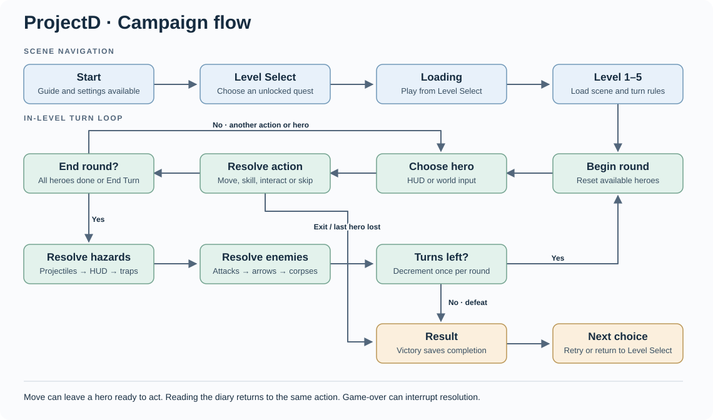
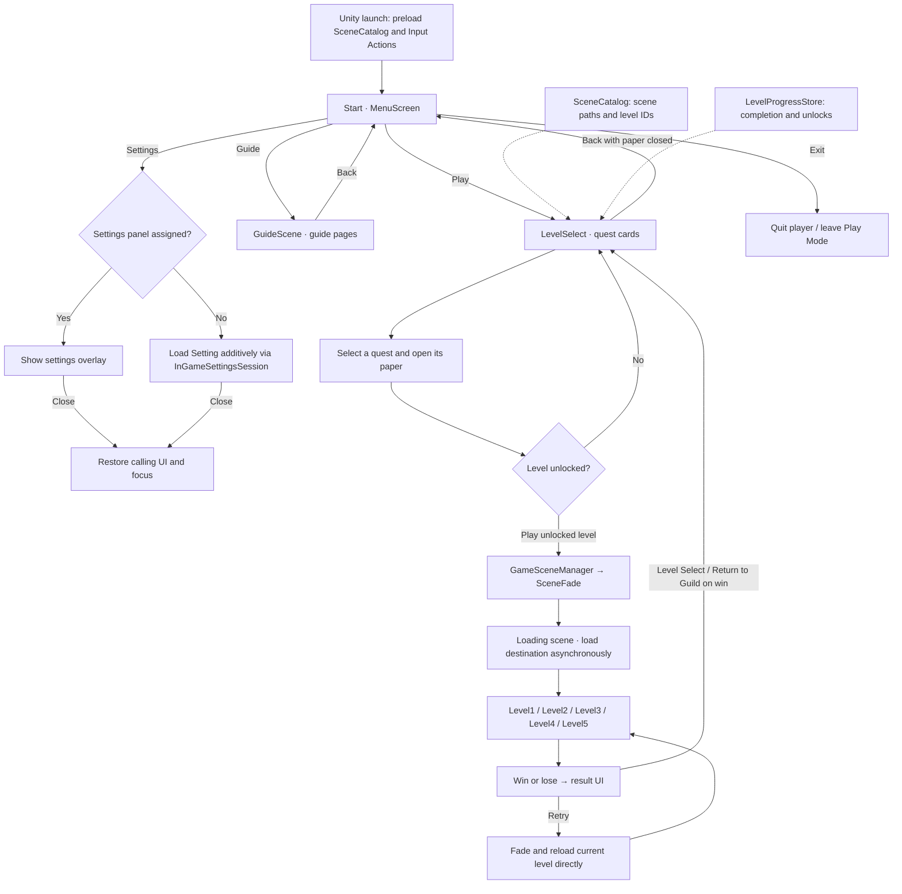
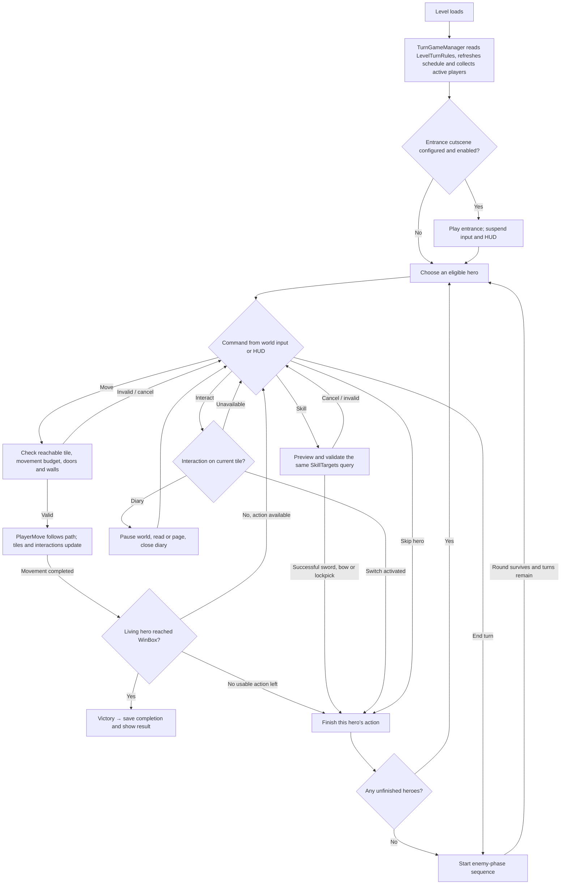
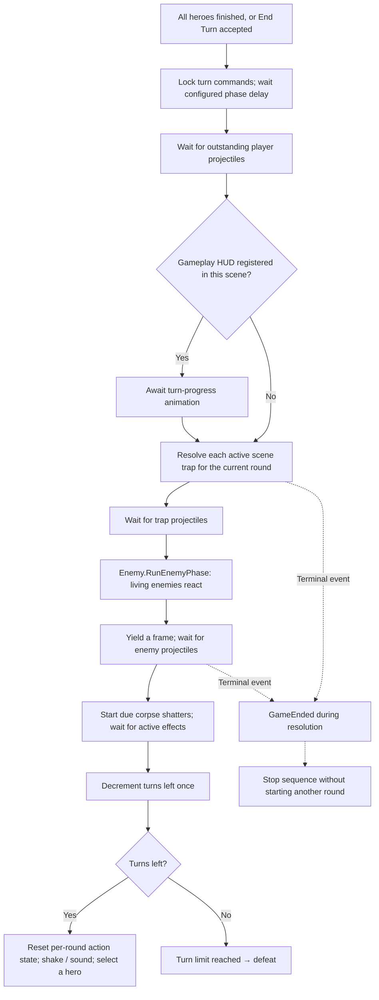
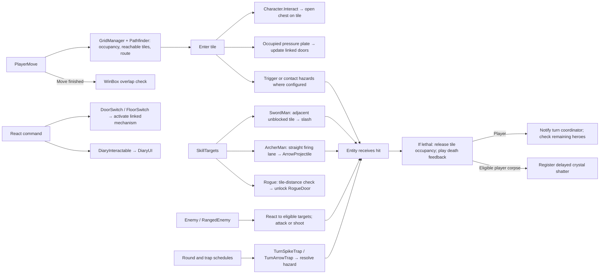
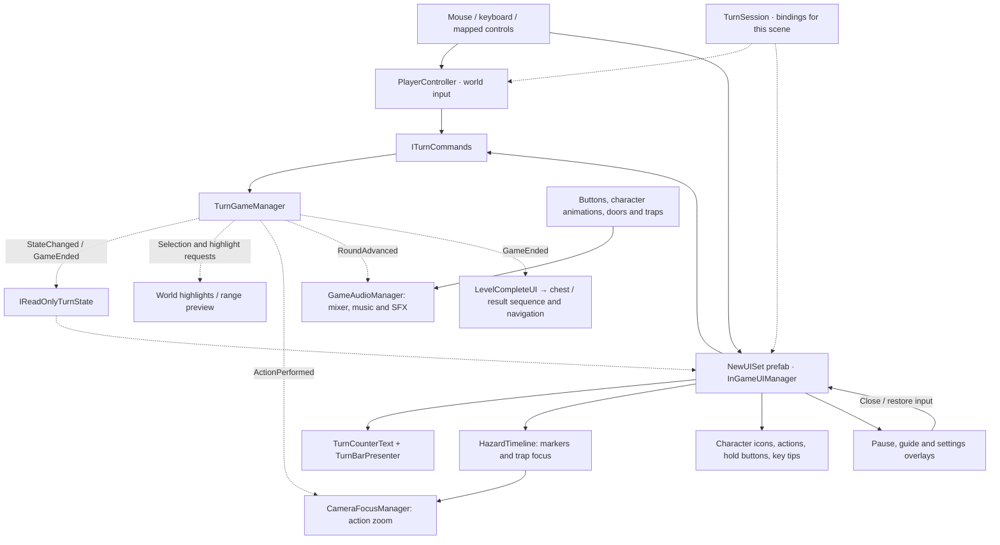
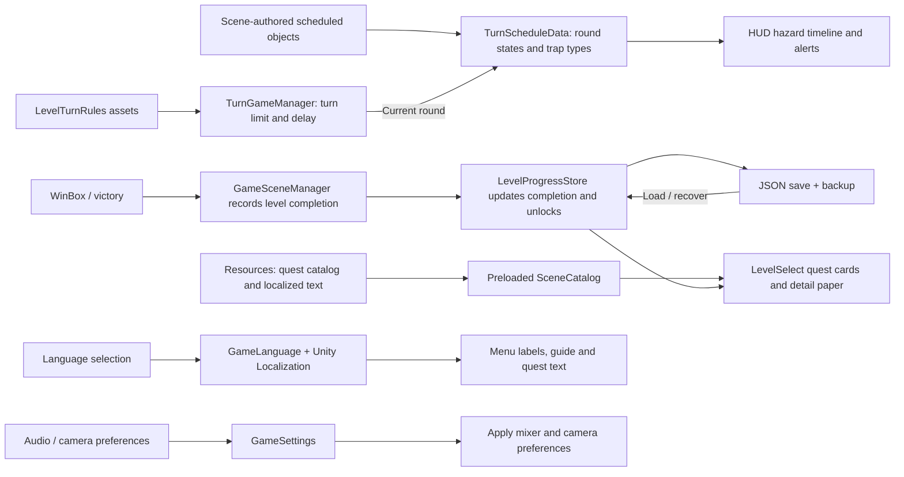
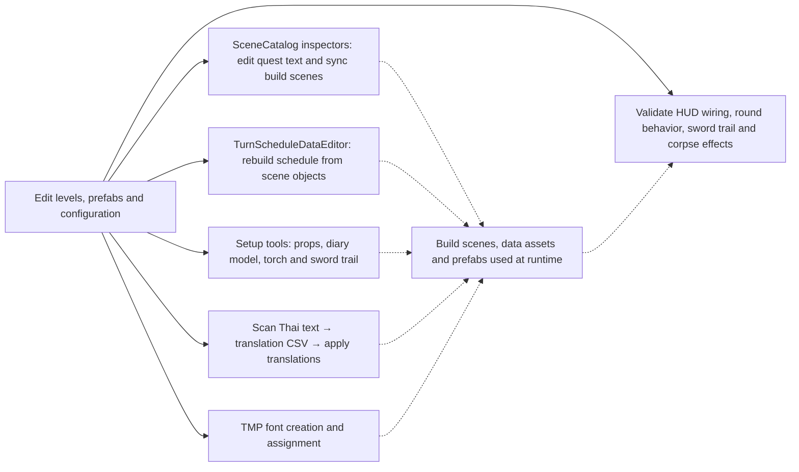

# ProjectD flow chart

[Explore script-to-script dependencies](SCRIPT_DIAGRAM.html)

Read the overview from Start to a campaign level. The diagrams below expand [navigation](#navigation), [player actions](#player-actions), [round resolution](#round-resolution), [world interactions](#world-interactions), [HUD and feedback](#hud-and-feedback), [data and progression](#data-and-progression), and [editor tooling](#editor-tooling). Solid arrows show an action, decision or transfer of control. Dotted arrows show a data dependency or notification. The scope is the current five-level campaign and its supporting systems.

## Navigation

The build has ten enabled scenes. The standalone Setting scene can be loaded additively to preserve its caller. Ordinary scene changes and retries bypass Loading. The result HUD’s `OpenNextLevel` callback returns to the guild in the current implementation. There are no configured secret levels. [Scene list](../ProjectSettings/EditorBuildSettings.asset) · [Navigation](../Assets/_Project/Core/SceneFlow/GameSceneManager.cs) · [Settings session](../Assets/_Project/Core/SceneFlow/InGameSettingsSession.cs) · [Result callbacks](../Assets/_Project/UI/HUD/LevelCompleteUI.cs)

## Player actions

Movement can precede a skill or interaction. A successful skill or switch interaction finishes the hero’s action. Losing the last living player can end the game before the normal round boundary. [Turn coordinator](../Assets/_Project/Gameplay/Turns/TurnGameManager.cs) · [World input](../Assets/_Project/Input/PlayerController.cs) · [Movement](../Assets/_Project/Gameplay/PlayerMove.cs) · [Skill targeting](../Assets/_Project/Gameplay/Grid/SkillTargets.cs)

## Round resolution

The phase uses the elapsed round number for traps and a separate countdown for defeat. Levels 1–4 start with **7 turns**, Level 5 with **13**. Both rules assets specify a **0.35 s** phase delay. Corpse cleanup becomes due at least one round after death. [Phase coroutine](../Assets/_Project/Gameplay/Turns/EnemyPhaseSequence.cs) · [Standard rules](../Assets/_Project/Data/StandardTurnRules.asset) · [Final level rules](../Assets/_Project/Data/FinalLevelTurnRules.asset) · [Corpse cleanup](../Assets/_Project/Gameplay/Characters/PlayerCorpseShatter.cs)

## World interactions

Switch targets are wired per scene or prefab. Doors and walls affect graph traversal and firing lanes; the rogue’s lockpick range uses Manhattan distance. [Character interactions](../Assets/_Project/Gameplay/Characters/Character.cs) · [Pressure plates](../Assets/_Project/Gameplay/Interactables/PressurePlate.cs) · [Grid](../Assets/_Project/Gameplay/Grid/GridManager.cs) · [WinBox](../Assets/_Project/Gameplay/Interactables/WinBox.cs)

## HUD and feedback

The HUD supplies `IGameplayOverlay` for input gating and the awaitable turn bar. `IWorldHighlights` exposes previews to the HUD. Camera, particles, materials, sprites, animations and audio present outcomes; board and turn code determines whether commands succeed. [Scene contracts](../Assets/_Project/Gameplay/Turns/TurnSession.cs) · [Active HUD](../Assets/_Project/UI/HUD/InGameUIManager.cs) · [Audio](../Assets/_Project/Audio/Runtime/GameAudioManager.cs)

## Data and progression

The Editor save lives under `Assets/_Project/Data/Progress/`. The player build writes to `Application.persistentDataPath`. Build settings register Input Actions, Localization and Addressables settings; Resources keys supply runtime-loaded text, shaders and the audio-manager prefab. [Catalog](../Assets/Resources/SceneCatalog.asset) · [Progress store](../Assets/_Project/Core/SceneFlow/LevelProgressStore.cs) · [Language](../Assets/_Project/Data/Localization/GameLanguage.cs)

## Editor tooling

The diagrams follow the current build list, serialized configuration and C# paths. Quarantined assets do not form a campaign step. The retired HUD is in the Unity-ignored `LegacyHUD~/` archive. [Editor tools](../Assets/_Project/Core/Editor) · [Catalog editor](../Assets/Resources/SceneCatalogEditor.cs)

## Script index

These groups cover all C# source files in the project-owned domains and the Resources catalog. The links open the implementation behind each diagram.

**Menus, scene transitions and settings** · [GameSceneManager](../Assets/_Project/Core/SceneFlow/GameSceneManager.cs), [InGameSettingsSession](../Assets/_Project/Core/SceneFlow/InGameSettingsSession.cs), [LevelProgressStore](../Assets/_Project/Core/SceneFlow/LevelProgressStore.cs), [SceneFade](../Assets/_Project/Core/SceneFlow/SceneFade.cs), [GameSettings](../Assets/_Project/Core/Settings/GameSettings.cs), [LoadingScreen](../Assets/_Project/UI/Menus/LoadingScreen.cs), [MenuScreen](../Assets/_Project/UI/Menus/MenuScreen.cs), [MenuScreen.LevelSelect](../Assets/_Project/UI/Menus/MenuScreen.LevelSelect.cs), [MenuScreen.QuestPaper](../Assets/_Project/UI/Menus/MenuScreen.QuestPaper.cs), [MenuScreen.Settings](../Assets/_Project/UI/Menus/MenuScreen.Settings.cs), [QuestPaperLevelCard](../Assets/_Project/UI/Menus/QuestPaperLevelCard.cs), [QuestPaperPool](../Assets/_Project/UI/Menus/QuestPaperPool.cs), [AudioSettingsUI](../Assets/_Project/UI/Settings/AudioSettingsUI.cs), [CameraSettingsUI](../Assets/_Project/UI/Settings/CameraSettingsUI.cs).

**Input and turn orchestration** · [MenuInput](../Assets/_Project/Input/MenuInput.cs), [PlayerController](../Assets/_Project/Input/PlayerController.cs), [ProjectDInputAction](../Assets/_Project/Input/ProjectDInputAction.cs), [EnemyPhaseSequence](../Assets/_Project/Gameplay/Turns/EnemyPhaseSequence.cs), [GameResultController](../Assets/_Project/Gameplay/Turns/GameResultController.cs), [TrapCountdownAlert](../Assets/_Project/Gameplay/Turns/TrapCountdownAlert.cs), [TrapCountdownSchedule](../Assets/_Project/Gameplay/Turns/TrapCountdownSchedule.cs), [TurnDebugPanel](../Assets/_Project/Gameplay/Turns/TurnDebugPanel.cs), [TurnGameManager](../Assets/_Project/Gameplay/Turns/TurnGameManager.cs), [TurnScheduleData](../Assets/_Project/Gameplay/Turns/TurnScheduleData.cs), [TurnSession](../Assets/_Project/Gameplay/Turns/TurnSession.cs).

**Board, units and world objects** · [AllOutlineColor](../Assets/_Project/Gameplay/AllOutlineColor.cs), [CharacterFacing](../Assets/_Project/Gameplay/CharacterFacing.cs), [ArcherMan](../Assets/_Project/Gameplay/Characters/ArcherMan.cs), [ArrowProjectile](../Assets/_Project/Gameplay/Characters/ArrowProjectile.cs), [Character](../Assets/_Project/Gameplay/Characters/Character.cs), [CharacterAnimationController](../Assets/_Project/Gameplay/Characters/CharacterAnimationController.cs), [CrystalShatterVisual](../Assets/_Project/Gameplay/Characters/CrystalShatterVisual.cs), [Enemy](../Assets/_Project/Gameplay/Characters/Enemy.cs), [EnemyAnimationController](../Assets/_Project/Gameplay/Characters/EnemyAnimationController.cs), [EnemyDustVisual](../Assets/_Project/Gameplay/Characters/EnemyDustVisual.cs), [PlayerCorpseShatter](../Assets/_Project/Gameplay/Characters/PlayerCorpseShatter.cs), [RangedEnemy](../Assets/_Project/Gameplay/Characters/RangedEnemy.cs), [Rogue](../Assets/_Project/Gameplay/Characters/Rogue.cs), [SwordMan](../Assets/_Project/Gameplay/Characters/SwordMan.cs), [SwordSlashTrail](../Assets/_Project/Gameplay/Characters/SwordSlashTrail.cs), [DiaryInteractable](../Assets/_Project/Gameplay/DiaryInteractable.cs), [Entity](../Assets/_Project/Gameplay/Entity.cs), [GridManager](../Assets/_Project/Gameplay/Grid/GridManager.cs), [Pathfinder](../Assets/_Project/Gameplay/Grid/Pathfinder.cs), [SkillTargets](../Assets/_Project/Gameplay/Grid/SkillTargets.cs), [Tile](../Assets/_Project/Gameplay/Grid/Tile.cs), [TurnTile](../Assets/_Project/Gameplay/Grid/TurnTile.cs), [Arrow](../Assets/_Project/Gameplay/Interactables/Arrow.cs), [ArrowTutorial](../Assets/_Project/Gameplay/Interactables/ArrowTutorial.cs), [Chest](../Assets/_Project/Gameplay/Interactables/Chest.cs), [DoorController](../Assets/_Project/Gameplay/Interactables/DoorController.cs), [DoorSwitch](../Assets/_Project/Gameplay/Interactables/DoorSwitch.cs), [DoorSwitchHoverBlink](../Assets/_Project/Gameplay/Interactables/DoorSwitchHoverBlink.cs), [FloorSwitch](../Assets/_Project/Gameplay/Interactables/FloorSwitch.cs), [PressurePlate](../Assets/_Project/Gameplay/Interactables/PressurePlate.cs), [PropInteractAnimation](../Assets/_Project/Gameplay/Interactables/PropInteractAnimation.cs), [RogueDoor](../Assets/_Project/Gameplay/Interactables/RogueDoor.cs), [SpikeTrap](../Assets/_Project/Gameplay/Interactables/SpikeTrap.cs), [SpikeTrapEvents](../Assets/_Project/Gameplay/Interactables/SpikeTrapEvents.cs), [SwitchSpikeTrap](../Assets/_Project/Gameplay/Interactables/SwitchSpikeTrap.cs), [TorchFire](../Assets/_Project/Gameplay/Interactables/TorchFire.cs), [Trap](../Assets/_Project/Gameplay/Interactables/Trap.cs), [TreasureChestAnimation](../Assets/_Project/Gameplay/Interactables/TreasureChestAnimation.cs), [TurnArrowTrap](../Assets/_Project/Gameplay/Interactables/TurnArrowTrap.cs), [TurnSpikeTrap](../Assets/_Project/Gameplay/Interactables/TurnSpikeTrap.cs), [TurnTrap](../Assets/_Project/Gameplay/Interactables/TurnTrap.cs), [TurnTrapVisuals](../Assets/_Project/Gameplay/Interactables/TurnTrapVisuals.cs), [WinBox](../Assets/_Project/Gameplay/Interactables/WinBox.cs), [PlayerMove](../Assets/_Project/Gameplay/PlayerMove.cs), [TEMPORARYMENUFIXER](../Assets/_Project/Gameplay/TEMPORARYMENUFIXER.cs).

**HUD, guide, results and diary** · [BackdropBlurCapture](../Assets/_Project/UI/HUD/BackdropBlurCapture.cs), [CharacterIconBurst](../Assets/_Project/UI/HUD/CharacterIconBurst.cs), [GuideTextDatabase](../Assets/_Project/UI/HUD/GuideTextDatabase.cs), [GuideUIManager](../Assets/_Project/UI/HUD/GuideUIManager.cs), [HazardTimeline](../Assets/_Project/UI/HUD/HazardTimeline.cs), [HoldButton](../Assets/_Project/UI/HUD/HoldButton.cs), [InGameUIManager](../Assets/_Project/UI/HUD/InGameUIManager.cs), [KeysTip](../Assets/_Project/UI/HUD/KeysTip.cs), [LevelCompleteCharacterIcons](../Assets/_Project/UI/HUD/LevelCompleteCharacterIcons.cs), [LevelCompleteSequence](../Assets/_Project/UI/HUD/LevelCompleteSequence.cs), [LevelCompleteUI](../Assets/_Project/UI/HUD/LevelCompleteUI.cs), [NewCharacterIcon](../Assets/_Project/UI/HUD/NewCharacterIcon.cs), [OverlayUI](../Assets/_Project/UI/HUD/OverlayUI.cs), [ParallaxMenuBackground](../Assets/_Project/UI/HUD/ParallaxMenuBackground.cs), [PauseUI](../Assets/_Project/UI/HUD/PauseUI.cs), [QuestPaperDecoration](../Assets/_Project/UI/HUD/QuestPaperDecoration.cs), [SelectedButtonBold](../Assets/_Project/UI/HUD/SelectedButtonBold.cs), [SpriteOutlinePadding](../Assets/_Project/UI/HUD/SpriteOutlinePadding.cs), [TurnBarPresenter](../Assets/_Project/UI/HUD/TurnBarPresenter.cs), [TurnCounterText](../Assets/_Project/UI/HUD/TurnCounterText.cs), [DiaryUI](../Assets/_Project/UI/Diary/DiaryUI.cs).

**Camera and audio** · [CameraFocusManager](../Assets/_Project/Art/Camera/CameraFocusManager.cs), [CutSceneCharacter](../Assets/_Project/Art/Camera/CutSceneCharacter.cs), [DoorCutScene](../Assets/_Project/Art/Camera/DoorCutScene.cs), [TurnScreenShake](../Assets/_Project/Art/Camera/TurnScreenShake.cs), [AudioCue](../Assets/_Project/Audio/Runtime/AudioCue.cs), [ButtonAudioFeedback](../Assets/_Project/Audio/Runtime/ButtonAudioFeedback.cs), [CharacterAudioEvents](../Assets/_Project/Audio/Runtime/CharacterAudioEvents.cs), [GameAudioManager](../Assets/_Project/Audio/Runtime/GameAudioManager.cs).

**Rules, localization and scene catalog** · [LevelTurnRules](../Assets/_Project/Data/LevelTurnRules.cs), [GameLanguage](../Assets/_Project/Data/Localization/GameLanguage.cs), [LanguageToggleButton](../Assets/_Project/Data/Localization/LanguageToggleButton.cs), [SceneCatalog](../Assets/Resources/SceneCatalog.cs), [SceneCatalogEditor](../Assets/Resources/SceneCatalogEditor.cs), [SceneCatalogQuestData](../Assets/Resources/SceneCatalogQuestData.cs), [SceneCatalogQuestTextEditor](../Assets/Resources/SceneCatalogQuestTextEditor.cs).

**Editor authoring and validation** · [CorpseShatterValidation](../Assets/_Project/Core/Editor/CorpseShatterValidation.cs), [CreateThaiEnglishTMPFonts](../Assets/_Project/Core/Editor/CreateThaiEnglishTMPFonts.cs), [DialPrefabValidation](../Assets/_Project/Core/Editor/DialPrefabValidation.cs), [DiaryModelSetup](../Assets/_Project/Core/Editor/DiaryModelSetup.cs), [ApplyTranslations](../Assets/_Project/Core/Editor/Localization/ApplyTranslations.cs), [LanguageTestMenu](../Assets/_Project/Core/Editor/Localization/LanguageTestMenu.cs), [ThaiTextScanner](../Assets/_Project/Core/Editor/Localization/ThaiTextScanner.cs), [PropInteractSetup](../Assets/_Project/Core/Editor/PropInteractSetup.cs), [SetTMPFontToNotoThai](../Assets/_Project/Core/Editor/SetTMPFontToNotoThai.cs), [SwordTrailProjectSetup](../Assets/_Project/Core/Editor/SwordTrailProjectSetup.cs), [TorchFireSetup](../Assets/_Project/Core/Editor/TorchFireSetup.cs), [TurnAndSlashVerification](../Assets/_Project/Core/Editor/TurnAndSlashVerification.cs), [TurnScheduleDataEditor](../Assets/_Project/Core/Editor/TurnScheduleDataEditor.cs).
