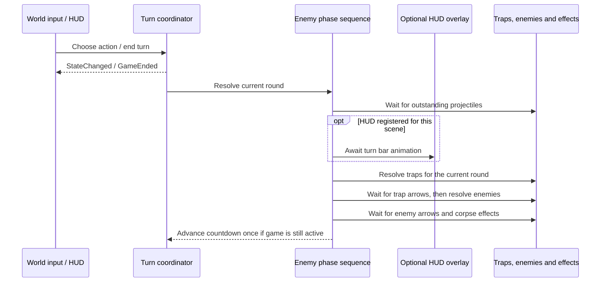

# ProjectD · Phase 3 refactor changelog

The five campaign levels keep their existing scene components, HUD prefab, and Inspector wiring. Turn commands now go through a gameplay contract. Selection, movement, death, camera feedback and round audio use scene-scoped notifications. The gameplay manager, player controller and camera no longer reach into the concrete HUD. A skill click and its preview now use the same board query.

## Permanent HUD name

[InGameUIManager.cs](Assets/_Project/UI/HUD/InGameUIManager.cs) is the component on NewUISet. Its script GUID remains `abe395a91f8128f4091480a704fb266d`. The prefab’s component identifier, persistent pause callback and nested override now use the permanent class name. The retired HUD scripts, prefabs and exclusive art remain together under `Assets/_Unused/LegacyHUD~/`, outside Unity import and compilation. Their original sidecars are preserved for archival use.

## Turn flow

## Class changes

| Class | Responsibility after the refactor |
|---|---|
| TurnGameManager | Owns turn state, commands and outcomes. Publishes selection and action feedback, delegates phase execution and debug rendering, and initializes the authored level rules. |
| InGameUIManager | Binds Inspector references and routes HUD actions. Observes turn state, issues gameplay commands and delegates bar, counter and hazard rendering. |
| PlayerController | Converts world input to turn commands, handles the world highlight contract and renders skill tiles returned by gameplay. Registers and releases its scene subscriptions with its enabled lifetime. |
| Character | Publishes skill-preview requests and supplies the scene’s turn state when registering a corpse. |
| SwordMan, ArcherMan, Rogue | Retain their distinct attacks and skill-use limits. Inherit the common preview request without calling the player controller. |
| Entity | Publishes player defeat after releasing the occupied tile. |
| PlayerMove | Publishes move completion to its scene’s turn coordinator. |
| PlayerCorpseShatter | Records the owning turn state and death round. Cleanup uses that same owner and the existing one-round delay. |
| CharacterAnimationController | Reads the active actor and skill-targeting state through the scene contract. |
| CameraFocusManager | Reads input and turn state through contracts and listens for action zoom requests. |
| CutSceneCharacter | Suspends the registered gameplay overlay for its own scene and restores it after the entrance. |
| GameAudioManager | Subscribes to round advancement for loaded gameplay scenes. Releases subscriptions on unload and destruction. |
| DiaryUI | Sets and clears the scene’s modal input flag while the diary is open. |
| TurnTile | Reads the round through its scene’s turn state. |
| SpikeTrap, TurnArrowTrap | Consult scene turn state for game-over cancellation. |
| TreasureChestAnimation | Observes the game-ended event and releases the subscription on disable. Its serialized turnManager override still takes precedence. |
| TrapCountdownAlert | Reads turns left and round number from the assigned manager or its scene’s current state. |

## New classes and assets

| Class | Purpose |
|---|---|
| LevelTurnRules | ScriptableObject definition for the turn limit and enemy-phase delay. |
| TurnSession | Keeps one set of turn bindings and notifications per Unity scene and releases its registry entry on unload. |
| SkillTargets | Computes sword adjacency, archer firing lanes and rogue Manhattan range. Gameplay validation uses board state, so a legal target no longer depends on whether a tile graphic is visible. |
| EnemyPhaseSequence | Runs the ordered coroutine shown above. An absent HUD skips the presentation wait. Disabling the HUD during its animation allows the wait to finish. |
| TurnDebugPanel | Draws the existing optional debug interface and hit-tests its actionable buttons using turn state and commands. |
| TurnBarPresenter | Owns turn-bar slots, fills, animation and cleanup. |
| TurnCounterText | Owns countdown text, color, size and slide-animation state. |
| HazardTimeline | Observes schedule changes, lays out round markers and cycles camera focus among the relevant traps. |

Levels 1–4 share [StandardTurnRules.asset](Assets/_Project/Data/StandardTurnRules.asset) with 7 turns. Level 5 uses [FinalLevelTurnRules.asset](Assets/_Project/Data/FinalLevelTurnRules.asset) with 13 turns. Both retain the 0.35-second enemy-phase delay. The manager copies these values at level startup. Scenes without a rules asset use their original serialized fields. The existing TurnScheduleData component retains scene-specific trap bindings and mutable round state.

## Contracts and events

The definitions live in [TurnSession.cs](Assets/_Project/Gameplay/Turns/TurnSession.cs). New gameplay types use the ProjectD.Gameplay.Turns namespace, HUD presenters use ProjectD.UI, and configuration uses ProjectD.Data. Existing serialized component names and assemblies retain their identities.

| Contract or signal | Producer → consumer |
|---|---|
| IReadOnlyTurnState | The coordinator exposes actor, round, action availability, outcome, and the existing StateChanged and GameEnded events. |
| ITurnCommands / ITurnController | Input and HUD send selection, movement, skill, cancel and end-turn commands. ITurnController combines command and state access for interactive callers. |
| IGameplayOverlay | The active HUD supplies input gating, world input actions, action selection and the awaitable turn-progress animation. |
| IWorldHighlights | The world controller provides selection, movement and interaction preview operations to the HUD. |
| PlayerSelected / MoveRangeRequested / HighlightsCleared | Coordinator → world selection and highlight renderer. |
| SkillPreviewRequested | Character → world highlight renderer, using SkillTargets. |
| MoveFinished / PlayerDefeated | Player movement and entity death → turn coordinator. |
| ActionPerformed / RoundAdvanced | Turn coordinator → camera zoom and audio feedback respectively. |

## Verification

- The pinned Unity 6000.5.9f1 compiler compiled runtime and Editor scripts for the Editor configuration and runtime scripts for the player configuration with zero errors. All three also passed with quarantined scripts excluded. These checks used the project’s cached compiler settings.
- Compared compiled fields against the Phase 2 assembly. All 625 inspected pre-existing public or explicitly serialized field names and types matched.
- All 1,040 pre-existing file/folder sidecars remained byte-identical. Eight new scripts and two rule assets have distinct new GUIDs. All ten build scenes resolve. Each gameplay scene’s new rules reference matches its previous turn count and delay.
- Static scans found zero unresolved external asset GUIDs and zero active serialized references into quarantine across the checked scenes, prefabs, controllers, configuration assets, materials and animations.
- A managed simulation exercised the production phase iterator and targeting code with test doubles for Unity scene objects. It passed projectile gating, HUD-before-traps ordering, round and scene selection for traps, enemy-arrow and corpse waits, single completion, no-HUD operation, game-over cancellation, blocked/open archer lanes, sword adjacency, rogue range and exhausted skills.

## Unity Editor acceptance checks

1. Open the project in 6000.5.9f1, allow import to finish, and run **Tools → UI → Validate In-Game HUD**. Inspect the turn manager’s Rules field on Level 1 and Level 5. Confirm 7 and 13 turns in the HUD.
2. Select each character and compare its preview with a click on the board. Try a sword diagonal, an archer shot through a wall, a rogue door just outside range and a hero with no remaining skill uses. Check that previewing another action does not spend a turn.
3. End a round with a projectile in flight. Check the bar, trap resolution, enemy phase, corpse cleanup, next-round audio and countdown in that order. Confirm a win or loss during resolution prevents the next player phase.
4. Check the entrance cutscene, hazard-marker camera focus, diary and pause/resume. Close the level, open it again, and verify that one click, one camera movement and one round sound occur per action.
5. Complete a level and reload progress. Check the results panel and unlocked level card. Where the optional debug panel is enabled, verify that its buttons capture clicks and its background remains click-through.

Editor import, Play Mode interaction and visual fidelity are manual checks. Existing Unity-facing components and compatibility singleton APIs remain in the default project assembly. The scene contracts remove direct dependencies from the refactored turn/input/HUD paths without imposing an assembly-definition migration.
