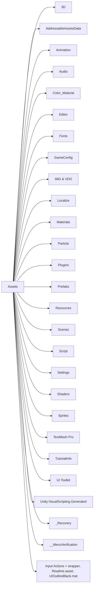
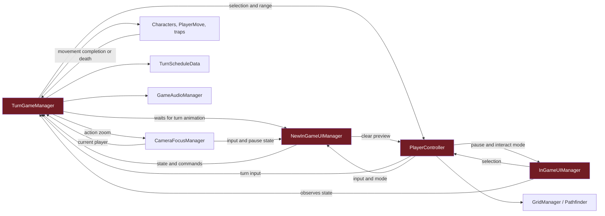
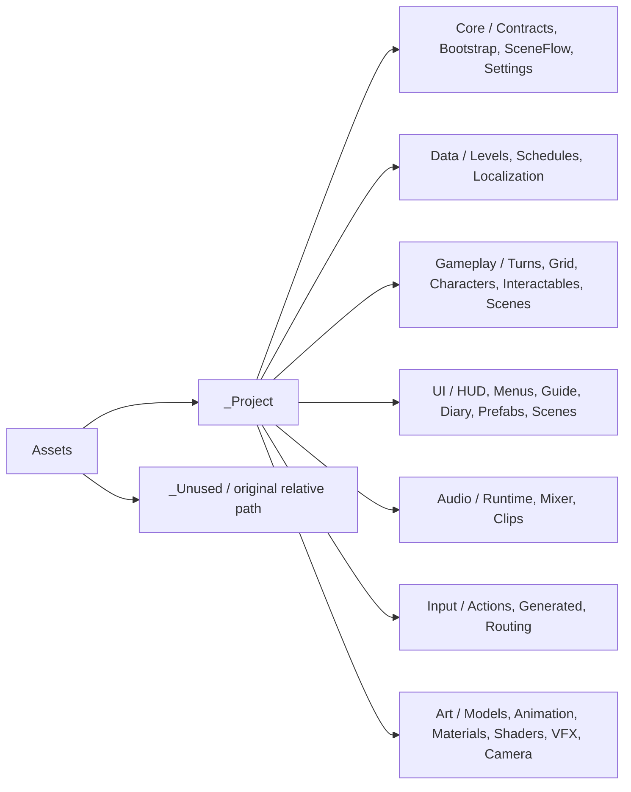
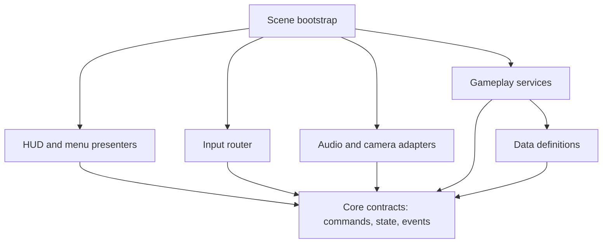

# ProjectD refactor · Phase 2 handoff

**713 USED · 168 UNUSED · 881 assets and scripts.** The ten enabled scenes now resolve in their original relative order. All five gameplay scenes use NewUISet. The subsequent Phase 3 changes and Editor acceptance checks are documented in [REFACTOR_CHANGELOG.md](REFACTOR_CHANGELOG.md). The counts and path mapping below record the Phase 2 handoff.

| Domain or disposition | Files |
|---|---:|
| Art | 138 |
| Audio | 28 |
| Core | 19 |
| Data | 15 |
| Gameplay | 76 |
| Input | 4 |
| Preserved roots | 149 |
| Quarantine | 168 |
| UI | 284 |

## What changed

- Removed the two cancelled build entries and the secret quest from the catalog, localized quest data and associated win/progress wiring. Build indices 0–9 now correspond to `Start`, `Setting`, `LevelSelect`, `Level1`, `Level2`, `Level3`, `Level4`, `Level5`, `GuideScene`, `Loading`.
- Archived the legacy HUD, its exclusive prefab/animation/sprite dependencies, superseded raw audio, unreferenced art and dead scripts with their original relative paths. Redirected active HUD callers and the validation menu. The pause overlay’s obsolete base callback no longer points to the legacy manager. NewUISet retains its resume override.
- Kept both mist shaders. Level1 reaches Drifting Mist.prefab → LowMistColor.mat → DriftingMist.shader. Level5TextureMist.mat and Level5TextureMist.shader are also active. Only the cancelled scene’s setup tool and material went to quarantine.
- Updated scene paths, editor asset lookups, localized CSV source paths, font tooling and editor save/backup paths. Editor progress can fall back to its previous location. Resources keys, localization addresses, source fonts/licenses and protected system roots remain stable. The two localization table collections are retained for editor authoring.
- The seven domains use existing folder identities. The folder ledger below identifies every retained or renamed folder, including the former Script folder at _Project and _Recovery at _Unused. No new folder GUIDs were needed.

## Verification

| Check | Result |
|---|---|
| File and folder identities | 881 assets + 159 folders. All 1,040 original sidecars matched by GUID and SHA-256. Zero orphan or additional sidecars. |
| Serialized asset references | Checked 159 scene, prefab, controller and .asset files plus 59 clips, override controllers and materials. Zero unresolved external asset GUID references against local assets and available package metadata. Zero active serialized links into quarantine in that scan. |
| Build and navigation | All ten enabled scene paths match their original GUIDs and the preloaded catalog. |
| C# | Unity 6000.5.9f1 Roslyn with the project’s cached Editor/player compilation settings. Runtime and Editor assemblies compile with zero errors, both with all archived scripts present and with them excluded. Obsolete Unity API warnings remain. |
| Asset paths | Checked literal Assets paths in active C# and traced the split model/clip, font and save lookup paths. |

The static GUID check resolves asset identities. Unity import, subasset fileIDs, Inspector binding behavior and rendering still need the Editor pass. The optional missing material on two LevelSelect graphics was cleared so they use the default UI material. TMP’s previously unresolved optional default sprite asset was cleared. Seven URP debug shader references were restored from matching installed settings and four unreferenced Volume subobjects with missing scripts were removed. A legacy template Readme script icon reference in its importer metadata was outside the serialized-asset check. Its .meta was preserved exactly.

**Editor acceptance checks**

1. Open with Unity 6000.5.9f1 and inspect import/Console results. Run Tools → UI → Validate In-Game HUD.
2. From Start, open Settings, LevelSelect and Guide in both languages. Check LevelSelect materials, TMP text/sprites and absence of the cancelled quest.
3. Play Levels 1–5. Check NewUISet selection, pause/resume, turn timing and level completion. Check mist rendering on Level 1 and that progress survives restart.

## Asset mapping

Every non-meta file has one row. The original file and its sidecar moved together. A matching old and new path denotes a file retained in place.

| Status | Original path | Current path |
|---|---|---|
| USED | `Assets/3D/Animation/Archer/ArchDeath.fbx` | `Assets/_Project/Art/Models/Animation/ArchDeath.fbx` |
| USED | `Assets/3D/Animation/Archer/ArchIdle.fbx` | `Assets/_Project/Art/Models/Animation/ArchIdle.fbx` |
| USED | `Assets/3D/Animation/Archer/ArchInteract.fbx` | `Assets/_Project/Art/Models/Animation/ArchInteract.fbx` |
| USED | `Assets/3D/Animation/Archer/ArchSkillAttack.fbx` | `Assets/_Project/Art/Models/Animation/ArchSkillAttack.fbx` |
| USED | `Assets/3D/Animation/Archer/ArchSkillCharge.fbx` | `Assets/_Project/Art/Models/Animation/ArchSkillCharge.fbx` |
| UNUSED | `Assets/3D/Animation/Archer/ArchSkillChargeAndAttack.fbx` | `Assets/_Unused/3D/Animation/Archer/ArchSkillChargeAndAttack.fbx` |
| USED | `Assets/3D/Animation/Archer/ArchWalk.fbx` | `Assets/_Project/Art/Models/Animation/ArchWalk.fbx` |
| USED | `Assets/3D/Animation/Archer/Archer.controller` | `Assets/_Project/Art/Models/Animation/Archer.controller` |
| USED | `Assets/3D/Animation/Enemy/BowSkelly/BowAttack.fbx` | `Assets/_Project/Art/Models/Animation/BowAttack.fbx` |
| USED | `Assets/3D/Animation/Enemy/BowSkelly/BowCharge.fbx` | `Assets/_Project/Art/Models/Animation/BowCharge.fbx` |
| UNUSED | `Assets/3D/Animation/Enemy/BowSkelly/BowChargeAndAttack.fbx` | `Assets/_Unused/3D/Animation/Enemy/BowSkelly/BowChargeAndAttack.fbx` |
| USED | `Assets/3D/Animation/Enemy/BowSkelly/BowIdle.fbx` | `Assets/_Project/Art/Models/Animation/BowIdle.fbx` |
| USED | `Assets/3D/Animation/Enemy/BowSkelly/BowSkelly.controller` | `Assets/_Project/Art/Models/Animation/BowSkelly.controller` |
| USED | `Assets/3D/Animation/Enemy/BowSkelly/bowDeath.fbx` | `Assets/_Project/Art/Models/Animation/bowDeath.fbx` |
| USED | `Assets/3D/Animation/Enemy/SwordSkelly/SwordAttack.fbx` | `Assets/_Project/Art/Models/Animation/SwordAttack.fbx` |
| USED | `Assets/3D/Animation/Enemy/SwordSkelly/SwordCharge.fbx` | `Assets/_Project/Art/Models/Animation/SwordCharge.fbx` |
| UNUSED | `Assets/3D/Animation/Enemy/SwordSkelly/SwordChargeandAttack.fbx` | `Assets/_Unused/3D/Animation/Enemy/SwordSkelly/SwordChargeandAttack.fbx` |
| USED | `Assets/3D/Animation/Enemy/SwordSkelly/SwordDeath.fbx` | `Assets/_Project/Art/Models/Animation/SwordDeath.fbx` |
| USED | `Assets/3D/Animation/Enemy/SwordSkelly/SwordIdle.fbx` | `Assets/_Project/Art/Models/Animation/SwordIdle.fbx` |
| USED | `Assets/3D/Animation/Enemy/SwordSkelly/SwordSkelly.controller` | `Assets/_Project/Art/Models/Animation/SwordSkelly.controller` |
| USED | `Assets/3D/Animation/Rogue/Rogue.controller` | `Assets/_Project/Art/Models/Animation/Rogue.controller` |
| USED | `Assets/3D/Animation/Rogue/RogueDeath.fbx` | `Assets/_Project/Art/Models/Animation/RogueDeath.fbx` |
| USED | `Assets/3D/Animation/Rogue/RogueIdle.fbx` | `Assets/_Project/Art/Models/Animation/RogueIdle.fbx` |
| USED | `Assets/3D/Animation/Rogue/RogueInteract.fbx` | `Assets/_Project/Art/Models/Animation/RogueInteract.fbx` |
| USED | `Assets/3D/Animation/Rogue/RogueSkillCharge.fbx` | `Assets/_Project/Art/Models/Animation/RogueSkillCharge.fbx` |
| UNUSED | `Assets/3D/Animation/Rogue/RogueSkillChargeAndUse.fbx` | `Assets/_Unused/3D/Animation/Rogue/RogueSkillChargeAndUse.fbx` |
| USED | `Assets/3D/Animation/Rogue/RogueSkillUse.fbx` | `Assets/_Project/Art/Models/Animation/RogueSkillUse.fbx` |
| USED | `Assets/3D/Animation/Rogue/RogueWalk.fbx` | `Assets/_Project/Art/Models/Animation/RogueWalk.fbx` |
| USED | `Assets/3D/Animation/Warrior/WarAnim.controller` | `Assets/_Project/Art/Models/Animation/WarAnim.controller` |
| USED | `Assets/3D/Animation/Warrior/WarDeath.fbx` | `Assets/_Project/Art/Models/Animation/WarDeath.fbx` |
| USED | `Assets/3D/Animation/Warrior/WarIdle.fbx` | `Assets/_Project/Art/Models/Animation/WarIdle.fbx` |
| USED | `Assets/3D/Animation/Warrior/WarInteract.fbx` | `Assets/_Project/Art/Models/Animation/WarInteract.fbx` |
| USED | `Assets/3D/Animation/Warrior/WarSkillAttack.fbx` | `Assets/_Project/Art/Models/Animation/WarSkillAttack.fbx` |
| USED | `Assets/3D/Animation/Warrior/WarSkillCharge.fbx` | `Assets/_Project/Art/Models/Animation/WarSkillCharge.fbx` |
| UNUSED | `Assets/3D/Animation/Warrior/WarSkillChargeAndAttack.fbx` | `Assets/_Unused/3D/Animation/Warrior/WarSkillChargeAndAttack.fbx` |
| USED | `Assets/3D/Animation/Warrior/WarWalk.fbx` | `Assets/_Project/Art/Models/Animation/WarWalk.fbx` |
| USED | `Assets/3D/Model/Archer_Model/ArcherModel.fbx` | `Assets/_Project/Art/Models/Characters/ArcherModel.fbx` |
| USED | `Assets/3D/Model/Archer_Model/Texture/Archer_BowArrow_128_BaseColor.png` | `Assets/_Project/Art/Textures/Archer_BowArrow_128_BaseColor.png` |
| USED | `Assets/3D/Model/Archer_Model/Texture/Archer_Main_512_BaseColor.png` | `Assets/_Project/Art/Textures/Archer_Main_512_BaseColor.png` |
| USED | `Assets/3D/Model/Archer_Model/Texture/Archer_mat.mat` | `Assets/_Project/Art/Materials/Archer_mat.mat` |
| USED | `Assets/3D/Model/Archer_Model/Texture/Bow_Archer.mat` | `Assets/_Project/Art/Materials/Bow_Archer.mat` |
| USED | `Assets/3D/Model/Archer_Model/arrow.fbx` | `Assets/_Project/Art/Models/Characters/arrow.fbx` |
| USED | `Assets/3D/Model/Archer_Model/arrow.prefab` | `Assets/_Project/Gameplay/Prefabs/ClassPlayer/arrow.prefab` |
| USED | `Assets/3D/Model/Enemy/BowSkelly/BowSkelly.fbx` | `Assets/_Project/Art/Models/Characters/BowSkelly.fbx` |
| USED | `Assets/3D/Model/Enemy/BowSkelly/Material/Skeleton_BowArrow_128_BaseColor.mat` | `Assets/_Project/Art/Materials/Skeleton_BowArrow_128_BaseColor.mat` |
| USED | `Assets/3D/Model/Enemy/BowSkelly/Material/Skeleton_BowArrow_128_BaseColor.png` | `Assets/_Project/Art/Textures/Skeleton_BowArrow_128_BaseColor.png` |
| UNUSED | `Assets/3D/Model/Enemy/Material/Skel.mat` | `Assets/_Unused/3D/Model/Enemy/Material/Skel.mat` |
| UNUSED | `Assets/3D/Model/Enemy/Material/Skeleton_Main_512_BaseColor.png` | `Assets/_Unused/3D/Model/Enemy/Material/Skeleton_Main_512_BaseColor.png` |
| UNUSED | `Assets/3D/Model/Enemy/SkelBow.fbx` | `Assets/_Unused/3D/Model/Enemy/SkelBow.fbx` |
| UNUSED | `Assets/3D/Model/Enemy/SkelbasSword.fbx` | `Assets/_Unused/3D/Model/Enemy/SkelbasSword.fbx` |
| USED | `Assets/3D/Model/Enemy/SwordSkelly/Material/Skeleton_Main_512_BaseColor.mat` | `Assets/_Project/Art/Materials/Skeleton_Main_512_BaseColor.mat` |
| USED | `Assets/3D/Model/Enemy/SwordSkelly/Material/Skeleton_Main_512_BaseColor.png` | `Assets/_Project/Art/Textures/Skeleton_Main_512_BaseColor.png` |
| USED | `Assets/3D/Model/Enemy/SwordSkelly/Material/Skeleton_Sword_128_BaseColor.mat` | `Assets/_Project/Art/Materials/Skeleton_Sword_128_BaseColor.mat` |
| USED | `Assets/3D/Model/Enemy/SwordSkelly/Material/Skeleton_Sword_128_BaseColor.png` | `Assets/_Project/Art/Textures/Skeleton_Sword_128_BaseColor.png` |
| USED | `Assets/3D/Model/Enemy/SwordSkelly/SwordSkelly.fbx` | `Assets/_Project/Art/Models/Characters/SwordSkelly.fbx` |
| USED | `Assets/3D/Model/Rogue_Model/RogueModelWithKey.fbx` | `Assets/_Project/Art/Models/Characters/RogueModelWithKey.fbx` |
| USED | `Assets/3D/Model/Rogue_Model/Texture/Key.mat` | `Assets/_Project/Art/Materials/Key.mat` |
| USED | `Assets/3D/Model/Rogue_Model/Texture/RogueMain.mat` | `Assets/_Project/Art/Materials/RogueMain.mat` |
| USED | `Assets/3D/Model/Rogue_Model/Texture/Rogue_Key_64_BaseColor.png` | `Assets/_Project/Art/Textures/Rogue_Key_64_BaseColor.png` |
| USED | `Assets/3D/Model/Rogue_Model/Texture/Rogue_Main_512_BaseColor.png` | `Assets/_Project/Art/Textures/Rogue_Main_512_BaseColor.png` |
| USED | `Assets/3D/Model/Warrior_Model/Texture/Scarf.mat` | `Assets/_Project/Art/Materials/Scarf.mat` |
| USED | `Assets/3D/Model/Warrior_Model/Texture/Sword.mat` | `Assets/_Project/Art/Materials/Sword.mat` |
| USED | `Assets/3D/Model/Warrior_Model/Texture/Sword_128.png` | `Assets/_Project/Art/Textures/Sword_128.png` |
| USED | `Assets/3D/Model/Warrior_Model/Texture/Warrior.mat` | `Assets/_Project/Art/Materials/Warrior.mat` |
| USED | `Assets/3D/Model/Warrior_Model/Texture/Warrior_Main.png` | `Assets/_Project/Art/Textures/Warrior_Main.png` |
| USED | `Assets/3D/Model/Warrior_Model/Texture/Warrior_Scarf.png` | `Assets/_Project/Art/Textures/Warrior_Scarf.png` |
| USED | `Assets/3D/Model/Warrior_Model/WarriorModel.fbx` | `Assets/_Project/Art/Models/Characters/WarriorModel.fbx` |
| UNUSED | `Assets/3D/OBJ-Model/Door/Door1_StoneSliding.fbx` | `Assets/_Unused/3D/OBJ-Model/Door/Door1_StoneSliding.fbx` |
| USED | `Assets/3D/OBJ-Model/Door/Door1_toranee.fbx` | `Assets/_Project/Art/Models/Environment/Door1_toranee.fbx` |
| USED | `Assets/3D/OBJ-Model/Door/Material/Door1_Carved_Stone_Texture 1.png` | `Assets/_Project/Art/Textures/Door1_Carved_Stone_Texture 1.png` |
| UNUSED | `Assets/3D/OBJ-Model/Door/Material/Door1_Carved_Stone_Texture.png` | `Assets/_Unused/3D/OBJ-Model/Door/Material/Door1_Carved_Stone_Texture.png` |
| USED | `Assets/3D/OBJ-Model/Door/Material/Door1_Gold_Texture 1.png` | `Assets/_Project/Art/Textures/Door1_Gold_Texture 1.png` |
| UNUSED | `Assets/3D/OBJ-Model/Door/Material/Door1_Gold_Texture.png` | `Assets/_Unused/3D/OBJ-Model/Door/Material/Door1_Gold_Texture.png` |
| UNUSED | `Assets/3D/OBJ-Model/Door/Material/Door_Moss_Texture 1.png` | `Assets/_Unused/3D/OBJ-Model/Door/Material/Door_Moss_Texture 1.png` |
| UNUSED | `Assets/3D/OBJ-Model/Door/Material/Door_Moss_Texture 2.png` | `Assets/_Unused/3D/OBJ-Model/Door/Material/Door_Moss_Texture 2.png` |
| USED | `Assets/3D/OBJ-Model/Door/Material/Door_Moss_Texture 3.png` | `Assets/_Project/Art/Textures/Door_Moss_Texture 3.png` |
| USED | `Assets/3D/OBJ-Model/Door/Material/Door_Moss_Texture.png` | `Assets/_Project/Art/Textures/Door_Moss_Texture.png` |
| UNUSED | `Assets/3D/OBJ-Model/Door/Material/Door_Stone_Cracked_Texture 1.png` | `Assets/_Unused/3D/OBJ-Model/Door/Material/Door_Stone_Cracked_Texture 1.png` |
| USED | `Assets/3D/OBJ-Model/Door/Material/Door_Stone_Cracked_Texture.png` | `Assets/_Project/Art/Textures/Door_Stone_Cracked_Texture.png` |
| UNUSED | `Assets/3D/OBJ-Model/Door/Material/Door_Stone_Texture 1.png` | `Assets/_Unused/3D/OBJ-Model/Door/Material/Door_Stone_Texture 1.png` |
| UNUSED | `Assets/3D/OBJ-Model/Door/Material/Door_Stone_Texture 2.png` | `Assets/_Unused/3D/OBJ-Model/Door/Material/Door_Stone_Texture 2.png` |
| USED | `Assets/3D/OBJ-Model/Door/Material/Door_Stone_Texture 3.png` | `Assets/_Project/Art/Textures/Door_Stone_Texture 3.png` |
| USED | `Assets/3D/OBJ-Model/Door/Material/Door_Stone_Texture.png` | `Assets/_Project/Art/Textures/Door_Stone_Texture.png` |
| UNUSED | `Assets/3D/OBJ-Model/Door/Material/ThiefDoor_Iron_Texture 1.png` | `Assets/_Unused/3D/OBJ-Model/Door/Material/ThiefDoor_Iron_Texture 1.png` |
| USED | `Assets/3D/OBJ-Model/Door/Material/ThiefDoor_Iron_Texture.png` | `Assets/_Project/Art/Textures/ThiefDoor_Iron_Texture.png` |
| USED | `Assets/3D/OBJ-Model/Door/Material/ThiefDoor_Keyhole_Texture.png` | `Assets/_Project/Art/Textures/ThiefDoor_Keyhole_Texture.png` |
| USED | `Assets/3D/OBJ-Model/Door/ThiefDoor_ArchPortcullis.fbx` | `Assets/_Project/Art/Models/Environment/ThiefDoor_ArchPortcullis.fbx` |
| UNUSED | `Assets/3D/OBJ-Model/Door/ThiefDoor_RectSwing.fbx` | `Assets/_Unused/3D/OBJ-Model/Door/ThiefDoor_RectSwing.fbx` |
| USED | `Assets/3D/OBJ-Model/Floor/Floor01.fbx` | `Assets/_Project/Art/Models/Environment/Floor01.fbx` |
| UNUSED | `Assets/3D/OBJ-Model/Floor/Floor01_crack.fbx` | `Assets/_Unused/3D/OBJ-Model/Floor/Floor01_crack.fbx` |
| USED | `Assets/3D/OBJ-Model/Floor/Floor01_แบบหนา.fbx` | `Assets/_Project/Art/Models/Environment/Floor01_แบบหนา.fbx` |
| UNUSED | `Assets/3D/OBJ-Model/Floor/Floor02.fbx` | `Assets/_Unused/3D/OBJ-Model/Floor/Floor02.fbx` |
| USED | `Assets/3D/OBJ-Model/Floor/Material/Floor01_NoCrack_Stone_BaseColor 1.png` | `Assets/_Project/Art/Textures/Floor01_NoCrack_Stone_BaseColor 1.png` |
| USED | `Assets/3D/OBJ-Model/Floor/Material/Floor01_NoCrack_Stone_BaseColor.png` | `Assets/_Project/Art/Textures/Floor01_NoCrack_Stone_BaseColor.png` |
| USED | `Assets/3D/OBJ-Model/Floor/Material/Floor01_NoCrack_Stone_Roughness 1.png` | `Assets/_Project/Art/Textures/Floor01_NoCrack_Stone_Roughness 1.png` |
| USED | `Assets/3D/OBJ-Model/Floor/Material/Floor01_NoCrack_Stone_Roughness.png` | `Assets/_Project/Art/Textures/Floor01_NoCrack_Stone_Roughness.png` |
| UNUSED | `Assets/3D/OBJ-Model/Floor/Material/Floor01_Stone_BaseColor.png` | `Assets/_Unused/3D/OBJ-Model/Floor/Material/Floor01_Stone_BaseColor.png` |
| UNUSED | `Assets/3D/OBJ-Model/Floor/Material/Floor01_Stone_Roughness.png` | `Assets/_Unused/3D/OBJ-Model/Floor/Material/Floor01_Stone_Roughness.png` |
| UNUSED | `Assets/3D/OBJ-Model/Floor/Material/Floor02_Stone_BaseColor.png` | `Assets/_Unused/3D/OBJ-Model/Floor/Material/Floor02_Stone_BaseColor.png` |
| UNUSED | `Assets/3D/OBJ-Model/Floor/Material/Floor02_Stone_Roughness.png` | `Assets/_Unused/3D/OBJ-Model/Floor/Material/Floor02_Stone_Roughness.png` |
| USED | `Assets/3D/OBJ-Model/Prop/Animation/Bow_Target_Anim.fbx` | `Assets/_Project/Art/Models/Environment/Bow_Target_Anim.fbx` |
| USED | `Assets/3D/OBJ-Model/Prop/Animation/Bow_Target_Anim_Interact.anim` | `Assets/_Project/Art/Models/Animation/Bow_Target_Anim_Interact.anim` |
| USED | `Assets/3D/OBJ-Model/Prop/Animation/Lever_floor_Anim.fbx` | `Assets/_Project/Art/Models/Environment/Lever_floor_Anim.fbx` |
| USED | `Assets/3D/OBJ-Model/Prop/Animation/Lever_floor_Anim_Interact.anim` | `Assets/_Project/Art/Models/Animation/Lever_floor_Anim_Interact.anim` |
| USED | `Assets/3D/OBJ-Model/Prop/Animation/TreasureChest.controller` | `Assets/_Project/Art/Models/Animation/TreasureChest.controller` |
| USED | `Assets/3D/OBJ-Model/Prop/Animation/Treasure_chest_Open_Anim.fbx` | `Assets/_Project/Art/Models/Environment/Treasure_chest_Open_Anim.fbx` |
| USED | `Assets/3D/OBJ-Model/Prop/Bow_Target.fbx` | `Assets/_Project/Art/Models/Environment/Bow_Target.fbx` |
| USED | `Assets/3D/OBJ-Model/Prop/DairyOpen.fbx` | `Assets/_Project/Art/Models/Environment/DairyOpen.fbx` |
| USED | `Assets/3D/OBJ-Model/Prop/Lever_Floor.fbx` | `Assets/_Project/Art/Models/Environment/Lever_Floor.fbx` |
| UNUSED | `Assets/3D/OBJ-Model/Prop/Lever_Wall.fbx` | `Assets/_Unused/3D/OBJ-Model/Prop/Lever_Wall.fbx` |
| USED | `Assets/3D/OBJ-Model/Prop/Material/Archery_Target_Atlas_BaseColor.png` | `Assets/_Project/Art/Textures/Archery_Target_Atlas_BaseColor.png` |
| USED | `Assets/3D/OBJ-Model/Prop/Material/Floor01_NoCrack_Stone_BaseColor.png` | `Assets/_Project/Art/Textures/Props/Floor01_NoCrack_Stone_BaseColor.png` |
| UNUSED | `Assets/3D/OBJ-Model/Prop/Material/Floor01_Stone_BaseColor.png` | `Assets/_Unused/3D/OBJ-Model/Prop/Material/Floor01_Stone_BaseColor.png` |
| USED | `Assets/3D/OBJ-Model/Prop/Material/Lever_Wood_Texture.png` | `Assets/_Project/Art/Textures/Lever_Wood_Texture.png` |
| USED | `Assets/3D/OBJ-Model/Prop/Material/Prop_Detail_Atlas 1.png` | `Assets/_Project/Art/Textures/Prop_Detail_Atlas 1.png` |
| USED | `Assets/3D/OBJ-Model/Prop/Material/Prop_Detail_Atlas 2.png` | `Assets/_Project/Art/Textures/Prop_Detail_Atlas 2.png` |
| USED | `Assets/3D/OBJ-Model/Prop/Material/Prop_Detail_Atlas 3.png` | `Assets/_Project/Art/Textures/Prop_Detail_Atlas 3.png` |
| USED | `Assets/3D/OBJ-Model/Prop/Material/Prop_Detail_Atlas 4.png` | `Assets/_Project/Art/Textures/Prop_Detail_Atlas 4.png` |
| UNUSED | `Assets/3D/OBJ-Model/Prop/Material/Prop_Detail_Atlas.png` | `Assets/_Unused/3D/OBJ-Model/Prop/Material/Prop_Detail_Atlas.png` |
| UNUSED | `Assets/3D/OBJ-Model/Prop/Material/Prop_Stone_Texture 1.png` | `Assets/_Unused/3D/OBJ-Model/Prop/Material/Prop_Stone_Texture 1.png` |
| USED | `Assets/3D/OBJ-Model/Prop/Material/Prop_Stone_Texture 2.png` | `Assets/_Project/Art/Textures/Prop_Stone_Texture 2.png` |
| UNUSED | `Assets/3D/OBJ-Model/Prop/Material/Prop_Stone_Texture.png` | `Assets/_Unused/3D/OBJ-Model/Prop/Material/Prop_Stone_Texture.png` |
| USED | `Assets/3D/OBJ-Model/Prop/Pressure_plate01.fbx` | `Assets/_Project/Art/Models/Environment/Pressure_plate01.fbx` |
| UNUSED | `Assets/3D/OBJ-Model/Prop/Pressure_plate02.fbx` | `Assets/_Unused/3D/OBJ-Model/Prop/Pressure_plate02.fbx` |
| USED | `Assets/3D/OBJ-Model/Prop/Torch.fbx` | `Assets/_Project/Art/Models/Environment/Torch.fbx` |
| USED | `Assets/3D/OBJ-Model/Prop/Treasure_chest.fbx` | `Assets/_Project/Art/Models/Environment/Treasure_chest.fbx` |
| USED | `Assets/3D/OBJ-Model/Trap/CrossbowTRap.fbx` | `Assets/_Project/Art/Models/Environment/CrossbowTRap.fbx` |
| USED | `Assets/3D/OBJ-Model/Trap/Material/Crossbow_Wood_Texture.png` | `Assets/_Project/Art/Textures/Crossbow_Wood_Texture.png` |
| USED | `Assets/3D/OBJ-Model/Trap/Material/Spike_Stone_Roughness.png` | `Assets/_Project/Art/Textures/Spike_Stone_Roughness.png` |
| USED | `Assets/3D/OBJ-Model/Trap/Material/Spike_Stone_Texture 1.png` | `Assets/_Project/Art/Textures/Spike_Stone_Texture 1.png` |
| USED | `Assets/3D/OBJ-Model/Trap/Material/Spike_Stone_Texture.png` | `Assets/_Project/Art/Textures/Spike_Stone_Texture.png` |
| USED | `Assets/3D/OBJ-Model/Trap/Material/Trap_Metal_Texture 1.png` | `Assets/_Project/Art/Textures/Trap_Metal_Texture 1.png` |
| USED | `Assets/3D/OBJ-Model/Trap/Material/Trap_Metal_Texture.png` | `Assets/_Project/Art/Textures/Trap_Metal_Texture.png` |
| USED | `Assets/3D/OBJ-Model/Trap/SpikeTrap.fbx` | `Assets/_Project/Art/Models/Environment/SpikeTrap.fbx` |
| USED | `Assets/3D/OBJ-Model/Wall/BrokenWall/Wall001BROKEN_001.fbx` | `Assets/_Project/Art/Models/Environment/Wall001BROKEN_001.fbx` |
| UNUSED | `Assets/3D/OBJ-Model/Wall/BrokenWall/Wall001BROKEN_001_NoPillar.fbx` | `Assets/_Unused/3D/OBJ-Model/Wall/BrokenWall/Wall001BROKEN_001_NoPillar.fbx` |
| UNUSED | `Assets/3D/OBJ-Model/Wall/BrokenWall/Wall001BROKEN_002.fbx` | `Assets/_Unused/3D/OBJ-Model/Wall/BrokenWall/Wall001BROKEN_002.fbx` |
| UNUSED | `Assets/3D/OBJ-Model/Wall/BrokenWall/Wall001BROKEN_002_NoPillar.fbx` | `Assets/_Unused/3D/OBJ-Model/Wall/BrokenWall/Wall001BROKEN_002_NoPillar.fbx` |
| UNUSED | `Assets/3D/OBJ-Model/Wall/Material/Header_Texture 1.png` | `Assets/_Unused/3D/OBJ-Model/Wall/Material/Header_Texture 1.png` |
| UNUSED | `Assets/3D/OBJ-Model/Wall/Material/Header_Texture 2.png` | `Assets/_Unused/3D/OBJ-Model/Wall/Material/Header_Texture 2.png` |
| UNUSED | `Assets/3D/OBJ-Model/Wall/Material/Header_Texture.png` | `Assets/_Unused/3D/OBJ-Model/Wall/Material/Header_Texture.png` |
| USED | `Assets/3D/OBJ-Model/Wall/Material/Pillar_Body_Texture 1.png` | `Assets/_Project/Art/Textures/Pillar_Body_Texture 1.png` |
| UNUSED | `Assets/3D/OBJ-Model/Wall/Material/Pillar_Body_Texture 2.png` | `Assets/_Unused/3D/OBJ-Model/Wall/Material/Pillar_Body_Texture 2.png` |
| UNUSED | `Assets/3D/OBJ-Model/Wall/Material/Pillar_Body_Texture 3.png` | `Assets/_Unused/3D/OBJ-Model/Wall/Material/Pillar_Body_Texture 3.png` |
| UNUSED | `Assets/3D/OBJ-Model/Wall/Material/Pillar_Body_Texture 4.png` | `Assets/_Unused/3D/OBJ-Model/Wall/Material/Pillar_Body_Texture 4.png` |
| UNUSED | `Assets/3D/OBJ-Model/Wall/Material/Pillar_Body_Texture 5.png` | `Assets/_Unused/3D/OBJ-Model/Wall/Material/Pillar_Body_Texture 5.png` |
| USED | `Assets/3D/OBJ-Model/Wall/Material/Pillar_Body_Texture 6.png` | `Assets/_Project/Art/Textures/Pillar_Body_Texture 6.png` |
| UNUSED | `Assets/3D/OBJ-Model/Wall/Material/Pillar_Body_Texture 7.png` | `Assets/_Unused/3D/OBJ-Model/Wall/Material/Pillar_Body_Texture 7.png` |
| USED | `Assets/3D/OBJ-Model/Wall/Material/Pillar_Body_Texture.png` | `Assets/_Project/Art/Textures/Pillar_Body_Texture.png` |
| UNUSED | `Assets/3D/OBJ-Model/Wall/Material/Pillar_Cap_Texture 1.png` | `Assets/_Unused/3D/OBJ-Model/Wall/Material/Pillar_Cap_Texture 1.png` |
| UNUSED | `Assets/3D/OBJ-Model/Wall/Material/Pillar_Cap_Texture 2.png` | `Assets/_Unused/3D/OBJ-Model/Wall/Material/Pillar_Cap_Texture 2.png` |
| UNUSED | `Assets/3D/OBJ-Model/Wall/Material/Pillar_Cap_Texture.png` | `Assets/_Unused/3D/OBJ-Model/Wall/Material/Pillar_Cap_Texture.png` |
| UNUSED | `Assets/3D/OBJ-Model/Wall/Material/Sign_BEAR_Texture 1.png` | `Assets/_Unused/3D/OBJ-Model/Wall/Material/Sign_BEAR_Texture 1.png` |
| UNUSED | `Assets/3D/OBJ-Model/Wall/Material/Sign_BEAR_Texture 2.png` | `Assets/_Unused/3D/OBJ-Model/Wall/Material/Sign_BEAR_Texture 2.png` |
| UNUSED | `Assets/3D/OBJ-Model/Wall/Material/Sign_BEAR_Texture.png` | `Assets/_Unused/3D/OBJ-Model/Wall/Material/Sign_BEAR_Texture.png` |
| UNUSED | `Assets/3D/OBJ-Model/Wall/Material/Sign_MR_Texture 1.png` | `Assets/_Unused/3D/OBJ-Model/Wall/Material/Sign_MR_Texture 1.png` |
| UNUSED | `Assets/3D/OBJ-Model/Wall/Material/Sign_MR_Texture 2.png` | `Assets/_Unused/3D/OBJ-Model/Wall/Material/Sign_MR_Texture 2.png` |
| UNUSED | `Assets/3D/OBJ-Model/Wall/Material/Sign_MR_Texture.png` | `Assets/_Unused/3D/OBJ-Model/Wall/Material/Sign_MR_Texture.png` |
| UNUSED | `Assets/3D/OBJ-Model/Wall/Material/Sign_TIME_Texture 1.png` | `Assets/_Unused/3D/OBJ-Model/Wall/Material/Sign_TIME_Texture 1.png` |
| UNUSED | `Assets/3D/OBJ-Model/Wall/Material/Sign_TIME_Texture 2.png` | `Assets/_Unused/3D/OBJ-Model/Wall/Material/Sign_TIME_Texture 2.png` |
| UNUSED | `Assets/3D/OBJ-Model/Wall/Material/Sign_TIME_Texture.png` | `Assets/_Unused/3D/OBJ-Model/Wall/Material/Sign_TIME_Texture.png` |
| USED | `Assets/3D/OBJ-Model/Wall/Material/Wall_Clean_Texture 1.png` | `Assets/_Project/Art/Textures/Wall_Clean_Texture 1.png` |
| UNUSED | `Assets/3D/OBJ-Model/Wall/Material/Wall_Clean_Texture 2.png` | `Assets/_Unused/3D/OBJ-Model/Wall/Material/Wall_Clean_Texture 2.png` |
| UNUSED | `Assets/3D/OBJ-Model/Wall/Material/Wall_Clean_Texture 3.png` | `Assets/_Unused/3D/OBJ-Model/Wall/Material/Wall_Clean_Texture 3.png` |
| UNUSED | `Assets/3D/OBJ-Model/Wall/Material/Wall_Clean_Texture 4.png` | `Assets/_Unused/3D/OBJ-Model/Wall/Material/Wall_Clean_Texture 4.png` |
| UNUSED | `Assets/3D/OBJ-Model/Wall/Material/Wall_Clean_Texture 5.png` | `Assets/_Unused/3D/OBJ-Model/Wall/Material/Wall_Clean_Texture 5.png` |
| USED | `Assets/3D/OBJ-Model/Wall/Material/Wall_Clean_Texture 6.png` | `Assets/_Project/Art/Textures/Wall_Clean_Texture 6.png` |
| UNUSED | `Assets/3D/OBJ-Model/Wall/Material/Wall_Clean_Texture 7.png` | `Assets/_Unused/3D/OBJ-Model/Wall/Material/Wall_Clean_Texture 7.png` |
| UNUSED | `Assets/3D/OBJ-Model/Wall/Material/Wall_Clean_Texture 8.png` | `Assets/_Unused/3D/OBJ-Model/Wall/Material/Wall_Clean_Texture 8.png` |
| UNUSED | `Assets/3D/OBJ-Model/Wall/Material/Wall_Clean_Texture 9.png` | `Assets/_Unused/3D/OBJ-Model/Wall/Material/Wall_Clean_Texture 9.png` |
| USED | `Assets/3D/OBJ-Model/Wall/Material/Wall_Clean_Texture.png` | `Assets/_Project/Art/Textures/Wall_Clean_Texture.png` |
| UNUSED | `Assets/3D/OBJ-Model/Wall/Material/Wall_Cracked_A_Texture 1.png` | `Assets/_Unused/3D/OBJ-Model/Wall/Material/Wall_Cracked_A_Texture 1.png` |
| UNUSED | `Assets/3D/OBJ-Model/Wall/Material/Wall_Cracked_A_Texture 2.png` | `Assets/_Unused/3D/OBJ-Model/Wall/Material/Wall_Cracked_A_Texture 2.png` |
| UNUSED | `Assets/3D/OBJ-Model/Wall/Material/Wall_Cracked_A_Texture.png` | `Assets/_Unused/3D/OBJ-Model/Wall/Material/Wall_Cracked_A_Texture.png` |
| USED | `Assets/3D/OBJ-Model/Wall/Material/Wall_Cracked_B_Texture 1.png` | `Assets/_Project/Art/Textures/Wall_Cracked_B_Texture 1.png` |
| UNUSED | `Assets/3D/OBJ-Model/Wall/Material/Wall_Cracked_B_Texture 2.png` | `Assets/_Unused/3D/OBJ-Model/Wall/Material/Wall_Cracked_B_Texture 2.png` |
| UNUSED | `Assets/3D/OBJ-Model/Wall/Material/Wall_Cracked_B_Texture 3.png` | `Assets/_Unused/3D/OBJ-Model/Wall/Material/Wall_Cracked_B_Texture 3.png` |
| UNUSED | `Assets/3D/OBJ-Model/Wall/Material/Wall_Cracked_B_Texture 4.png` | `Assets/_Unused/3D/OBJ-Model/Wall/Material/Wall_Cracked_B_Texture 4.png` |
| UNUSED | `Assets/3D/OBJ-Model/Wall/Material/Wall_Cracked_B_Texture 5.png` | `Assets/_Unused/3D/OBJ-Model/Wall/Material/Wall_Cracked_B_Texture 5.png` |
| USED | `Assets/3D/OBJ-Model/Wall/Material/Wall_Cracked_B_Texture 6.png` | `Assets/_Project/Art/Textures/Wall_Cracked_B_Texture 6.png` |
| UNUSED | `Assets/3D/OBJ-Model/Wall/Material/Wall_Cracked_B_Texture 7.png` | `Assets/_Unused/3D/OBJ-Model/Wall/Material/Wall_Cracked_B_Texture 7.png` |
| UNUSED | `Assets/3D/OBJ-Model/Wall/Material/Wall_Cracked_B_Texture 8.png` | `Assets/_Unused/3D/OBJ-Model/Wall/Material/Wall_Cracked_B_Texture 8.png` |
| UNUSED | `Assets/3D/OBJ-Model/Wall/Material/Wall_Cracked_B_Texture 9.png` | `Assets/_Unused/3D/OBJ-Model/Wall/Material/Wall_Cracked_B_Texture 9.png` |
| USED | `Assets/3D/OBJ-Model/Wall/Material/Wall_Cracked_B_Texture.png` | `Assets/_Project/Art/Textures/Wall_Cracked_B_Texture.png` |
| UNUSED | `Assets/3D/OBJ-Model/Wall/Material/Wall_Moss_Texture 1.png` | `Assets/_Unused/3D/OBJ-Model/Wall/Material/Wall_Moss_Texture 1.png` |
| UNUSED | `Assets/3D/OBJ-Model/Wall/Material/Wall_Moss_Texture 2.png` | `Assets/_Unused/3D/OBJ-Model/Wall/Material/Wall_Moss_Texture 2.png` |
| UNUSED | `Assets/3D/OBJ-Model/Wall/Material/Wall_Moss_Texture.png` | `Assets/_Unused/3D/OBJ-Model/Wall/Material/Wall_Moss_Texture.png` |
| USED | `Assets/3D/OBJ-Model/Wall/Wall-Normal/FIX_Wall001_2Side_Pillar.fbx` | `Assets/_Project/Art/Models/Environment/FIX_Wall001_2Side_Pillar.fbx` |
| USED | `Assets/3D/OBJ-Model/Wall/Wall-Normal/FIX_Wall001_L_Pillar.fbx` | `Assets/_Project/Art/Models/Environment/FIX_Wall001_L_Pillar.fbx` |
| UNUSED | `Assets/3D/OBJ-Model/Wall/Wall-Normal/FIX_Wall001_R_Pillar.fbx` | `Assets/_Unused/3D/OBJ-Model/Wall/Wall-Normal/FIX_Wall001_R_Pillar.fbx` |
| UNUSED | `Assets/3D/OBJ-Model/Wall/Wall-Normal/FIX_Wall002_2Side_Pillar.fbx` | `Assets/_Unused/3D/OBJ-Model/Wall/Wall-Normal/FIX_Wall002_2Side_Pillar.fbx` |
| UNUSED | `Assets/3D/OBJ-Model/Wall/Wall-Normal/FIX_Wall002_L_Pillar.fbx` | `Assets/_Unused/3D/OBJ-Model/Wall/Wall-Normal/FIX_Wall002_L_Pillar.fbx` |
| UNUSED | `Assets/3D/OBJ-Model/Wall/Wall-Normal/FIX_Wall002_R_Pillar.fbx` | `Assets/_Unused/3D/OBJ-Model/Wall/Wall-Normal/FIX_Wall002_R_Pillar.fbx` |
| USED | `Assets/AddressableAssetsData/AddressableAssetSettings.asset` | `Assets/AddressableAssetsData/AddressableAssetSettings.asset` |
| USED | `Assets/AddressableAssetsData/AssetGroupTemplates/Packed Assets.asset` | `Assets/AddressableAssetsData/AssetGroupTemplates/Packed Assets.asset` |
| USED | `Assets/AddressableAssetsData/AssetGroups/Default Local Group.asset` | `Assets/AddressableAssetsData/AssetGroups/Default Local Group.asset` |
| USED | `Assets/AddressableAssetsData/AssetGroups/Localization-Assets-Shared.asset` | `Assets/AddressableAssetsData/AssetGroups/Localization-Assets-Shared.asset` |
| USED | `Assets/AddressableAssetsData/AssetGroups/Localization-Locales.asset` | `Assets/AddressableAssetsData/AssetGroups/Localization-Locales.asset` |
| USED | `Assets/AddressableAssetsData/AssetGroups/Localization-String-Tables-English (en).asset` | `Assets/AddressableAssetsData/AssetGroups/Localization-String-Tables-English (en).asset` |
| USED | `Assets/AddressableAssetsData/AssetGroups/Localization-String-Tables-Thai (Thailand) (th-TH).asset` | `Assets/AddressableAssetsData/AssetGroups/Localization-String-Tables-Thai (Thailand) (th-TH).asset` |
| USED | `Assets/AddressableAssetsData/AssetGroups/Schemas/Default Local Group_BundledAssetGroupSchema.asset` | `Assets/AddressableAssetsData/AssetGroups/Schemas/Default Local Group_BundledAssetGroupSchema.asset` |
| USED | `Assets/AddressableAssetsData/AssetGroups/Schemas/Default Local Group_ContentUpdateGroupSchema.asset` | `Assets/AddressableAssetsData/AssetGroups/Schemas/Default Local Group_ContentUpdateGroupSchema.asset` |
| USED | `Assets/AddressableAssetsData/AssetGroups/Schemas/Localization-Assets-Shared_BundledAssetGroupSchema.asset` | `Assets/AddressableAssetsData/AssetGroups/Schemas/Localization-Assets-Shared_BundledAssetGroupSchema.asset` |
| USED | `Assets/AddressableAssetsData/AssetGroups/Schemas/Localization-Assets-Shared_ContentUpdateGroupSchema.asset` | `Assets/AddressableAssetsData/AssetGroups/Schemas/Localization-Assets-Shared_ContentUpdateGroupSchema.asset` |
| USED | `Assets/AddressableAssetsData/AssetGroups/Schemas/Localization-Assets-Shared_LocalizationGroupSchema.asset` | `Assets/AddressableAssetsData/AssetGroups/Schemas/Localization-Assets-Shared_LocalizationGroupSchema.asset` |
| USED | `Assets/AddressableAssetsData/AssetGroups/Schemas/Localization-Locales_BundledAssetGroupSchema.asset` | `Assets/AddressableAssetsData/AssetGroups/Schemas/Localization-Locales_BundledAssetGroupSchema.asset` |
| USED | `Assets/AddressableAssetsData/AssetGroups/Schemas/Localization-Locales_ContentUpdateGroupSchema.asset` | `Assets/AddressableAssetsData/AssetGroups/Schemas/Localization-Locales_ContentUpdateGroupSchema.asset` |
| USED | `Assets/AddressableAssetsData/AssetGroups/Schemas/Localization-Locales_LocalizationGroupSchema.asset` | `Assets/AddressableAssetsData/AssetGroups/Schemas/Localization-Locales_LocalizationGroupSchema.asset` |
| USED | `Assets/AddressableAssetsData/AssetGroups/Schemas/Localization-String-Tables-English (en)_BundledAssetGroupSchema.asset` | `Assets/AddressableAssetsData/AssetGroups/Schemas/Localization-String-Tables-English (en)_BundledAssetGroupSchema.asset` |
| USED | `Assets/AddressableAssetsData/AssetGroups/Schemas/Localization-String-Tables-English (en)_ContentUpdateGroupSchema.asset` | `Assets/AddressableAssetsData/AssetGroups/Schemas/Localization-String-Tables-English (en)_ContentUpdateGroupSchema.asset` |
| USED | `Assets/AddressableAssetsData/AssetGroups/Schemas/Localization-String-Tables-English (en)_LocalizationGroupSchema.asset` | `Assets/AddressableAssetsData/AssetGroups/Schemas/Localization-String-Tables-English (en)_LocalizationGroupSchema.asset` |
| USED | `Assets/AddressableAssetsData/AssetGroups/Schemas/Localization-String-Tables-Thai (Thailand) (th-TH)_BundledAssetGroupSchema.asset` | `Assets/AddressableAssetsData/AssetGroups/Schemas/Localization-String-Tables-Thai (Thailand) (th-TH)_BundledAssetGroupSchema.asset` |
| USED | `Assets/AddressableAssetsData/AssetGroups/Schemas/Localization-String-Tables-Thai (Thailand) (th-TH)_ContentUpdateGroupSchema.asset` | `Assets/AddressableAssetsData/AssetGroups/Schemas/Localization-String-Tables-Thai (Thailand) (th-TH)_ContentUpdateGroupSchema.asset` |
| USED | `Assets/AddressableAssetsData/AssetGroups/Schemas/Localization-String-Tables-Thai (Thailand) (th-TH)_LocalizationGroupSchema.asset` | `Assets/AddressableAssetsData/AssetGroups/Schemas/Localization-String-Tables-Thai (Thailand) (th-TH)_LocalizationGroupSchema.asset` |
| USED | `Assets/AddressableAssetsData/DataBuilders/BuildScriptFastMode.asset` | `Assets/AddressableAssetsData/DataBuilders/BuildScriptFastMode.asset` |
| USED | `Assets/AddressableAssetsData/DataBuilders/BuildScriptPackedMode.asset` | `Assets/AddressableAssetsData/DataBuilders/BuildScriptPackedMode.asset` |
| USED | `Assets/AddressableAssetsData/DataBuilders/BuildScriptPackedPlayMode.asset` | `Assets/AddressableAssetsData/DataBuilders/BuildScriptPackedPlayMode.asset` |
| USED | `Assets/AddressableAssetsData/DefaultObject.asset` | `Assets/AddressableAssetsData/DefaultObject.asset` |
| USED | `Assets/AddressableAssetsData/Windows/addressables_content_state.bin` | `Assets/AddressableAssetsData/Windows/addressables_content_state.bin` |
| UNUSED | `Assets/Animation/UI/ActionFocus/Interact.controller` | `Assets/_Unused/Animation/UI/ActionFocus/Interact.controller` |
| UNUSED | `Assets/Animation/UI/ActionFocus/InteractFocused.anim` | `Assets/_Unused/Animation/UI/ActionFocus/InteractFocused.anim` |
| UNUSED | `Assets/Animation/UI/ActionFocus/InteractNormal.anim` | `Assets/_Unused/Animation/UI/ActionFocus/InteractNormal.anim` |
| UNUSED | `Assets/Animation/UI/ActionFocus/Move.controller` | `Assets/_Unused/Animation/UI/ActionFocus/Move.controller` |
| UNUSED | `Assets/Animation/UI/ActionFocus/MoveFocused.anim` | `Assets/_Unused/Animation/UI/ActionFocus/MoveFocused.anim` |
| UNUSED | `Assets/Animation/UI/ActionFocus/MoveNormal.anim` | `Assets/_Unused/Animation/UI/ActionFocus/MoveNormal.anim` |
| UNUSED | `Assets/Animation/UI/ActionFocus/Signature.controller` | `Assets/_Unused/Animation/UI/ActionFocus/Signature.controller` |
| UNUSED | `Assets/Animation/UI/ActionFocus/SignatureFocused.anim` | `Assets/_Unused/Animation/UI/ActionFocus/SignatureFocused.anim` |
| UNUSED | `Assets/Animation/UI/ActionFocus/SignatureNormal.anim` | `Assets/_Unused/Animation/UI/ActionFocus/SignatureNormal.anim` |
| UNUSED | `Assets/Animation/UI/ClothDown.anim` | `Assets/_Unused/Animation/UI/ClothDown.anim` |
| USED | `Assets/Animation/UI/ClothInLevelSelector.anim` | `Assets/_Project/UI/Animation/ClothInLevelSelector.anim` |
| USED | `Assets/Animation/UI/GuideBookmark/GuideBookmark.controller` | `Assets/_Project/UI/Animation/GuideBookmark.controller` |
| USED | `Assets/Animation/UI/GuideBookmark/GuideBookmarkNormal.anim` | `Assets/_Project/UI/Animation/GuideBookmarkNormal.anim` |
| USED | `Assets/Animation/UI/GuideBookmark/GuideBookmarkRaised.anim` | `Assets/_Project/UI/Animation/GuideBookmarkRaised.anim` |
| UNUSED | `Assets/Animation/UI/IconArcher.controller` | `Assets/_Unused/Animation/UI/IconArcher.controller` |
| USED | `Assets/Animation/UI/IconSelection/IconSelection.controller` | `Assets/_Project/UI/Animation/IconSelection.controller` |
| USED | `Assets/Animation/UI/IconSelection/Normal.anim` | `Assets/_Project/UI/Animation/Normal.anim` |
| USED | `Assets/Animation/UI/IconSelection/Selected.anim` | `Assets/_Project/UI/Animation/Selected.anim` |
| USED | `Assets/Animation/UI/OpenScroll.anim` | `Assets/_Project/UI/Animation/OpenScroll.anim` |
| USED | `Assets/Animation/UI/Paper.controller` | `Assets/_Project/UI/Animation/Paper.controller` |
| USED | `Assets/Animation/UI/QuestPaper.controller` | `Assets/_Project/UI/Animation/QuestPaper.controller` |
| USED | `Assets/Animation/UI/QuestPaperPopIn.anim` | `Assets/_Project/UI/Animation/QuestPaperPopIn.anim` |
| UNUSED | `Assets/Animation/UI/Selection.anim` | `Assets/_Unused/Animation/UI/Selection.anim` |
| USED | `Assets/Audio/BellSecret.mp3` | `Assets/_Project/Audio/BellSecret.mp3` |
| USED | `Assets/Audio/Buildup.mp3` | `Assets/_Project/Audio/Buildup.mp3` |
| USED | `Assets/Audio/Clock.mp3` | `Assets/_Project/Audio/Clock.mp3` |
| USED | `Assets/Audio/CloseBook.mp3` | `Assets/_Project/Audio/CloseBook.mp3` |
| USED | `Assets/Audio/DoorFix.mp3` | `Assets/_Project/Audio/DoorFix.mp3` |
| USED | `Assets/Audio/DustDead.mp3` | `Assets/_Project/Audio/DustDead.mp3` |
| USED | `Assets/Audio/GameAudio.mixer` | `Assets/_Project/Audio/GameAudio.mixer` |
| UNUSED | `Assets/Audio/Level_BGM2.mp3` | `Assets/_Unused/Audio/Level_BGM2.mp3` |
| USED | `Assets/Audio/Levers.mp3` | `Assets/_Project/Audio/Levers.mp3` |
| USED | `Assets/Audio/Processed/Bowshot_fix.mp3` | `Assets/_Project/Audio/Processed/Bowshot_fix.mp3` |
| USED | `Assets/Audio/Processed/Pause_fix.mp3` | `Assets/_Project/Audio/Processed/Pause_fix.mp3` |
| USED | `Assets/Audio/Processed/Run_trimmed.wav` | `Assets/_Project/Audio/Processed/Run_trimmed.wav` |
| USED | `Assets/Audio/Processed/button_click_trimmed.wav` | `Assets/_Project/Audio/Processed/button_click_trimmed.wav` |
| USED | `Assets/Audio/Processed/death_trimmed.wav` | `Assets/_Project/Audio/Processed/death_trimmed.wav` |
| USED | `Assets/Audio/Processed/hover_trimmed.wav` | `Assets/_Project/Audio/Processed/hover_trimmed.wav` |
| USED | `Assets/Audio/Processed/slash_trimmed.wav` | `Assets/_Project/Audio/Processed/slash_trimmed.wav` |
| USED | `Assets/Audio/RogueDoor.mp3` | `Assets/_Project/Audio/RogueDoor.mp3` |
| UNUSED | `Assets/Audio/Run.mp3` | `Assets/_Unused/Audio/Run.mp3` |
| USED | `Assets/Audio/ShatterEffect 1.mp3` | `Assets/_Project/Audio/ShatterEffect 1.mp3` |
| USED | `Assets/Audio/SpikeTrap.mp3` | `Assets/_Project/Audio/SpikeTrap.mp3` |
| USED | `Assets/Audio/TurnPages.mp3` | `Assets/_Project/Audio/TurnPages.mp3` |
| UNUSED | `Assets/Audio/bowshot.mp3` | `Assets/_Unused/Audio/bowshot.mp3` |
| UNUSED | `Assets/Audio/button_click.mp3` | `Assets/_Unused/Audio/button_click.mp3` |
| USED | `Assets/Audio/character_select.mp3` | `Assets/_Project/Audio/character_select.mp3` |
| USED | `Assets/Audio/chestOpen.mp3` | `Assets/_Project/Audio/chestOpen.mp3` |
| UNUSED | `Assets/Audio/death.mp3` | `Assets/_Unused/Audio/death.mp3` |
| UNUSED | `Assets/Audio/door.mp3` | `Assets/_Unused/Audio/door.mp3` |
| UNUSED | `Assets/Audio/hover.mp3` | `Assets/_Unused/Audio/hover.mp3` |
| UNUSED | `Assets/Audio/level_bgm.mp3` | `Assets/_Unused/Audio/level_bgm.mp3` |
| USED | `Assets/Audio/level_bgm3.mp3` | `Assets/_Project/Audio/level_bgm3.mp3` |
| USED | `Assets/Audio/menu_bgm.mp3` | `Assets/_Project/Audio/menu_bgm.mp3` |
| UNUSED | `Assets/Audio/pause.mp3` | `Assets/_Unused/Audio/pause.mp3` |
| UNUSED | `Assets/Audio/slash.mp3` | `Assets/_Unused/Audio/slash.mp3` |
| USED | `Assets/Audio/turnChange.mp3` | `Assets/_Project/Audio/turnChange.mp3` |
| UNUSED | `Assets/Color_Material/Blue Material 2.mat` | `Assets/_Unused/Color_Material/Blue Material 2.mat` |
| UNUSED | `Assets/Color_Material/Blue Material.mat` | `Assets/_Unused/Color_Material/Blue Material.mat` |
| USED | `Assets/Color_Material/Green Material.mat` | `Assets/_Project/Art/Materials/Green Material.mat` |
| USED | `Assets/Color_Material/Highlight-In-Tile/Highlight Material.mat` | `Assets/_Project/Art/Materials/Highlight Material.mat` |
| UNUSED | `Assets/Color_Material/Pink Material.mat` | `Assets/_Unused/Color_Material/Pink Material.mat` |
| UNUSED | `Assets/Color_Material/Purple Material.mat` | `Assets/_Unused/Color_Material/Purple Material.mat` |
| USED | `Assets/Color_Material/brown.mat` | `Assets/_Project/Art/Materials/brown.mat` |
| UNUSED | `Assets/Color_Material/red Material 1.mat` | `Assets/_Unused/Color_Material/red Material 1.mat` |
| USED | `Assets/Color_Material/red Material 2.mat` | `Assets/_Project/Art/Materials/red Material 2.mat` |
| UNUSED | `Assets/Color_Material/red Material.mat` | `Assets/_Unused/Color_Material/red Material.mat` |
| USED | `Assets/Editor/CorpseShatterValidation.cs` | `Assets/_Project/Core/Editor/CorpseShatterValidation.cs` |
| USED | `Assets/Editor/CreateThaiEnglishTMPFonts.cs` | `Assets/_Project/Core/Editor/CreateThaiEnglishTMPFonts.cs` |
| USED | `Assets/Editor/DialPrefabValidation.cs` | `Assets/_Project/Core/Editor/DialPrefabValidation.cs` |
| USED | `Assets/Editor/DiaryModelSetup.cs` | `Assets/_Project/Core/Editor/DiaryModelSetup.cs` |
| UNUSED | `Assets/Editor/Level5MistSceneSetup.cs` | `Assets/_Unused/Editor/Level5MistSceneSetup.cs` |
| USED | `Assets/Editor/Localization/ApplyTranslations.cs` | `Assets/_Project/Core/Editor/Localization/ApplyTranslations.cs` |
| USED | `Assets/Editor/Localization/LanguageTestMenu.cs` | `Assets/_Project/Core/Editor/Localization/LanguageTestMenu.cs` |
| USED | `Assets/Editor/Localization/ThaiTextScanner.cs` | `Assets/_Project/Core/Editor/Localization/ThaiTextScanner.cs` |
| USED | `Assets/Editor/PropInteractSetup.cs` | `Assets/_Project/Core/Editor/PropInteractSetup.cs` |
| USED | `Assets/Editor/SetTMPFontToNotoThai.cs` | `Assets/_Project/Core/Editor/SetTMPFontToNotoThai.cs` |
| USED | `Assets/Editor/SwordTrailProjectSetup.cs` | `Assets/_Project/Core/Editor/SwordTrailProjectSetup.cs` |
| USED | `Assets/Editor/TorchFireSetup.cs` | `Assets/_Project/Core/Editor/TorchFireSetup.cs` |
| USED | `Assets/Editor/TurnAndSlashVerification.cs` | `Assets/_Project/Core/Editor/TurnAndSlashVerification.cs` |
| USED | `Assets/Editor/TurnScheduleDataEditor.cs` | `Assets/_Project/Core/Editor/TurnScheduleDataEditor.cs` |
| UNUSED | `Assets/Fonts/NotoSansBold.asset` | `Assets/_Unused/Fonts/NotoSansBold.asset` |
| UNUSED | `Assets/Fonts/NotoSansRegular.asset` | `Assets/_Unused/Fonts/NotoSansRegular.asset` |
| USED | `Assets/Fonts/NotoSansThai-Bold SDF.asset` | `Assets/_Project/UI/Fonts/NotoSansThai-Bold SDF.asset` |
| USED | `Assets/Fonts/NotoSansThai-Regular SDF.asset` | `Assets/_Project/UI/Fonts/NotoSansThai-Regular SDF.asset` |
| USED | `Assets/Fonts/Noto_Sans_Thai/NotoSansThai-VariableFont_wdth,wght.ttf` | `Assets/Fonts/Noto_Sans_Thai/NotoSansThai-VariableFont_wdth,wght.ttf` |
| USED | `Assets/Fonts/Noto_Sans_Thai/OFL.txt` | `Assets/Fonts/Noto_Sans_Thai/OFL.txt` |
| USED | `Assets/Fonts/Noto_Sans_Thai/README.txt` | `Assets/Fonts/Noto_Sans_Thai/README.txt` |
| USED | `Assets/Fonts/Noto_Sans_Thai/static/NotoSansThai-Black.ttf` | `Assets/Fonts/Noto_Sans_Thai/static/NotoSansThai-Black.ttf` |
| USED | `Assets/Fonts/Noto_Sans_Thai/static/NotoSansThai-Bold.ttf` | `Assets/Fonts/Noto_Sans_Thai/static/NotoSansThai-Bold.ttf` |
| USED | `Assets/Fonts/Noto_Sans_Thai/static/NotoSansThai-ExtraBold.ttf` | `Assets/Fonts/Noto_Sans_Thai/static/NotoSansThai-ExtraBold.ttf` |
| USED | `Assets/Fonts/Noto_Sans_Thai/static/NotoSansThai-ExtraLight.ttf` | `Assets/Fonts/Noto_Sans_Thai/static/NotoSansThai-ExtraLight.ttf` |
| USED | `Assets/Fonts/Noto_Sans_Thai/static/NotoSansThai-Light.ttf` | `Assets/Fonts/Noto_Sans_Thai/static/NotoSansThai-Light.ttf` |
| USED | `Assets/Fonts/Noto_Sans_Thai/static/NotoSansThai-Medium.ttf` | `Assets/Fonts/Noto_Sans_Thai/static/NotoSansThai-Medium.ttf` |
| USED | `Assets/Fonts/Noto_Sans_Thai/static/NotoSansThai-Regular.ttf` | `Assets/Fonts/Noto_Sans_Thai/static/NotoSansThai-Regular.ttf` |
| USED | `Assets/Fonts/Noto_Sans_Thai/static/NotoSansThai-SemiBold.ttf` | `Assets/Fonts/Noto_Sans_Thai/static/NotoSansThai-SemiBold.ttf` |
| USED | `Assets/Fonts/Noto_Sans_Thai/static/NotoSansThai-Thin.ttf` | `Assets/Fonts/Noto_Sans_Thai/static/NotoSansThai-Thin.ttf` |
| USED | `Assets/Fonts/Noto_Sans_Thai/static/NotoSansThai_Condensed-Black.ttf` | `Assets/Fonts/Noto_Sans_Thai/static/NotoSansThai_Condensed-Black.ttf` |
| USED | `Assets/Fonts/Noto_Sans_Thai/static/NotoSansThai_Condensed-Bold.ttf` | `Assets/Fonts/Noto_Sans_Thai/static/NotoSansThai_Condensed-Bold.ttf` |
| USED | `Assets/Fonts/Noto_Sans_Thai/static/NotoSansThai_Condensed-ExtraBold.ttf` | `Assets/Fonts/Noto_Sans_Thai/static/NotoSansThai_Condensed-ExtraBold.ttf` |
| USED | `Assets/Fonts/Noto_Sans_Thai/static/NotoSansThai_Condensed-ExtraLight.ttf` | `Assets/Fonts/Noto_Sans_Thai/static/NotoSansThai_Condensed-ExtraLight.ttf` |
| USED | `Assets/Fonts/Noto_Sans_Thai/static/NotoSansThai_Condensed-Light.ttf` | `Assets/Fonts/Noto_Sans_Thai/static/NotoSansThai_Condensed-Light.ttf` |
| USED | `Assets/Fonts/Noto_Sans_Thai/static/NotoSansThai_Condensed-Medium.ttf` | `Assets/Fonts/Noto_Sans_Thai/static/NotoSansThai_Condensed-Medium.ttf` |
| USED | `Assets/Fonts/Noto_Sans_Thai/static/NotoSansThai_Condensed-Regular.ttf` | `Assets/Fonts/Noto_Sans_Thai/static/NotoSansThai_Condensed-Regular.ttf` |
| USED | `Assets/Fonts/Noto_Sans_Thai/static/NotoSansThai_Condensed-SemiBold.ttf` | `Assets/Fonts/Noto_Sans_Thai/static/NotoSansThai_Condensed-SemiBold.ttf` |
| USED | `Assets/Fonts/Noto_Sans_Thai/static/NotoSansThai_Condensed-Thin.ttf` | `Assets/Fonts/Noto_Sans_Thai/static/NotoSansThai_Condensed-Thin.ttf` |
| USED | `Assets/Fonts/Noto_Sans_Thai/static/NotoSansThai_ExtraCondensed-Black.ttf` | `Assets/Fonts/Noto_Sans_Thai/static/NotoSansThai_ExtraCondensed-Black.ttf` |
| USED | `Assets/Fonts/Noto_Sans_Thai/static/NotoSansThai_ExtraCondensed-Bold.ttf` | `Assets/Fonts/Noto_Sans_Thai/static/NotoSansThai_ExtraCondensed-Bold.ttf` |
| USED | `Assets/Fonts/Noto_Sans_Thai/static/NotoSansThai_ExtraCondensed-ExtraBold.ttf` | `Assets/Fonts/Noto_Sans_Thai/static/NotoSansThai_ExtraCondensed-ExtraBold.ttf` |
| USED | `Assets/Fonts/Noto_Sans_Thai/static/NotoSansThai_ExtraCondensed-ExtraLight.ttf` | `Assets/Fonts/Noto_Sans_Thai/static/NotoSansThai_ExtraCondensed-ExtraLight.ttf` |
| USED | `Assets/Fonts/Noto_Sans_Thai/static/NotoSansThai_ExtraCondensed-Light.ttf` | `Assets/Fonts/Noto_Sans_Thai/static/NotoSansThai_ExtraCondensed-Light.ttf` |
| USED | `Assets/Fonts/Noto_Sans_Thai/static/NotoSansThai_ExtraCondensed-Medium.ttf` | `Assets/Fonts/Noto_Sans_Thai/static/NotoSansThai_ExtraCondensed-Medium.ttf` |
| USED | `Assets/Fonts/Noto_Sans_Thai/static/NotoSansThai_ExtraCondensed-Regular.ttf` | `Assets/Fonts/Noto_Sans_Thai/static/NotoSansThai_ExtraCondensed-Regular.ttf` |
| USED | `Assets/Fonts/Noto_Sans_Thai/static/NotoSansThai_ExtraCondensed-SemiBold.ttf` | `Assets/Fonts/Noto_Sans_Thai/static/NotoSansThai_ExtraCondensed-SemiBold.ttf` |
| USED | `Assets/Fonts/Noto_Sans_Thai/static/NotoSansThai_ExtraCondensed-Thin.ttf` | `Assets/Fonts/Noto_Sans_Thai/static/NotoSansThai_ExtraCondensed-Thin.ttf` |
| USED | `Assets/Fonts/Noto_Sans_Thai/static/NotoSansThai_SemiCondensed-Black.ttf` | `Assets/Fonts/Noto_Sans_Thai/static/NotoSansThai_SemiCondensed-Black.ttf` |
| USED | `Assets/Fonts/Noto_Sans_Thai/static/NotoSansThai_SemiCondensed-Bold.ttf` | `Assets/Fonts/Noto_Sans_Thai/static/NotoSansThai_SemiCondensed-Bold.ttf` |
| USED | `Assets/Fonts/Noto_Sans_Thai/static/NotoSansThai_SemiCondensed-ExtraBold.ttf` | `Assets/Fonts/Noto_Sans_Thai/static/NotoSansThai_SemiCondensed-ExtraBold.ttf` |
| USED | `Assets/Fonts/Noto_Sans_Thai/static/NotoSansThai_SemiCondensed-ExtraLight.ttf` | `Assets/Fonts/Noto_Sans_Thai/static/NotoSansThai_SemiCondensed-ExtraLight.ttf` |
| USED | `Assets/Fonts/Noto_Sans_Thai/static/NotoSansThai_SemiCondensed-Light.ttf` | `Assets/Fonts/Noto_Sans_Thai/static/NotoSansThai_SemiCondensed-Light.ttf` |
| USED | `Assets/Fonts/Noto_Sans_Thai/static/NotoSansThai_SemiCondensed-Medium.ttf` | `Assets/Fonts/Noto_Sans_Thai/static/NotoSansThai_SemiCondensed-Medium.ttf` |
| USED | `Assets/Fonts/Noto_Sans_Thai/static/NotoSansThai_SemiCondensed-Regular.ttf` | `Assets/Fonts/Noto_Sans_Thai/static/NotoSansThai_SemiCondensed-Regular.ttf` |
| USED | `Assets/Fonts/Noto_Sans_Thai/static/NotoSansThai_SemiCondensed-SemiBold.ttf` | `Assets/Fonts/Noto_Sans_Thai/static/NotoSansThai_SemiCondensed-SemiBold.ttf` |
| USED | `Assets/Fonts/Noto_Sans_Thai/static/NotoSansThai_SemiCondensed-Thin.ttf` | `Assets/Fonts/Noto_Sans_Thai/static/NotoSansThai_SemiCondensed-Thin.ttf` |
| UNUSED | `Assets/Fonts/PlaypenRegular.asset` | `Assets/_Unused/Fonts/PlaypenRegular.asset` |
| USED | `Assets/Fonts/PlaypenSansThai-Bold SDF.asset` | `Assets/_Project/UI/Fonts/PlaypenSansThai-Bold SDF.asset` |
| USED | `Assets/Fonts/PlaypenSansThai-Regular SDF.asset` | `Assets/_Project/UI/Fonts/PlaypenSansThai-Regular SDF.asset` |
| USED | `Assets/Fonts/Playpen_Sans_Thai/OFL.txt` | `Assets/Fonts/Playpen_Sans_Thai/OFL.txt` |
| USED | `Assets/Fonts/Playpen_Sans_Thai/PlaypenSansThai-VariableFont_wght.ttf` | `Assets/Fonts/Playpen_Sans_Thai/PlaypenSansThai-VariableFont_wght.ttf` |
| USED | `Assets/Fonts/Playpen_Sans_Thai/README.txt` | `Assets/Fonts/Playpen_Sans_Thai/README.txt` |
| USED | `Assets/Fonts/Playpen_Sans_Thai/static/PlaypenSansThai-Bold.ttf` | `Assets/Fonts/Playpen_Sans_Thai/static/PlaypenSansThai-Bold.ttf` |
| USED | `Assets/Fonts/Playpen_Sans_Thai/static/PlaypenSansThai-ExtraBold.ttf` | `Assets/Fonts/Playpen_Sans_Thai/static/PlaypenSansThai-ExtraBold.ttf` |
| USED | `Assets/Fonts/Playpen_Sans_Thai/static/PlaypenSansThai-ExtraLight.ttf` | `Assets/Fonts/Playpen_Sans_Thai/static/PlaypenSansThai-ExtraLight.ttf` |
| USED | `Assets/Fonts/Playpen_Sans_Thai/static/PlaypenSansThai-Light.ttf` | `Assets/Fonts/Playpen_Sans_Thai/static/PlaypenSansThai-Light.ttf` |
| USED | `Assets/Fonts/Playpen_Sans_Thai/static/PlaypenSansThai-Medium.ttf` | `Assets/Fonts/Playpen_Sans_Thai/static/PlaypenSansThai-Medium.ttf` |
| USED | `Assets/Fonts/Playpen_Sans_Thai/static/PlaypenSansThai-Regular.ttf` | `Assets/Fonts/Playpen_Sans_Thai/static/PlaypenSansThai-Regular.ttf` |
| USED | `Assets/Fonts/Playpen_Sans_Thai/static/PlaypenSansThai-SemiBold.ttf` | `Assets/Fonts/Playpen_Sans_Thai/static/PlaypenSansThai-SemiBold.ttf` |
| USED | `Assets/Fonts/Playpen_Sans_Thai/static/PlaypenSansThai-Thin.ttf` | `Assets/Fonts/Playpen_Sans_Thai/static/PlaypenSansThai-Thin.ttf` |
| USED | `Assets/Fonts/RedactedScript-Bold SDF.asset` | `Assets/_Project/UI/Fonts/RedactedScript-Bold SDF.asset` |
| USED | `Assets/Fonts/RedactedScript-Regular SDF.asset` | `Assets/_Project/UI/Fonts/RedactedScript-Regular SDF.asset` |
| USED | `Assets/Fonts/Redacted_Script/OFL.txt` | `Assets/Fonts/Redacted_Script/OFL.txt` |
| USED | `Assets/Fonts/Redacted_Script/RedactedScript-Bold.ttf` | `Assets/Fonts/Redacted_Script/RedactedScript-Bold.ttf` |
| USED | `Assets/Fonts/Redacted_Script/RedactedScript-Light.ttf` | `Assets/Fonts/Redacted_Script/RedactedScript-Light.ttf` |
| USED | `Assets/Fonts/Redacted_Script/RedactedScript-Regular.ttf` | `Assets/Fonts/Redacted_Script/RedactedScript-Regular.ttf` |
| USED | `Assets/IMG & VDO/VDO/2026-11-23 19-37-56.mp4` | `Assets/_Project/UI/Video/2026-11-23 19-37-56.mp4` |
| USED | `Assets/IMG & VDO/VDO/Acher.mp4` | `Assets/_Project/UI/Video/Acher.mp4` |
| USED | `Assets/IMG & VDO/VDO/Character.mp4` | `Assets/_Project/UI/Video/Character.mp4` |
| USED | `Assets/IMG & VDO/VDO/Door.mp4` | `Assets/_Project/UI/Video/Door.mp4` |
| USED | `Assets/IMG & VDO/VDO/EV.mp4` | `Assets/_Project/UI/Video/EV.mp4` |
| USED | `Assets/IMG & VDO/VDO/Rogue.mp4` | `Assets/_Project/UI/Video/Rogue.mp4` |
| USED | `Assets/IMG & VDO/VDO/Skeleton.mp4` | `Assets/_Project/UI/Video/Skeleton.mp4` |
| USED | `Assets/IMG & VDO/VDO/Sword.mp4` | `Assets/_Project/UI/Video/Sword.mp4` |
| USED | `Assets/IMG & VDO/VDO/Trap.mp4` | `Assets/_Project/UI/Video/Trap.mp4` |
| USED | `Assets/IMG & VDO/VDO/Trigger.mp4` | `Assets/_Project/UI/Video/Trigger.mp4` |
| USED | `Assets/IMG & VDO/VDO/Turn.mp4` | `Assets/_Project/UI/Video/Turn.mp4` |
| USED | `Assets/Localize/English (en).asset` | `Assets/_Project/Data/Localization/English (en).asset` |
| USED | `Assets/Localize/Guide Shared Data.asset` | `Assets/_Project/Data/Localization/Guide Shared Data.asset` |
| USED | `Assets/Localize/Guide.asset` | `Assets/_Project/Data/Localization/Guide.asset` |
| USED | `Assets/Localize/Guide_th-TH.asset` | `Assets/_Project/Data/Localization/Guide_th-TH.asset` |
| USED | `Assets/Localize/Thai (Thailand) (th-TH).asset` | `Assets/_Project/Data/Localization/Thai (Thailand) (th-TH).asset` |
| USED | `Assets/Localize/Thai.asset` | `Assets/_Project/Data/Localization/Thai.asset` |
| USED | `Assets/Localize/ThaiTextExport.csv` | `Assets/_Project/Data/Localization/ThaiTextExport.csv` |
| USED | `Assets/Localize/UI Shared Data.asset` | `Assets/_Project/Data/Localization/UI Shared Data.asset` |
| USED | `Assets/Localize/UI.asset` | `Assets/_Project/Data/Localization/UI.asset` |
| USED | `Assets/Localize/UI_en.asset` | `Assets/_Project/Data/Localization/UI_en.asset` |
| USED | `Assets/Localize/UI_th-TH.asset` | `Assets/_Project/Data/Localization/UI_th-TH.asset` |
| UNUSED | `Assets/Materials/Level5Mist.mat` | `Assets/_Unused/Materials/Level5Mist.mat` |
| USED | `Assets/Materials/Level5MistNoise.png` | `Assets/_Project/Art/Materials/Level5MistNoise.png` |
| USED | `Assets/Materials/Level5TextureMist.mat` | `Assets/_Project/Art/Materials/Level5TextureMist.mat` |
| USED | `Assets/Materials/LowMistColor.mat` | `Assets/_Project/Art/Materials/LowMistColor.mat` |
| UNUSED | `Assets/Materials/MainMistColor.mat` | `Assets/_Unused/Materials/MainMistColor.mat` |
| USED | `Assets/Particle/TorchParticle.shader` | `Assets/_Project/Art/Shaders/TorchParticle.shader` |
| USED | `Assets/Plugins/ThaiTextCare/Resources/ThaiTextCareSettings.asset` | `Assets/Plugins/ThaiTextCare/Resources/ThaiTextCareSettings.asset` |
| USED | `Assets/Plugins/ThaiTextCare/Resources/dictionary.txt` | `Assets/Plugins/ThaiTextCare/Resources/dictionary.txt` |
| USED | `Assets/Prefabs/Camera/Intro(CutScene).prefab` | `Assets/_Project/Art/Camera/Intro(CutScene).prefab` |
| USED | `Assets/Prefabs/ClassPlayer/ArcherModel.prefab` | `Assets/_Project/Gameplay/Prefabs/ClassPlayer/ArcherModel.prefab` |
| USED | `Assets/Prefabs/ClassPlayer/RogueModel.prefab` | `Assets/_Project/Gameplay/Prefabs/ClassPlayer/RogueModel.prefab` |
| USED | `Assets/Prefabs/ClassPlayer/WarriorModel.prefab` | `Assets/_Project/Gameplay/Prefabs/ClassPlayer/WarriorModel.prefab` |
| USED | `Assets/Prefabs/Diary/Diary.prefab` | `Assets/_Project/Gameplay/Prefabs/Diary/Diary.prefab` |
| USED | `Assets/Prefabs/Diary/DiaryUI.prefab` | `Assets/_Project/Gameplay/Prefabs/Diary/DiaryUI.prefab` |
| USED | `Assets/Prefabs/Effects/Drifting Mist.prefab` | `Assets/_Project/Art/Effects/Drifting Mist.prefab` |
| USED | `Assets/Prefabs/Effects/TorchFire.prefab` | `Assets/_Project/Art/Effects/TorchFire.prefab` |
| USED | `Assets/Prefabs/Effects/TorchFlame.mat` | `Assets/_Project/Art/Effects/TorchFlame.mat` |
| USED | `Assets/Prefabs/Enemy/BowSkelly.prefab` | `Assets/_Project/Gameplay/Prefabs/Enemy/BowSkelly.prefab` |
| USED | `Assets/Prefabs/Enemy/SwordSkelly.prefab` | `Assets/_Project/Gameplay/Prefabs/Enemy/SwordSkelly.prefab` |
| USED | `Assets/Prefabs/Prop-OBJ/Arrow.prefab` | `Assets/_Project/Gameplay/Prefabs/Environment/Arrow.prefab` |
| UNUSED | `Assets/Prefabs/Prop-OBJ/Door/Door.prefab` | `Assets/_Unused/Prefabs/Prop-OBJ/Door/Door.prefab` |
| USED | `Assets/Prefabs/Prop-OBJ/Door/Door1_toranee.prefab` | `Assets/_Project/Gameplay/Prefabs/Environment/Door1_toranee.prefab` |
| USED | `Assets/Prefabs/Prop-OBJ/Door/ThiefDoor_ArchPortcullis.prefab` | `Assets/_Project/Gameplay/Prefabs/Environment/ThiefDoor_ArchPortcullis.prefab` |
| USED | `Assets/Prefabs/Prop-OBJ/OutlineManager.prefab` | `Assets/_Project/Gameplay/Prefabs/Environment/OutlineManager.prefab` |
| USED | `Assets/Prefabs/Prop-OBJ/Switch/Bow_Target.prefab` | `Assets/_Project/Gameplay/Prefabs/Environment/Bow_Target.prefab` |
| UNUSED | `Assets/Prefabs/Prop-OBJ/Switch/Lever_Floor.prefab` | `Assets/_Unused/Prefabs/Prop-OBJ/Switch/Lever_Floor.prefab` |
| USED | `Assets/Prefabs/Prop-OBJ/Switch/Pressure_plate01.prefab` | `Assets/_Project/Gameplay/Prefabs/Environment/Pressure_plate01.prefab` |
| UNUSED | `Assets/Prefabs/Prop-OBJ/ThiefDoor/ThiefDoor_ArchPortcullis.prefab` | `Assets/_Unused/Prefabs/Prop-OBJ/ThiefDoor/ThiefDoor_ArchPortcullis.prefab` |
| USED | `Assets/Prefabs/Prop-OBJ/Trap/Arrow Trap - Every 2 Turns.prefab` | `Assets/_Project/Gameplay/Prefabs/Environment/Arrow Trap - Every 2 Turns.prefab` |
| USED | `Assets/Prefabs/Prop-OBJ/Trap/Spike Trap - Every 2 Turns.prefab` | `Assets/_Project/Gameplay/Prefabs/Environment/Spike Trap - Every 2 Turns.prefab` |
| USED | `Assets/Prefabs/Prop-OBJ/Trap/SpikeTrap (Switch).prefab` | `Assets/_Project/Gameplay/Prefabs/Environment/SpikeTrap (Switch).prefab` |
| USED | `Assets/Prefabs/Prop-OBJ/Wall/BOKEN-WALL/Wall001BROKEN_001.prefab` | `Assets/_Project/Gameplay/Prefabs/Environment/Wall001BROKEN_001.prefab` |
| UNUSED | `Assets/Prefabs/Prop-OBJ/Wall/WALL-NORMAL/FIX_Wall001_2Side_Pillar (1).prefab` | `Assets/_Unused/Prefabs/Prop-OBJ/Wall/WALL-NORMAL/FIX_Wall001_2Side_Pillar (1).prefab` |
| UNUSED | `Assets/Prefabs/Prop-OBJ/Wall/WALL-NORMAL/FIX_Wall001_L_Pillar.prefab` | `Assets/_Unused/Prefabs/Prop-OBJ/Wall/WALL-NORMAL/FIX_Wall001_L_Pillar.prefab` |
| USED | `Assets/Prefabs/SceneManager/LoadScreen.prefab` | `Assets/_Project/Gameplay/Prefabs/SceneManager/LoadScreen.prefab` |
| UNUSED | `Assets/Prefabs/Tile/Cube.prefab` | `Assets/_Unused/Prefabs/Tile/Cube.prefab` |
| USED | `Assets/Prefabs/Tile/Tile001.prefab` | `Assets/_Project/Gameplay/Prefabs/Tile/Tile001.prefab` |
| UNUSED | `Assets/Prefabs/Tile/Tile002.prefab` | `Assets/_Unused/Prefabs/Tile/Tile002.prefab` |
| UNUSED | `Assets/Prefabs/Tile/TileTurnBlock 1.prefab` | `Assets/_Unused/Prefabs/Tile/TileTurnBlock 1.prefab` |
| USED | `Assets/Prefabs/Tile/TileTurnBlock.prefab` | `Assets/_Project/Gameplay/Prefabs/Tile/TileTurnBlock.prefab` |
| UNUSED | `Assets/Prefabs/UIThings/Character/IconArcher.prefab` | `Assets/_Unused/Prefabs/UIThings/Character/IconArcher.prefab` |
| UNUSED | `Assets/Prefabs/UIThings/Character/IconRogue.prefab` | `Assets/_Unused/Prefabs/UIThings/Character/IconRogue.prefab` |
| UNUSED | `Assets/Prefabs/UIThings/Character/IconSword.prefab` | `Assets/_Unused/Prefabs/UIThings/Character/IconSword.prefab` |
| UNUSED | `Assets/Prefabs/UIThings/Hazard/IconSkellyBow.prefab` | `Assets/_Unused/Prefabs/UIThings/Hazard/IconSkellyBow.prefab` |
| UNUSED | `Assets/Prefabs/UIThings/Hazard/IconSkellySword.prefab` | `Assets/_Unused/Prefabs/UIThings/Hazard/IconSkellySword.prefab` |
| UNUSED | `Assets/Prefabs/UIThings/Hazard/IconTrapCrossbow.prefab` | `Assets/_Unused/Prefabs/UIThings/Hazard/IconTrapCrossbow.prefab` |
| USED | `Assets/Prefabs/UIThings/InGame/Bar.prefab` | `Assets/_Project/UI/Prefabs/InGame/Bar.prefab` |
| UNUSED | `Assets/Prefabs/UIThings/InGame/DialEventIcon.prefab` | `Assets/_Unused/Prefabs/UIThings/InGame/DialEventIcon.prefab` |
| UNUSED | `Assets/Prefabs/UIThings/InGame/DialTick.prefab` | `Assets/_Unused/Prefabs/UIThings/InGame/DialTick.prefab` |
| USED | `Assets/Prefabs/UIThings/InGame/HazardEvent.prefab` | `Assets/_Project/UI/Prefabs/InGame/HazardEvent.prefab` |
| UNUSED | `Assets/Prefabs/UIThings/InGame/InGameUI.prefab` | `Assets/_Unused/Prefabs/UIThings/InGame/InGameUI.prefab` |
| UNUSED | `Assets/Prefabs/UIThings/InGame/InGameUISet.prefab` | `Assets/_Unused/Prefabs/UIThings/InGame/InGameUISet.prefab` |
| USED | `Assets/Prefabs/UIThings/InGame/NewChact/CharacterIconBurst.prefab` | `Assets/_Project/UI/Prefabs/InGame/CharacterIconBurst.prefab` |
| USED | `Assets/Prefabs/UIThings/InGame/NewChact/EndTurnIcon.prefab` | `Assets/_Project/UI/Prefabs/InGame/EndTurnIcon.prefab` |
| USED | `Assets/Prefabs/UIThings/InGame/NewChact/NewActionIcon.prefab` | `Assets/_Project/UI/Prefabs/InGame/NewActionIcon.prefab` |
| USED | `Assets/Prefabs/UIThings/InGame/NewChact/NewCharacterIcon.prefab` | `Assets/_Project/UI/Prefabs/InGame/NewCharacterIcon.prefab` |
| USED | `Assets/Prefabs/UIThings/InGame/NewChact/NewCharacterIconNormal.anim` | `Assets/_Project/UI/Prefabs/InGame/NewCharacterIconNormal.anim` |
| USED | `Assets/Prefabs/UIThings/InGame/NewChact/NewCharacterIconSelected.anim` | `Assets/_Project/UI/Prefabs/InGame/NewCharacterIconSelected.anim` |
| USED | `Assets/Prefabs/UIThings/InGame/NewChact/NewCharacterIconSelection.overrideController` | `Assets/_Project/UI/Prefabs/InGame/NewCharacterIconSelection.overrideController` |
| USED | `Assets/Prefabs/UIThings/InGame/NewUISet.prefab` | `Assets/_Project/UI/Prefabs/InGame/NewUISet.prefab` |
| UNUSED | `Assets/Prefabs/UIThings/InGame/UIManager.prefab` | `Assets/_Unused/Prefabs/UIThings/InGame/UIManager.prefab` |
| USED | `Assets/Prefabs/UIThings/Overlay/GuideUI.prefab` | `Assets/_Project/UI/Prefabs/Overlay/GuideUI.prefab` |
| USED | `Assets/Prefabs/UIThings/Overlay/PauseUI.prefab` | `Assets/_Project/UI/Prefabs/Overlay/PauseUI.prefab` |
| USED | `Assets/Prefabs/UIThings/Overlay/SettingCanva.prefab` | `Assets/_Project/UI/Prefabs/Overlay/SettingCanva.prefab` |
| USED | `Assets/Prefabs/UIThings/QuestPaper.prefab` | `Assets/_Project/UI/Prefabs/Common/QuestPaper.prefab` |
| USED | `Assets/Prefabs/UIThings/Result/Animations/CharacterIconsHidden.anim` | `Assets/_Project/UI/Prefabs/Result/CharacterIconsHidden.anim` |
| USED | `Assets/Prefabs/UIThings/Result/Animations/ClearStampPopIn.anim` | `Assets/_Project/UI/Prefabs/Result/ClearStampPopIn.anim` |
| USED | `Assets/Prefabs/UIThings/Result/Animations/ClearStampPopIn.overrideController` | `Assets/_Project/UI/Prefabs/Result/ClearStampPopIn.overrideController` |
| USED | `Assets/Prefabs/UIThings/Result/Animations/PaperSheetPopIn.anim` | `Assets/_Project/UI/Prefabs/Result/PaperSheetPopIn.anim` |
| USED | `Assets/Prefabs/UIThings/Result/Animations/PaperSheetPopIn.overrideController` | `Assets/_Project/UI/Prefabs/Result/PaperSheetPopIn.overrideController` |
| USED | `Assets/Prefabs/UIThings/Result/Animations/PopIn.anim` | `Assets/_Project/UI/Prefabs/Result/PopIn.anim` |
| USED | `Assets/Prefabs/UIThings/Result/Animations/PopInAnimator.controller` | `Assets/_Project/UI/Prefabs/Result/PopInAnimator.controller` |
| USED | `Assets/Prefabs/UIThings/Result/LevelCompletePanel.prefab` | `Assets/_Project/UI/Prefabs/Result/LevelCompletePanel.prefab` |
| USED | `Assets/Prefabs/UIThings/Result/LevelCompleteUIController.prefab` | `Assets/_Project/UI/Prefabs/Result/LevelCompleteUIController.prefab` |
| USED | `Assets/Prefabs/UIThings/Result/ResultUISet.prefab` | `Assets/_Project/UI/Prefabs/Result/ResultUISet.prefab` |
| UNUSED | `Assets/Prefabs/UIThings/TempIcon.prefab` | `Assets/_Unused/Prefabs/UIThings/TempIcon.prefab` |
| USED | `Assets/Prefabs/UIThings/Tips/ConfirmSelection.prefab` | `Assets/_Project/UI/Prefabs/Tips/ConfirmSelection.prefab` |
| USED | `Assets/Prefabs/UIThings/Tips/GuideTip_Bookmark.prefab` | `Assets/_Project/UI/Prefabs/Tips/GuideTip_Bookmark.prefab` |
| USED | `Assets/Prefabs/UIThings/Tips/GuideTip_Return.prefab` | `Assets/_Project/UI/Prefabs/Tips/GuideTip_Return.prefab` |
| USED | `Assets/Prefabs/UIThings/Tips/GuideTip_Select.prefab` | `Assets/_Project/UI/Prefabs/Tips/GuideTip_Select.prefab` |
| USED | `Assets/Prefabs/UIThings/Tips/GuideTip_Title.prefab` | `Assets/_Project/UI/Prefabs/Tips/GuideTip_Title.prefab` |
| USED | `Assets/Prefabs/UIThings/Tips/NavigateSelection.prefab` | `Assets/_Project/UI/Prefabs/Tips/NavigateSelection.prefab` |
| USED | `Assets/Prefabs/UIThings/Tips/PanRotateTip.prefab` | `Assets/_Project/UI/Prefabs/Tips/PanRotateTip.prefab` |
| USED | `Assets/Prefabs/UIThings/Tips/Pause.prefab` | `Assets/_Project/UI/Prefabs/Tips/Pause.prefab` |
| USED | `Assets/Prefabs/UIThings/Tips/Reset.prefab` | `Assets/_Project/UI/Prefabs/Tips/Reset.prefab` |
| USED | `Assets/Prefabs/UIThings/Tips/Return.prefab` | `Assets/_Project/UI/Prefabs/Tips/Return.prefab` |
| USED | `Assets/Prefabs/UIThings/Tips/SelectionMode.prefab` | `Assets/_Project/UI/Prefabs/Tips/SelectionMode.prefab` |
| USED | `Assets/Prefabs/UIThings/Tips/ShowPositions.prefab` | `Assets/_Project/UI/Prefabs/Tips/ShowPositions.prefab` |
| USED | `Assets/Prefabs/UIThings/Tips/ToggleTips.prefab` | `Assets/_Project/UI/Prefabs/Tips/ToggleTips.prefab` |
| USED | `Assets/ProjectDInputAction.cs` | `Assets/_Project/Input/ProjectDInputAction.cs` |
| USED | `Assets/ProjectDInputAction.inputactions` | `Assets/_Project/Input/ProjectDInputAction.inputactions` |
| USED | `Assets/Readme.asset` | `Assets/Readme.asset` |
| USED | `Assets/Resources/CorpseCrystal.shader` | `Assets/Resources/CorpseCrystal.shader` |
| USED | `Assets/Resources/EnemyDust.shader` | `Assets/Resources/EnemyDust.shader` |
| USED | `Assets/Resources/GameAudioManager.prefab` | `Assets/Resources/GameAudioManager.prefab` |
| USED | `Assets/Resources/GuidePlayer.renderTexture` | `Assets/Resources/GuidePlayer.renderTexture` |
| USED | `Assets/Resources/GuideText.txt` | `Assets/Resources/GuideText.txt` |
| USED | `Assets/Resources/GuideText_en.txt` | `Assets/Resources/GuideText_en.txt` |
| USED | `Assets/Resources/QuestCatalog.txt` | `Assets/Resources/QuestCatalog.txt` |
| USED | `Assets/Resources/QuestCatalog_en.txt` | `Assets/Resources/QuestCatalog_en.txt` |
| USED | `Assets/Resources/QuestDepthDescriptions.txt` | `Assets/Resources/QuestDepthDescriptions.txt` |
| USED | `Assets/Resources/QuestDepthDescriptions_en.txt` | `Assets/Resources/QuestDepthDescriptions_en.txt` |
| USED | `Assets/Resources/RedSwordTrail.shader` | `Assets/Resources/RedSwordTrail.shader` |
| USED | `Assets/Resources/SceneCatalog.asset` | `Assets/Resources/SceneCatalog.asset` |
| USED | `Assets/Resources/SceneCatalog.cs` | `Assets/Resources/SceneCatalog.cs` |
| USED | `Assets/Resources/SceneCatalogEditor.cs` | `Assets/Resources/SceneCatalogEditor.cs` |
| USED | `Assets/Resources/SceneCatalogQuestData.cs` | `Assets/Resources/SceneCatalogQuestData.cs` |
| USED | `Assets/Resources/SceneCatalogQuestTextEditor.cs` | `Assets/Resources/SceneCatalogQuestTextEditor.cs` |
| USED | `Assets/Scenes/MainScene/Level/Level1.unity` | `Assets/_Project/Gameplay/Scenes/Level1.unity` |
| USED | `Assets/Scenes/MainScene/Level/Level2.unity` | `Assets/_Project/Gameplay/Scenes/Level2.unity` |
| USED | `Assets/Scenes/MainScene/Level/Level3.unity` | `Assets/_Project/Gameplay/Scenes/Level3.unity` |
| USED | `Assets/Scenes/MainScene/Level/Level4.unity` | `Assets/_Project/Gameplay/Scenes/Level4.unity` |
| USED | `Assets/Scenes/MainScene/Level/Level5.unity` | `Assets/_Project/Gameplay/Scenes/Level5.unity` |
| USED | `Assets/Scenes/MainScene/Menus/Guide/GuideScene.unity` | `Assets/_Project/UI/Scenes/GuideScene.unity` |
| USED | `Assets/Scenes/MainScene/Menus/LevelSelect.unity` | `Assets/_Project/UI/Scenes/LevelSelect.unity` |
| USED | `Assets/Scenes/MainScene/Menus/Loading.unity` | `Assets/_Project/UI/Scenes/Loading.unity` |
| USED | `Assets/Scenes/MainScene/Menus/Setting.unity` | `Assets/_Project/UI/Scenes/Setting.unity` |
| USED | `Assets/Scenes/MainScene/Menus/Start.unity` | `Assets/_Project/UI/Scenes/Start.unity` |
| USED | `Assets/Script/AllOutlineColor.cs` | `Assets/_Project/Gameplay/AllOutlineColor.cs` |
| USED | `Assets/Script/Camera/CameraFocusManager.cs` | `Assets/_Project/Art/Camera/CameraFocusManager.cs` |
| USED | `Assets/Script/Camera/CutSceneCharacter.cs` | `Assets/_Project/Art/Camera/CutSceneCharacter.cs` |
| USED | `Assets/Script/Camera/DoorCutScene.cs` | `Assets/_Project/Art/Camera/DoorCutScene.cs` |
| USED | `Assets/Script/Camera/TurnScreenShake.cs` | `Assets/_Project/Art/Camera/TurnScreenShake.cs` |
| USED | `Assets/Script/Character/AnimationController/CharacterAnimationController.cs` | `Assets/_Project/Gameplay/Characters/CharacterAnimationController.cs` |
| USED | `Assets/Script/Character/AnimationController/EnemyAnimationController.cs` | `Assets/_Project/Gameplay/Characters/EnemyAnimationController.cs` |
| USED | `Assets/Script/Character/ArcherMan.cs` | `Assets/_Project/Gameplay/Characters/ArcherMan.cs` |
| USED | `Assets/Script/Character/ArrowProjectile.cs` | `Assets/_Project/Gameplay/Characters/ArrowProjectile.cs` |
| USED | `Assets/Script/Character/Character.cs` | `Assets/_Project/Gameplay/Characters/Character.cs` |
| USED | `Assets/Script/Character/CrystalShatterVisual.cs` | `Assets/_Project/Gameplay/Characters/CrystalShatterVisual.cs` |
| USED | `Assets/Script/Character/Enemy.cs` | `Assets/_Project/Gameplay/Characters/Enemy.cs` |
| USED | `Assets/Script/Character/EnemyDustVisual.cs` | `Assets/_Project/Gameplay/Characters/EnemyDustVisual.cs` |
| USED | `Assets/Script/Character/PlayerCorpseShatter.cs` | `Assets/_Project/Gameplay/Characters/PlayerCorpseShatter.cs` |
| USED | `Assets/Script/Character/RangedEnemy.cs` | `Assets/_Project/Gameplay/Characters/RangedEnemy.cs` |
| USED | `Assets/Script/Character/Rogue.cs` | `Assets/_Project/Gameplay/Characters/Rogue.cs` |
| USED | `Assets/Script/Character/SwordMan.cs` | `Assets/_Project/Gameplay/Characters/SwordMan.cs` |
| USED | `Assets/Script/Character/SwordSlashTrail.cs` | `Assets/_Project/Gameplay/Characters/SwordSlashTrail.cs` |
| USED | `Assets/Script/CharacterFacing.cs` | `Assets/_Project/Gameplay/CharacterFacing.cs` |
| USED | `Assets/Script/Diary/DiaryInteractable.cs` | `Assets/_Project/Gameplay/DiaryInteractable.cs` |
| USED | `Assets/Script/Diary/DiaryUI.cs` | `Assets/_Project/UI/Diary/DiaryUI.cs` |
| USED | `Assets/Script/Entity.cs` | `Assets/_Project/Gameplay/Entity.cs` |
| USED | `Assets/Script/GameManager/Alert Trap/TrapCountdownAlert.cs` | `Assets/_Project/Gameplay/Turns/TrapCountdownAlert.cs` |
| USED | `Assets/Script/GameManager/Alert Trap/TrapCountdownAlert.prefab` | `Assets/_Project/Gameplay/Turns/TrapCountdownAlert.prefab` |
| USED | `Assets/Script/GameManager/Alert Trap/TrapCountdownSchedule.cs` | `Assets/_Project/Gameplay/Turns/TrapCountdownSchedule.cs` |
| UNUSED | `Assets/Script/GameManager/DebugSkipTurn.cs` | `Assets/_Unused/Script/GameManager/DebugSkipTurn.cs` |
| USED | `Assets/Script/GameManager/GameResultController.cs` | `Assets/_Project/Gameplay/Turns/GameResultController.cs` |
| USED | `Assets/Script/GameManager/TurnGameManager.cs` | `Assets/_Project/Gameplay/Turns/TurnGameManager.cs` |
| USED | `Assets/Script/GameManager/TurnScheduleData.cs` | `Assets/_Project/Gameplay/Turns/TurnScheduleData.cs` |
| USED | `Assets/Script/GameSettings/AudioCue.cs` | `Assets/_Project/Audio/Runtime/AudioCue.cs` |
| USED | `Assets/Script/GameSettings/AudioSettingsUI.cs` | `Assets/_Project/UI/Settings/AudioSettingsUI.cs` |
| USED | `Assets/Script/GameSettings/ButtonAudioFeedback.cs` | `Assets/_Project/Audio/Runtime/ButtonAudioFeedback.cs` |
| USED | `Assets/Script/GameSettings/CameraSettingsUI.cs` | `Assets/_Project/UI/Settings/CameraSettingsUI.cs` |
| USED | `Assets/Script/GameSettings/CharacterAudioEvents.cs` | `Assets/_Project/Audio/Runtime/CharacterAudioEvents.cs` |
| USED | `Assets/Script/GameSettings/GameAudioManager.cs` | `Assets/_Project/Audio/Runtime/GameAudioManager.cs` |
| USED | `Assets/Script/GameSettings/GameSettings.cs` | `Assets/_Project/Core/Settings/GameSettings.cs` |
| UNUSED | `Assets/Script/GameSettings/PauseMenu.cs` | `Assets/_Unused/Script/GameSettings/PauseMenu.cs` |
| USED | `Assets/Script/GridManager.cs` | `Assets/_Project/Gameplay/Grid/GridManager.cs` |
| USED | `Assets/Script/Localization/GameLanguage.cs` | `Assets/_Project/Data/Localization/GameLanguage.cs` |
| USED | `Assets/Script/Localization/LanguageToggleButton.cs` | `Assets/_Project/Data/Localization/LanguageToggleButton.cs` |
| UNUSED | `Assets/Script/MAp/GenBlock.cs` | `Assets/_Unused/Script/MAp/GenBlock.cs` |
| USED | `Assets/Script/MAp/Tile.cs` | `Assets/_Project/Gameplay/Grid/Tile.cs` |
| USED | `Assets/Script/MAp/TurnTile.cs` | `Assets/_Project/Gameplay/Grid/TurnTile.cs` |
| USED | `Assets/Script/OBJ/ArrowTrap/Arrow.cs` | `Assets/_Project/Gameplay/Interactables/Arrow.cs` |
| UNUSED | `Assets/Script/OBJ/ArrowTrap/Arrow.prefab` | `Assets/_Unused/Script/OBJ/ArrowTrap/Arrow.prefab` |
| UNUSED | `Assets/Script/OBJ/ArrowTrap/ArrowTrap.cs` | `Assets/_Unused/Script/OBJ/ArrowTrap/ArrowTrap.cs` |
| USED | `Assets/Script/OBJ/ArrowTutorial.cs` | `Assets/_Project/Gameplay/Interactables/ArrowTutorial.cs` |
| USED | `Assets/Script/OBJ/Chest.cs` | `Assets/_Project/Gameplay/Interactables/Chest.cs` |
| USED | `Assets/Script/OBJ/Door/DoorController.cs` | `Assets/_Project/Gameplay/Interactables/DoorController.cs` |
| USED | `Assets/Script/OBJ/Door/DoorSwitch.cs` | `Assets/_Project/Gameplay/Interactables/DoorSwitch.cs` |
| USED | `Assets/Script/OBJ/Door/DoorSwitchHoverBlink.cs` | `Assets/_Project/Gameplay/Interactables/DoorSwitchHoverBlink.cs` |
| USED | `Assets/Script/OBJ/Door/PressurePlate.cs` | `Assets/_Project/Gameplay/Interactables/PressurePlate.cs` |
| USED | `Assets/Script/OBJ/FloorSwitch.cs` | `Assets/_Project/Gameplay/Interactables/FloorSwitch.cs` |
| USED | `Assets/Script/OBJ/PropInteractAnimation.cs` | `Assets/_Project/Gameplay/Interactables/PropInteractAnimation.cs` |
| USED | `Assets/Script/OBJ/RogueDoor.cs` | `Assets/_Project/Gameplay/Interactables/RogueDoor.cs` |
| USED | `Assets/Script/OBJ/SpikeTrap.cs` | `Assets/_Project/Gameplay/Interactables/SpikeTrap.cs` |
| USED | `Assets/Script/OBJ/SpikeTrapEvents.cs` | `Assets/_Project/Gameplay/Interactables/SpikeTrapEvents.cs` |
| USED | `Assets/Script/OBJ/SwitchSpikeTrap.cs` | `Assets/_Project/Gameplay/Interactables/SwitchSpikeTrap.cs` |
| USED | `Assets/Script/OBJ/TorchFire.cs` | `Assets/_Project/Gameplay/Interactables/TorchFire.cs` |
| USED | `Assets/Script/OBJ/Trap.cs` | `Assets/_Project/Gameplay/Interactables/Trap.cs` |
| USED | `Assets/Script/OBJ/TreasureChestAnimation.cs` | `Assets/_Project/Gameplay/Interactables/TreasureChestAnimation.cs` |
| USED | `Assets/Script/OBJ/TurnArrowTrap.cs` | `Assets/_Project/Gameplay/Interactables/TurnArrowTrap.cs` |
| USED | `Assets/Script/OBJ/TurnSpikeTrap.cs` | `Assets/_Project/Gameplay/Interactables/TurnSpikeTrap.cs` |
| USED | `Assets/Script/OBJ/TurnTrap.cs` | `Assets/_Project/Gameplay/Interactables/TurnTrap.cs` |
| USED | `Assets/Script/OBJ/TurnTrapVisuals.cs` | `Assets/_Project/Gameplay/Interactables/TurnTrapVisuals.cs` |
| USED | `Assets/Script/OBJ/WinBox.cs` | `Assets/_Project/Gameplay/Interactables/WinBox.cs` |
| USED | `Assets/Script/Pathfinder.cs` | `Assets/_Project/Gameplay/Grid/Pathfinder.cs` |
| USED | `Assets/Script/PlayerController.cs` | `Assets/_Project/Input/PlayerController.cs` |
| USED | `Assets/Script/PlayerMove.cs` | `Assets/_Project/Gameplay/PlayerMove.cs` |
| USED | `Assets/Script/SceneManager/GameSceneManager.cs` | `Assets/_Project/Core/SceneFlow/GameSceneManager.cs` |
| USED | `Assets/Script/SceneManager/InGameSettingsSession.cs` | `Assets/_Project/Core/SceneFlow/InGameSettingsSession.cs` |
| USED | `Assets/Script/SceneManager/LevelProgressStore.cs` | `Assets/_Project/Core/SceneFlow/LevelProgressStore.cs` |
| UNUSED | `Assets/Script/SceneManager/LevelSelect Menu.prefab` | `Assets/_Unused/Script/SceneManager/LevelSelect Menu.prefab` |
| USED | `Assets/Script/SceneManager/LoadingScreen.cs` | `Assets/_Project/UI/Menus/LoadingScreen.cs` |
| USED | `Assets/Script/SceneManager/MenuInput.cs` | `Assets/_Project/Input/MenuInput.cs` |
| USED | `Assets/Script/SceneManager/MenuScreen.LevelSelect.cs` | `Assets/_Project/UI/Menus/MenuScreen.LevelSelect.cs` |
| USED | `Assets/Script/SceneManager/MenuScreen.QuestPaper.cs` | `Assets/_Project/UI/Menus/MenuScreen.QuestPaper.cs` |
| USED | `Assets/Script/SceneManager/MenuScreen.Settings.cs` | `Assets/_Project/UI/Menus/MenuScreen.Settings.cs` |
| USED | `Assets/Script/SceneManager/MenuScreen.cs` | `Assets/_Project/UI/Menus/MenuScreen.cs` |
| USED | `Assets/Script/SceneManager/QuestPaperLevelCard.cs` | `Assets/_Project/UI/Menus/QuestPaperLevelCard.cs` |
| USED | `Assets/Script/SceneManager/QuestPaperPool.cs` | `Assets/_Project/UI/Menus/QuestPaperPool.cs` |
| USED | `Assets/Script/SceneManager/SceneFade.cs` | `Assets/_Project/Core/SceneFlow/SceneFade.cs` |
| USED | `Assets/Script/SceneManager/Start Menu.prefab` | `Assets/_Project/Core/SceneFlow/Start Menu.prefab` |
| USED | `Assets/Script/SceneManager/level-progress.json` | `Assets/_Project/Data/Progress/level-progress.json` |
| USED | `Assets/Script/SceneManager/level-progress.json.bak` | `Assets/_Project/Data/Progress/level-progress.json.bak` |
| USED | `Assets/Script/TEMPORARYMENUFIXER.cs` | `Assets/_Project/Gameplay/TEMPORARYMENUFIXER.cs` |
| USED | `Assets/Script/UI/BackdropBlurCapture.cs` | `Assets/_Project/UI/HUD/BackdropBlurCapture.cs` |
| USED | `Assets/Script/UI/GuideUI/GuideTextDatabase.cs` | `Assets/_Project/UI/HUD/GuideTextDatabase.cs` |
| USED | `Assets/Script/UI/GuideUI/GuideUIManager.cs` | `Assets/_Project/UI/HUD/GuideUIManager.cs` |
| USED | `Assets/Script/UI/HoldButton.cs` | `Assets/_Project/UI/HUD/HoldButton.cs` |
| UNUSED | `Assets/Script/UI/IconTurnIndicator.cs` | `Assets/_Unused/Script/UI/IconTurnIndicator.cs` |
| UNUSED | `Assets/Script/UI/InGameUI/UI/CharacterActionList.cs` | `Assets/_Unused/Script/UI/InGameUI/UI/CharacterActionList.cs` |
| USED | `Assets/Script/UI/InGameUI/UI/CharacterIconBurst.cs` | `Assets/_Project/UI/HUD/CharacterIconBurst.cs` |
| UNUSED | `Assets/Script/UI/InGameUI/UI/InGameUIManager.cs` | `Assets/_Unused/Script/UI/InGameUI/UI/InGameUIManager.cs` |
| USED | `Assets/Script/UI/InGameUI/UI/NewCharacterIcon.cs` | `Assets/_Project/UI/HUD/NewCharacterIcon.cs` |
| USED | `Assets/Script/UI/InGameUI/UI/NewInGameUIManager.cs` | `Assets/_Project/UI/HUD/NewInGameUIManager.cs` |
| UNUSED | `Assets/Script/UI/InGameUI/UI/ObjectIcon.cs` | `Assets/_Unused/Script/UI/InGameUI/UI/ObjectIcon.cs` |
| UNUSED | `Assets/Script/UI/InGameUI/UITurnCounter.cs` | `Assets/_Unused/Script/UI/InGameUI/UITurnCounter.cs` |
| USED | `Assets/Script/UI/KeysTip.cs` | `Assets/_Project/UI/HUD/KeysTip.cs` |
| USED | `Assets/Script/UI/LevelCompleteCharacterIcons.cs` | `Assets/_Project/UI/HUD/LevelCompleteCharacterIcons.cs` |
| USED | `Assets/Script/UI/LevelCompleteSequence.cs` | `Assets/_Project/UI/HUD/LevelCompleteSequence.cs` |
| USED | `Assets/Script/UI/LevelCompleteUI.cs` | `Assets/_Project/UI/HUD/LevelCompleteUI.cs` |
| USED | `Assets/Script/UI/OverlayUI.cs` | `Assets/_Project/UI/HUD/OverlayUI.cs` |
| USED | `Assets/Script/UI/ParallaxMenuBackground.cs` | `Assets/_Project/UI/HUD/ParallaxMenuBackground.cs` |
| USED | `Assets/Script/UI/PauseUI.cs` | `Assets/_Project/UI/HUD/PauseUI.cs` |
| USED | `Assets/Script/UI/QuestPaperDecoration.cs` | `Assets/_Project/UI/HUD/QuestPaperDecoration.cs` |
| USED | `Assets/Script/UI/SelectedButtonBold.cs` | `Assets/_Project/UI/HUD/SelectedButtonBold.cs` |
| USED | `Assets/Script/UI/SpriteOutlinePadding.cs` | `Assets/_Project/UI/HUD/SpriteOutlinePadding.cs` |
| USED | `Assets/Settings/DefaultVolumeProfile.asset` | `Assets/Settings/DefaultVolumeProfile.asset` |
| USED | `Assets/Settings/Mobile_RPAsset.asset` | `Assets/Settings/Mobile_RPAsset.asset` |
| USED | `Assets/Settings/Mobile_Renderer.asset` | `Assets/Settings/Mobile_Renderer.asset` |
| USED | `Assets/Settings/PC_RPAsset.asset` | `Assets/Settings/PC_RPAsset.asset` |
| USED | `Assets/Settings/PC_Renderer.asset` | `Assets/Settings/PC_Renderer.asset` |
| USED | `Assets/Settings/SampleSceneProfile.asset` | `Assets/Settings/SampleSceneProfile.asset` |
| USED | `Assets/Settings/UniversalRenderPipelineGlobalSettings.asset` | `Assets/Settings/UniversalRenderPipelineGlobalSettings.asset` |
| USED | `Assets/Shaders/DriftingMist.shader` | `Assets/_Project/Art/Shaders/DriftingMist.shader` |
| USED | `Assets/Shaders/Level5TextureMist.shader` | `Assets/_Project/Art/Shaders/Level5TextureMist.shader` |
| USED | `Assets/Shaders/Outline.shadergraph` | `Assets/_Project/Art/Shaders/Outline.shadergraph` |
| USED | `Assets/Shaders/Outline_MAT.mat` | `Assets/_Project/Art/Materials/Outline_MAT.mat` |
| USED | `Assets/Shaders/UIOutlinWhite.mat` | `Assets/_Project/Art/Materials/UIOutlinWhite.mat` |
| USED | `Assets/Shaders/UIOutline.mat` | `Assets/_Project/Art/Materials/UIOutline.mat` |
| USED | `Assets/Shaders/UIOutline.shader` | `Assets/_Project/Art/Shaders/UIOutline.shader` |
| UNUSED | `Assets/Shaders/UIShapeFrame.mat` | `Assets/_Unused/Shaders/UIShapeFrame.mat` |
| UNUSED | `Assets/Shaders/UIShapeFrame.shader` | `Assets/_Unused/Shaders/UIShapeFrame.shader` |
| UNUSED | `Assets/Sprites/Clear-Stamp.png` | `Assets/_Unused/Sprites/Clear-Stamp.png` |
| USED | `Assets/Sprites/Fail-Stamp.png` | `Assets/_Project/UI/Sprites/Common/Fail-Stamp.png` |
| USED | `Assets/Sprites/InGameUI/Icon_Archer.png` | `Assets/_Project/UI/Sprites/InGameUI/Icon_Archer.png` |
| USED | `Assets/Sprites/InGameUI/Icon_Sword.png` | `Assets/_Project/UI/Sprites/InGameUI/Icon_Sword.png` |
| USED | `Assets/Sprites/InGameUI/Icon_rogue.png` | `Assets/_Project/UI/Sprites/InGameUI/Icon_rogue.png` |
| UNUSED | `Assets/Sprites/InGameUI/Icon_skellyBow.png` | `Assets/_Unused/Sprites/InGameUI/Icon_skellyBow.png` |
| UNUSED | `Assets/Sprites/InGameUI/Icon_skellySword.png` | `Assets/_Unused/Sprites/InGameUI/Icon_skellySword.png` |
| UNUSED | `Assets/Sprites/InGameUI/Icon_trapCrossbow.png` | `Assets/_Unused/Sprites/InGameUI/Icon_trapCrossbow.png` |
| USED | `Assets/Sprites/InGameUI/SimpCrossbow.png` | `Assets/_Project/UI/Sprites/InGameUI/SimpCrossbow.png` |
| USED | `Assets/Sprites/InGameUI/SimpSpike.png` | `Assets/_Project/UI/Sprites/InGameUI/SimpSpike.png` |
| UNUSED | `Assets/Sprites/InGameUI/Watch/Indicator.png` | `Assets/_Unused/Sprites/InGameUI/Watch/Indicator.png` |
| UNUSED | `Assets/Sprites/InGameUI/Watch/TextSpace.png` | `Assets/_Unused/Sprites/InGameUI/Watch/TextSpace.png` |
| UNUSED | `Assets/Sprites/InGameUI/Watch/body.png` | `Assets/_Unused/Sprites/InGameUI/Watch/body.png` |
| UNUSED | `Assets/Sprites/InGameUI/Watch/button.png` | `Assets/_Unused/Sprites/InGameUI/Watch/button.png` |
| UNUSED | `Assets/Sprites/InGameUI/Watch/leg.png` | `Assets/_Unused/Sprites/InGameUI/Watch/leg.png` |
| USED | `Assets/Sprites/InGameUI/actionIcon/Icon_Interact.png` | `Assets/_Project/UI/Sprites/InGameUI/Icon_Interact.png` |
| USED | `Assets/Sprites/InGameUI/actionIcon/Icon_InteractOn.png` | `Assets/_Project/UI/Sprites/InGameUI/Icon_InteractOn.png` |
| USED | `Assets/Sprites/InGameUI/actionIcon/Icon_Movement.png` | `Assets/_Project/UI/Sprites/InGameUI/Icon_Movement.png` |
| USED | `Assets/Sprites/InGameUI/actionIcon/Icon_MovementOn.png` | `Assets/_Project/UI/Sprites/InGameUI/Icon_MovementOn.png` |
| USED | `Assets/Sprites/InGameUI/actionIcon/Icon_lockpicking.png` | `Assets/_Project/UI/Sprites/InGameUI/Icon_lockpicking.png` |
| USED | `Assets/Sprites/InGameUI/actionIcon/Icon_lockpickingOn.png` | `Assets/_Project/UI/Sprites/InGameUI/Icon_lockpickingOn.png` |
| USED | `Assets/Sprites/InGameUI/actionIcon/Icon_shoot.png` | `Assets/_Project/UI/Sprites/InGameUI/Icon_shoot.png` |
| USED | `Assets/Sprites/InGameUI/actionIcon/Icon_shootOn.png` | `Assets/_Project/UI/Sprites/InGameUI/Icon_shootOn.png` |
| USED | `Assets/Sprites/InGameUI/actionIcon/Icon_slash.png` | `Assets/_Project/UI/Sprites/InGameUI/Icon_slash.png` |
| USED | `Assets/Sprites/InGameUI/actionIcon/Icon_slashOn.png` | `Assets/_Project/UI/Sprites/InGameUI/Icon_slashOn.png` |
| USED | `Assets/Sprites/InGameUI/glow.png` | `Assets/_Project/UI/Sprites/InGameUI/glow.png` |
| UNUSED | `Assets/Sprites/InGameUI/icon.clip` | `Assets/_Unused/Sprites/InGameUI/icon.clip` |
| UNUSED | `Assets/Sprites/InGameUI/strap.png` | `Assets/_Unused/Sprites/InGameUI/strap.png` |
| USED | `Assets/Sprites/Keyboard/NormalKey.png` | `Assets/_Project/UI/Sprites/Keyboard/NormalKey.png` |
| USED | `Assets/Sprites/Keyboard/Spacebar.png` | `Assets/_Project/UI/Sprites/Keyboard/Spacebar.png` |
| UNUSED | `Assets/Sprites/Keyboard/Tab.png` | `Assets/_Unused/Sprites/Keyboard/Tab.png` |
| USED | `Assets/Sprites/Keyboard/TabwithSymbol.png` | `Assets/_Project/UI/Sprites/Keyboard/TabwithSymbol.png` |
| USED | `Assets/Sprites/Keyboard/leftmouse.png` | `Assets/_Project/UI/Sprites/Keyboard/leftmouse.png` |
| UNUSED | `Assets/Sprites/Keyboard/middlemouse.png` | `Assets/_Unused/Sprites/Keyboard/middlemouse.png` |
| USED | `Assets/Sprites/Keyboard/rightmouse.png` | `Assets/_Project/UI/Sprites/Keyboard/rightmouse.png` |
| USED | `Assets/Sprites/Language flag/ENG.png` | `Assets/_Project/UI/Sprites/Language flag/ENG.png` |
| USED | `Assets/Sprites/Language flag/Thailand.png` | `Assets/_Project/UI/Sprites/Language flag/Thailand.png` |
| USED | `Assets/Sprites/Loading/SpriteTransparent/Archer/AWalk0001.png` | `Assets/_Project/UI/Sprites/Loading/Archer/AWalk0001.png` |
| USED | `Assets/Sprites/Loading/SpriteTransparent/Archer/AWalk0002.png` | `Assets/_Project/UI/Sprites/Loading/Archer/AWalk0002.png` |
| USED | `Assets/Sprites/Loading/SpriteTransparent/Archer/AWalk0003.png` | `Assets/_Project/UI/Sprites/Loading/Archer/AWalk0003.png` |
| USED | `Assets/Sprites/Loading/SpriteTransparent/Archer/AWalk0004.png` | `Assets/_Project/UI/Sprites/Loading/Archer/AWalk0004.png` |
| USED | `Assets/Sprites/Loading/SpriteTransparent/Archer/AWalk0005.png` | `Assets/_Project/UI/Sprites/Loading/Archer/AWalk0005.png` |
| USED | `Assets/Sprites/Loading/SpriteTransparent/Archer/AWalk0006.png` | `Assets/_Project/UI/Sprites/Loading/Archer/AWalk0006.png` |
| USED | `Assets/Sprites/Loading/SpriteTransparent/Archer/AWalk0007.png` | `Assets/_Project/UI/Sprites/Loading/Archer/AWalk0007.png` |
| USED | `Assets/Sprites/Loading/SpriteTransparent/Archer/AWalk0008.png` | `Assets/_Project/UI/Sprites/Loading/Archer/AWalk0008.png` |
| USED | `Assets/Sprites/Loading/SpriteTransparent/Archer/AWalk0009.png` | `Assets/_Project/UI/Sprites/Loading/Archer/AWalk0009.png` |
| USED | `Assets/Sprites/Loading/SpriteTransparent/Archer/AWalk0010.png` | `Assets/_Project/UI/Sprites/Loading/Archer/AWalk0010.png` |
| USED | `Assets/Sprites/Loading/SpriteTransparent/Archer/AWalk0011.png` | `Assets/_Project/UI/Sprites/Loading/Archer/AWalk0011.png` |
| USED | `Assets/Sprites/Loading/SpriteTransparent/Archer/AWalk0012.png` | `Assets/_Project/UI/Sprites/Loading/Archer/AWalk0012.png` |
| USED | `Assets/Sprites/Loading/SpriteTransparent/Archer/AWalk0013.png` | `Assets/_Project/UI/Sprites/Loading/Archer/AWalk0013.png` |
| USED | `Assets/Sprites/Loading/SpriteTransparent/Archer/AWalk0014.png` | `Assets/_Project/UI/Sprites/Loading/Archer/AWalk0014.png` |
| USED | `Assets/Sprites/Loading/SpriteTransparent/Archer/AWalk0015.png` | `Assets/_Project/UI/Sprites/Loading/Archer/AWalk0015.png` |
| USED | `Assets/Sprites/Loading/SpriteTransparent/Archer/AWalk0016.png` | `Assets/_Project/UI/Sprites/Loading/Archer/AWalk0016.png` |
| USED | `Assets/Sprites/Loading/SpriteTransparent/Archer/AWalk0017.png` | `Assets/_Project/UI/Sprites/Loading/Archer/AWalk0017.png` |
| USED | `Assets/Sprites/Loading/SpriteTransparent/Archer/AWalk0018.png` | `Assets/_Project/UI/Sprites/Loading/Archer/AWalk0018.png` |
| USED | `Assets/Sprites/Loading/SpriteTransparent/Archer/AWalk0019.png` | `Assets/_Project/UI/Sprites/Loading/Archer/AWalk0019.png` |
| USED | `Assets/Sprites/Loading/SpriteTransparent/Archer/AWalk0020.png` | `Assets/_Project/UI/Sprites/Loading/Archer/AWalk0020.png` |
| USED | `Assets/Sprites/Loading/SpriteTransparent/Archer/AWalk0021.png` | `Assets/_Project/UI/Sprites/Loading/Archer/AWalk0021.png` |
| USED | `Assets/Sprites/Loading/SpriteTransparent/Archer/AWalk0022.png` | `Assets/_Project/UI/Sprites/Loading/Archer/AWalk0022.png` |
| USED | `Assets/Sprites/Loading/SpriteTransparent/Archer/AWalk0023.png` | `Assets/_Project/UI/Sprites/Loading/Archer/AWalk0023.png` |
| USED | `Assets/Sprites/Loading/SpriteTransparent/Archer/AWalk0024.png` | `Assets/_Project/UI/Sprites/Loading/Archer/AWalk0024.png` |
| USED | `Assets/Sprites/Loading/SpriteTransparent/Archer/AWalk0025.png` | `Assets/_Project/UI/Sprites/Loading/Archer/AWalk0025.png` |
| USED | `Assets/Sprites/Loading/SpriteTransparent/Archer/AWalk0026.png` | `Assets/_Project/UI/Sprites/Loading/Archer/AWalk0026.png` |
| USED | `Assets/Sprites/Loading/SpriteTransparent/Archer/AWalk0027.png` | `Assets/_Project/UI/Sprites/Loading/Archer/AWalk0027.png` |
| USED | `Assets/Sprites/Loading/SpriteTransparent/Archer/AWalk0028.png` | `Assets/_Project/UI/Sprites/Loading/Archer/AWalk0028.png` |
| USED | `Assets/Sprites/Loading/SpriteTransparent/Archer/AWalk0029.png` | `Assets/_Project/UI/Sprites/Loading/Archer/AWalk0029.png` |
| USED | `Assets/Sprites/Loading/SpriteTransparent/Archer/AWalk0030.png` | `Assets/_Project/UI/Sprites/Loading/Archer/AWalk0030.png` |
| USED | `Assets/Sprites/Loading/SpriteTransparent/Archer/AWalk0031.png` | `Assets/_Project/UI/Sprites/Loading/Archer/AWalk0031.png` |
| USED | `Assets/Sprites/Loading/SpriteTransparent/Archer/AWalk0032.png` | `Assets/_Project/UI/Sprites/Loading/Archer/AWalk0032.png` |
| USED | `Assets/Sprites/Loading/SpriteTransparent/Archer/AWalk0033.png` | `Assets/_Project/UI/Sprites/Loading/Archer/AWalk0033.png` |
| USED | `Assets/Sprites/Loading/SpriteTransparent/Archer/AWalk0034.png` | `Assets/_Project/UI/Sprites/Loading/Archer/AWalk0034.png` |
| USED | `Assets/Sprites/Loading/SpriteTransparent/Archer/AWalk0035.png` | `Assets/_Project/UI/Sprites/Loading/Archer/AWalk0035.png` |
| USED | `Assets/Sprites/Loading/SpriteTransparent/Archer/AWalk0036.png` | `Assets/_Project/UI/Sprites/Loading/Archer/AWalk0036.png` |
| USED | `Assets/Sprites/Loading/SpriteTransparent/Archer/AWalk0037.png` | `Assets/_Project/UI/Sprites/Loading/Archer/AWalk0037.png` |
| USED | `Assets/Sprites/Loading/SpriteTransparent/Archer/AWalk0038.png` | `Assets/_Project/UI/Sprites/Loading/Archer/AWalk0038.png` |
| USED | `Assets/Sprites/Loading/SpriteTransparent/Archer/AWalk0039.png` | `Assets/_Project/UI/Sprites/Loading/Archer/AWalk0039.png` |
| USED | `Assets/Sprites/Loading/SpriteTransparent/Archer/AWalk0040.png` | `Assets/_Project/UI/Sprites/Loading/Archer/AWalk0040.png` |
| USED | `Assets/Sprites/Loading/SpriteTransparent/Archer/AWalk0041.png` | `Assets/_Project/UI/Sprites/Loading/Archer/AWalk0041.png` |
| USED | `Assets/Sprites/Loading/SpriteTransparent/Archer/AWalk0042.png` | `Assets/_Project/UI/Sprites/Loading/Archer/AWalk0042.png` |
| USED | `Assets/Sprites/Loading/SpriteTransparent/Archer/AWalk0043.png` | `Assets/_Project/UI/Sprites/Loading/Archer/AWalk0043.png` |
| USED | `Assets/Sprites/Loading/SpriteTransparent/Archer/AWalk0044.png` | `Assets/_Project/UI/Sprites/Loading/Archer/AWalk0044.png` |
| USED | `Assets/Sprites/Loading/SpriteTransparent/Archer/AWalk0045.png` | `Assets/_Project/UI/Sprites/Loading/Archer/AWalk0045.png` |
| USED | `Assets/Sprites/Loading/SpriteTransparent/Archer/AWalk0046.png` | `Assets/_Project/UI/Sprites/Loading/Archer/AWalk0046.png` |
| USED | `Assets/Sprites/Loading/SpriteTransparent/Archer/AWalk0047.png` | `Assets/_Project/UI/Sprites/Loading/Archer/AWalk0047.png` |
| USED | `Assets/Sprites/Loading/SpriteTransparent/Archer/AWalk0048.png` | `Assets/_Project/UI/Sprites/Loading/Archer/AWalk0048.png` |
| USED | `Assets/Sprites/Loading/SpriteTransparent/Archer/AWalk0049.png` | `Assets/_Project/UI/Sprites/Loading/Archer/AWalk0049.png` |
| USED | `Assets/Sprites/Loading/SpriteTransparent/Archer/AWalk0050.png` | `Assets/_Project/UI/Sprites/Loading/Archer/AWalk0050.png` |
| USED | `Assets/Sprites/Loading/SpriteTransparent/Archer/AWalk0051.png` | `Assets/_Project/UI/Sprites/Loading/Archer/AWalk0051.png` |
| USED | `Assets/Sprites/Loading/SpriteTransparent/Archer/AWalk0052.png` | `Assets/_Project/UI/Sprites/Loading/Archer/AWalk0052.png` |
| USED | `Assets/Sprites/Loading/SpriteTransparent/Archer/AWalk0053.png` | `Assets/_Project/UI/Sprites/Loading/Archer/AWalk0053.png` |
| USED | `Assets/Sprites/Loading/SpriteTransparent/Archer/AWalk0054.png` | `Assets/_Project/UI/Sprites/Loading/Archer/AWalk0054.png` |
| USED | `Assets/Sprites/Loading/SpriteTransparent/Archer/AWalk0055.png` | `Assets/_Project/UI/Sprites/Loading/Archer/AWalk0055.png` |
| USED | `Assets/Sprites/Loading/SpriteTransparent/Archer/AWalk0056.png` | `Assets/_Project/UI/Sprites/Loading/Archer/AWalk0056.png` |
| USED | `Assets/Sprites/Loading/SpriteTransparent/Archer/AWalk0057.png` | `Assets/_Project/UI/Sprites/Loading/Archer/AWalk0057.png` |
| USED | `Assets/Sprites/Loading/SpriteTransparent/Archer/AWalk0058.png` | `Assets/_Project/UI/Sprites/Loading/Archer/AWalk0058.png` |
| USED | `Assets/Sprites/Loading/SpriteTransparent/Archer/AWalk0059.png` | `Assets/_Project/UI/Sprites/Loading/Archer/AWalk0059.png` |
| USED | `Assets/Sprites/Loading/SpriteTransparent/Thief/TWalk0020.png` | `Assets/_Project/UI/Sprites/Loading/Thief/TWalk0020.png` |
| USED | `Assets/Sprites/Loading/SpriteTransparent/Thief/TWalk0021.png` | `Assets/_Project/UI/Sprites/Loading/Thief/TWalk0021.png` |
| USED | `Assets/Sprites/Loading/SpriteTransparent/Thief/TWalk0022.png` | `Assets/_Project/UI/Sprites/Loading/Thief/TWalk0022.png` |
| USED | `Assets/Sprites/Loading/SpriteTransparent/Thief/TWalk0023.png` | `Assets/_Project/UI/Sprites/Loading/Thief/TWalk0023.png` |
| USED | `Assets/Sprites/Loading/SpriteTransparent/Thief/TWalk0024.png` | `Assets/_Project/UI/Sprites/Loading/Thief/TWalk0024.png` |
| USED | `Assets/Sprites/Loading/SpriteTransparent/Thief/TWalk0025.png` | `Assets/_Project/UI/Sprites/Loading/Thief/TWalk0025.png` |
| USED | `Assets/Sprites/Loading/SpriteTransparent/Thief/TWalk0026.png` | `Assets/_Project/UI/Sprites/Loading/Thief/TWalk0026.png` |
| USED | `Assets/Sprites/Loading/SpriteTransparent/Thief/TWalk0027.png` | `Assets/_Project/UI/Sprites/Loading/Thief/TWalk0027.png` |
| USED | `Assets/Sprites/Loading/SpriteTransparent/Thief/TWalk0028.png` | `Assets/_Project/UI/Sprites/Loading/Thief/TWalk0028.png` |
| USED | `Assets/Sprites/Loading/SpriteTransparent/Thief/TWalk0029.png` | `Assets/_Project/UI/Sprites/Loading/Thief/TWalk0029.png` |
| USED | `Assets/Sprites/Loading/SpriteTransparent/Thief/TWalk0030.png` | `Assets/_Project/UI/Sprites/Loading/Thief/TWalk0030.png` |
| USED | `Assets/Sprites/Loading/SpriteTransparent/Thief/TWalk0031.png` | `Assets/_Project/UI/Sprites/Loading/Thief/TWalk0031.png` |
| USED | `Assets/Sprites/Loading/SpriteTransparent/Thief/TWalk0032.png` | `Assets/_Project/UI/Sprites/Loading/Thief/TWalk0032.png` |
| USED | `Assets/Sprites/Loading/SpriteTransparent/Thief/TWalk0033.png` | `Assets/_Project/UI/Sprites/Loading/Thief/TWalk0033.png` |
| USED | `Assets/Sprites/Loading/SpriteTransparent/Thief/TWalk0034.png` | `Assets/_Project/UI/Sprites/Loading/Thief/TWalk0034.png` |
| USED | `Assets/Sprites/Loading/SpriteTransparent/Thief/TWalk0035.png` | `Assets/_Project/UI/Sprites/Loading/Thief/TWalk0035.png` |
| USED | `Assets/Sprites/Loading/SpriteTransparent/Thief/TWalk0036.png` | `Assets/_Project/UI/Sprites/Loading/Thief/TWalk0036.png` |
| USED | `Assets/Sprites/Loading/SpriteTransparent/Thief/TWalk0037.png` | `Assets/_Project/UI/Sprites/Loading/Thief/TWalk0037.png` |
| USED | `Assets/Sprites/Loading/SpriteTransparent/Thief/TWalk0038.png` | `Assets/_Project/UI/Sprites/Loading/Thief/TWalk0038.png` |
| USED | `Assets/Sprites/Loading/SpriteTransparent/Thief/TWalk0039.png` | `Assets/_Project/UI/Sprites/Loading/Thief/TWalk0039.png` |
| USED | `Assets/Sprites/Loading/SpriteTransparent/Thief/TWalk0040.png` | `Assets/_Project/UI/Sprites/Loading/Thief/TWalk0040.png` |
| USED | `Assets/Sprites/Loading/SpriteTransparent/Thief/TWalk0041.png` | `Assets/_Project/UI/Sprites/Loading/Thief/TWalk0041.png` |
| USED | `Assets/Sprites/Loading/SpriteTransparent/Thief/TWalk0042.png` | `Assets/_Project/UI/Sprites/Loading/Thief/TWalk0042.png` |
| USED | `Assets/Sprites/Loading/SpriteTransparent/Thief/TWalk0043.png` | `Assets/_Project/UI/Sprites/Loading/Thief/TWalk0043.png` |
| USED | `Assets/Sprites/Loading/SpriteTransparent/Thief/TWalk0044.png` | `Assets/_Project/UI/Sprites/Loading/Thief/TWalk0044.png` |
| USED | `Assets/Sprites/Loading/SpriteTransparent/Thief/TWalk0045.png` | `Assets/_Project/UI/Sprites/Loading/Thief/TWalk0045.png` |
| USED | `Assets/Sprites/Loading/SpriteTransparent/Thief/TWalk0046.png` | `Assets/_Project/UI/Sprites/Loading/Thief/TWalk0046.png` |
| USED | `Assets/Sprites/Loading/SpriteTransparent/Thief/TWalk0047.png` | `Assets/_Project/UI/Sprites/Loading/Thief/TWalk0047.png` |
| USED | `Assets/Sprites/Loading/SpriteTransparent/Thief/TWalk0048.png` | `Assets/_Project/UI/Sprites/Loading/Thief/TWalk0048.png` |
| USED | `Assets/Sprites/Loading/SpriteTransparent/Thief/TWalk0049.png` | `Assets/_Project/UI/Sprites/Loading/Thief/TWalk0049.png` |
| USED | `Assets/Sprites/Loading/SpriteTransparent/Thief/TWalk0050.png` | `Assets/_Project/UI/Sprites/Loading/Thief/TWalk0050.png` |
| USED | `Assets/Sprites/Loading/SpriteTransparent/Thief/TWalk0051.png` | `Assets/_Project/UI/Sprites/Loading/Thief/TWalk0051.png` |
| USED | `Assets/Sprites/Loading/SpriteTransparent/Thief/TWalk0052.png` | `Assets/_Project/UI/Sprites/Loading/Thief/TWalk0052.png` |
| USED | `Assets/Sprites/Loading/SpriteTransparent/Thief/TWalk0053.png` | `Assets/_Project/UI/Sprites/Loading/Thief/TWalk0053.png` |
| USED | `Assets/Sprites/Loading/SpriteTransparent/Thief/TWalk0054.png` | `Assets/_Project/UI/Sprites/Loading/Thief/TWalk0054.png` |
| USED | `Assets/Sprites/Loading/SpriteTransparent/Thief/TWalk0055.png` | `Assets/_Project/UI/Sprites/Loading/Thief/TWalk0055.png` |
| USED | `Assets/Sprites/Loading/SpriteTransparent/Thief/TWalk0056.png` | `Assets/_Project/UI/Sprites/Loading/Thief/TWalk0056.png` |
| USED | `Assets/Sprites/Loading/SpriteTransparent/Thief/TWalk0057.png` | `Assets/_Project/UI/Sprites/Loading/Thief/TWalk0057.png` |
| USED | `Assets/Sprites/Loading/SpriteTransparent/Thief/TWalk0058.png` | `Assets/_Project/UI/Sprites/Loading/Thief/TWalk0058.png` |
| USED | `Assets/Sprites/Loading/SpriteTransparent/Thief/TWalk0059.png` | `Assets/_Project/UI/Sprites/Loading/Thief/TWalk0059.png` |
| USED | `Assets/Sprites/Loading/SpriteTransparent/War/WWalk0000.png` | `Assets/_Project/UI/Sprites/Loading/War/WWalk0000.png` |
| USED | `Assets/Sprites/Loading/SpriteTransparent/War/WWalk0001.png` | `Assets/_Project/UI/Sprites/Loading/War/WWalk0001.png` |
| USED | `Assets/Sprites/Loading/SpriteTransparent/War/WWalk0002.png` | `Assets/_Project/UI/Sprites/Loading/War/WWalk0002.png` |
| USED | `Assets/Sprites/Loading/SpriteTransparent/War/WWalk0003.png` | `Assets/_Project/UI/Sprites/Loading/War/WWalk0003.png` |
| USED | `Assets/Sprites/Loading/SpriteTransparent/War/WWalk0004.png` | `Assets/_Project/UI/Sprites/Loading/War/WWalk0004.png` |
| USED | `Assets/Sprites/Loading/SpriteTransparent/War/WWalk0005.png` | `Assets/_Project/UI/Sprites/Loading/War/WWalk0005.png` |
| USED | `Assets/Sprites/Loading/SpriteTransparent/War/WWalk0006.png` | `Assets/_Project/UI/Sprites/Loading/War/WWalk0006.png` |
| USED | `Assets/Sprites/Loading/SpriteTransparent/War/WWalk0007.png` | `Assets/_Project/UI/Sprites/Loading/War/WWalk0007.png` |
| USED | `Assets/Sprites/Loading/SpriteTransparent/War/WWalk0008.png` | `Assets/_Project/UI/Sprites/Loading/War/WWalk0008.png` |
| USED | `Assets/Sprites/Loading/SpriteTransparent/War/WWalk0009.png` | `Assets/_Project/UI/Sprites/Loading/War/WWalk0009.png` |
| USED | `Assets/Sprites/Loading/SpriteTransparent/War/WWalk0010.png` | `Assets/_Project/UI/Sprites/Loading/War/WWalk0010.png` |
| USED | `Assets/Sprites/Loading/SpriteTransparent/War/WWalk0011.png` | `Assets/_Project/UI/Sprites/Loading/War/WWalk0011.png` |
| USED | `Assets/Sprites/Loading/SpriteTransparent/War/WWalk0012.png` | `Assets/_Project/UI/Sprites/Loading/War/WWalk0012.png` |
| USED | `Assets/Sprites/Loading/SpriteTransparent/War/WWalk0013.png` | `Assets/_Project/UI/Sprites/Loading/War/WWalk0013.png` |
| USED | `Assets/Sprites/Loading/SpriteTransparent/War/WWalk0014.png` | `Assets/_Project/UI/Sprites/Loading/War/WWalk0014.png` |
| USED | `Assets/Sprites/Loading/SpriteTransparent/War/WWalk0015.png` | `Assets/_Project/UI/Sprites/Loading/War/WWalk0015.png` |
| USED | `Assets/Sprites/Loading/SpriteTransparent/War/WWalk0016.png` | `Assets/_Project/UI/Sprites/Loading/War/WWalk0016.png` |
| USED | `Assets/Sprites/Loading/SpriteTransparent/War/WWalk0017.png` | `Assets/_Project/UI/Sprites/Loading/War/WWalk0017.png` |
| USED | `Assets/Sprites/Loading/SpriteTransparent/War/WWalk0018.png` | `Assets/_Project/UI/Sprites/Loading/War/WWalk0018.png` |
| USED | `Assets/Sprites/Loading/SpriteTransparent/War/WWalk0019.png` | `Assets/_Project/UI/Sprites/Loading/War/WWalk0019.png` |
| USED | `Assets/Sprites/Loading/SpriteTransparent/War/WWalk0020.png` | `Assets/_Project/UI/Sprites/Loading/War/WWalk0020.png` |
| USED | `Assets/Sprites/Loading/SpriteTransparent/War/WWalk0021.png` | `Assets/_Project/UI/Sprites/Loading/War/WWalk0021.png` |
| USED | `Assets/Sprites/Loading/SpriteTransparent/War/WWalk0022.png` | `Assets/_Project/UI/Sprites/Loading/War/WWalk0022.png` |
| USED | `Assets/Sprites/Loading/SpriteTransparent/War/WWalk0023.png` | `Assets/_Project/UI/Sprites/Loading/War/WWalk0023.png` |
| USED | `Assets/Sprites/Loading/SpriteTransparent/War/WWalk0024.png` | `Assets/_Project/UI/Sprites/Loading/War/WWalk0024.png` |
| USED | `Assets/Sprites/Loading/SpriteTransparent/War/WWalk0025.png` | `Assets/_Project/UI/Sprites/Loading/War/WWalk0025.png` |
| USED | `Assets/Sprites/Loading/SpriteTransparent/War/WWalk0026.png` | `Assets/_Project/UI/Sprites/Loading/War/WWalk0026.png` |
| USED | `Assets/Sprites/Loading/SpriteTransparent/War/WWalk0027.png` | `Assets/_Project/UI/Sprites/Loading/War/WWalk0027.png` |
| USED | `Assets/Sprites/Loading/SpriteTransparent/War/WWalk0028.png` | `Assets/_Project/UI/Sprites/Loading/War/WWalk0028.png` |
| USED | `Assets/Sprites/Loading/SpriteTransparent/War/WWalk0029.png` | `Assets/_Project/UI/Sprites/Loading/War/WWalk0029.png` |
| USED | `Assets/Sprites/Loading/SpriteTransparent/War/WWalk0030.png` | `Assets/_Project/UI/Sprites/Loading/War/WWalk0030.png` |
| USED | `Assets/Sprites/Loading/SpriteTransparent/War/WWalk0031.png` | `Assets/_Project/UI/Sprites/Loading/War/WWalk0031.png` |
| USED | `Assets/Sprites/Loading/SpriteTransparent/War/WWalk0032.png` | `Assets/_Project/UI/Sprites/Loading/War/WWalk0032.png` |
| USED | `Assets/Sprites/Loading/SpriteTransparent/War/WWalk0033.png` | `Assets/_Project/UI/Sprites/Loading/War/WWalk0033.png` |
| USED | `Assets/Sprites/Loading/SpriteTransparent/War/WWalk0034.png` | `Assets/_Project/UI/Sprites/Loading/War/WWalk0034.png` |
| USED | `Assets/Sprites/Loading/SpriteTransparent/War/WWalk0035.png` | `Assets/_Project/UI/Sprites/Loading/War/WWalk0035.png` |
| USED | `Assets/Sprites/Loading/SpriteTransparent/War/WWalk0036.png` | `Assets/_Project/UI/Sprites/Loading/War/WWalk0036.png` |
| USED | `Assets/Sprites/Loading/SpriteTransparent/War/WWalk0037.png` | `Assets/_Project/UI/Sprites/Loading/War/WWalk0037.png` |
| USED | `Assets/Sprites/Loading/SpriteTransparent/War/WWalk0038.png` | `Assets/_Project/UI/Sprites/Loading/War/WWalk0038.png` |
| USED | `Assets/Sprites/Loading/SpriteTransparent/War/WWalk0039.png` | `Assets/_Project/UI/Sprites/Loading/War/WWalk0039.png` |
| USED | `Assets/Sprites/Loading/SpriteTransparent/War/WWalk0040.png` | `Assets/_Project/UI/Sprites/Loading/War/WWalk0040.png` |
| UNUSED | `Assets/Sprites/StarStamp-Icon.png` | `Assets/_Unused/Sprites/StarStamp-Icon.png` |
| UNUSED | `Assets/Sprites/Temp/InGameUI/ObjectIconBlank.png` | `Assets/_Unused/Sprites/Temp/InGameUI/ObjectIconBlank.png` |
| USED | `Assets/Sprites/Temp/InGameUI/ObjectIconTemp.png` | `Assets/_Project/UI/Sprites/Temp/ObjectIconTemp.png` |
| UNUSED | `Assets/Sprites/Temp/InGameUI/SelectedObjectIconBlank.png` | `Assets/_Unused/Sprites/Temp/InGameUI/SelectedObjectIconBlank.png` |
| UNUSED | `Assets/Sprites/Temp/InGameUI/design.png` | `Assets/_Unused/Sprites/Temp/InGameUI/design.png` |
| USED | `Assets/Sprites/Temp/square.png` | `Assets/_Project/UI/Sprites/Temp/square.png` |
| USED | `Assets/Sprites/UI/Guide/bookmark01.png` | `Assets/_Project/UI/Sprites/UI/bookmark01.png` |
| USED | `Assets/Sprites/UI/Guide/bookmark02.png` | `Assets/_Project/UI/Sprites/UI/bookmark02.png` |
| USED | `Assets/Sprites/UI/Guide/bookmark03.png` | `Assets/_Project/UI/Sprites/UI/bookmark03.png` |
| USED | `Assets/Sprites/UI/Guide/bookmark04.png` | `Assets/_Project/UI/Sprites/UI/bookmark04.png` |
| USED | `Assets/Sprites/UI/Guide/cover.png` | `Assets/_Project/UI/Sprites/UI/cover.png` |
| UNUSED | `Assets/Sprites/UI/Guide/deco01.png` | `Assets/_Unused/Sprites/UI/Guide/deco01.png` |
| UNUSED | `Assets/Sprites/UI/Guide/guidebook.png` | `Assets/_Unused/Sprites/UI/Guide/guidebook.png` |
| USED | `Assets/Sprites/UI/Guide/leftpage.png` | `Assets/_Project/UI/Sprites/UI/leftpage.png` |
| USED | `Assets/Sprites/UI/Guide/rightpage.png` | `Assets/_Project/UI/Sprites/UI/rightpage.png` |
| USED | `Assets/Sprites/UI/LevelSelector/bell.png` | `Assets/_Project/UI/Sprites/UI/bell.png` |
| UNUSED | `Assets/Sprites/UI/LevelSelector/bellalone.png` | `Assets/_Unused/Sprites/UI/LevelSelector/bellalone.png` |
| USED | `Assets/Sprites/UI/LevelSelector/bg.png` | `Assets/_Project/UI/Sprites/UI/bg.png` |
| USED | `Assets/Sprites/UI/LevelSelector/board.png` | `Assets/_Project/UI/Sprites/UI/board.png` |
| USED | `Assets/Sprites/UI/LevelSelector/cloth.png` | `Assets/_Project/UI/Sprites/UI/cloth.png` |
| USED | `Assets/Sprites/UI/LevelSelector/paperstack.png` | `Assets/_Project/UI/Sprites/UI/paperstack.png` |
| USED | `Assets/Sprites/UI/NewInGameUI/Pocket.png` | `Assets/_Project/UI/Sprites/UI/Pocket.png` |
| USED | `Assets/Sprites/UI/NewInGameUI/Skip.png` | `Assets/_Project/UI/Sprites/UI/Skip.png` |
| UNUSED | `Assets/Sprites/UI/Paper/1.png` | `Assets/_Unused/Sprites/UI/Paper/1.png` |
| UNUSED | `Assets/Sprites/UI/Paper/2.png` | `Assets/_Unused/Sprites/UI/Paper/2.png` |
| UNUSED | `Assets/Sprites/UI/Paper/3.png` | `Assets/_Unused/Sprites/UI/Paper/3.png` |
| USED | `Assets/Sprites/UI/Paper/paper.png` | `Assets/_Project/UI/Sprites/UI/paper.png` |
| USED | `Assets/Sprites/UI/crossout.png` | `Assets/_Project/UI/Sprites/UI/crossout.png` |
| USED | `Assets/Sprites/UI/startmenu.png` | `Assets/_Project/UI/Sprites/UI/startmenu.png` |
| USED | `Assets/Sprites/UI/stclear.png` | `Assets/_Project/UI/Sprites/UI/stclear.png` |
| USED | `Assets/Sprites/icon.png` | `Assets/_Project/UI/Sprites/Common/icon.png` |
| USED | `Assets/Sprites/table.png` | `Assets/_Project/UI/Sprites/Common/table.png` |
| USED | `Assets/Sprites/title.png` | `Assets/_Project/UI/Sprites/Common/title.png` |
| USED | `Assets/TextMesh Pro/Fonts/LiberationSans - OFL.txt` | `Assets/TextMesh Pro/Fonts/LiberationSans - OFL.txt` |
| USED | `Assets/TextMesh Pro/Fonts/LiberationSans.ttf` | `Assets/TextMesh Pro/Fonts/LiberationSans.ttf` |
| USED | `Assets/TextMesh Pro/Resources/Fonts & Materials/LiberationSans SDF - Drop Shadow.mat` | `Assets/TextMesh Pro/Resources/Fonts & Materials/LiberationSans SDF - Drop Shadow.mat` |
| USED | `Assets/TextMesh Pro/Resources/Fonts & Materials/LiberationSans SDF - Fallback.asset` | `Assets/TextMesh Pro/Resources/Fonts & Materials/LiberationSans SDF - Fallback.asset` |
| USED | `Assets/TextMesh Pro/Resources/Fonts & Materials/LiberationSans SDF - Outline.mat` | `Assets/TextMesh Pro/Resources/Fonts & Materials/LiberationSans SDF - Outline.mat` |
| USED | `Assets/TextMesh Pro/Resources/Fonts & Materials/LiberationSans SDF.asset` | `Assets/TextMesh Pro/Resources/Fonts & Materials/LiberationSans SDF.asset` |
| USED | `Assets/TextMesh Pro/Resources/LineBreaking Following Characters.txt` | `Assets/TextMesh Pro/Resources/LineBreaking Following Characters.txt` |
| USED | `Assets/TextMesh Pro/Resources/LineBreaking Leading Characters.txt` | `Assets/TextMesh Pro/Resources/LineBreaking Leading Characters.txt` |
| USED | `Assets/TextMesh Pro/Resources/Style Sheets/Default Style Sheet.asset` | `Assets/TextMesh Pro/Resources/Style Sheets/Default Style Sheet.asset` |
| USED | `Assets/TextMesh Pro/Resources/TMP Settings.asset` | `Assets/TextMesh Pro/Resources/TMP Settings.asset` |
| USED | `Assets/TextMesh Pro/Shaders/SDFFunctions.hlsl` | `Assets/TextMesh Pro/Shaders/SDFFunctions.hlsl` |
| USED | `Assets/TextMesh Pro/Shaders/TMP_Bitmap-Custom-Atlas.shader` | `Assets/TextMesh Pro/Shaders/TMP_Bitmap-Custom-Atlas.shader` |
| USED | `Assets/TextMesh Pro/Shaders/TMP_Bitmap-Mobile.shader` | `Assets/TextMesh Pro/Shaders/TMP_Bitmap-Mobile.shader` |
| USED | `Assets/TextMesh Pro/Shaders/TMP_Bitmap.shader` | `Assets/TextMesh Pro/Shaders/TMP_Bitmap.shader` |
| USED | `Assets/TextMesh Pro/Shaders/TMP_SDF Overlay.shader` | `Assets/TextMesh Pro/Shaders/TMP_SDF Overlay.shader` |
| USED | `Assets/TextMesh Pro/Shaders/TMP_SDF SSD SpaceWarp.shader` | `Assets/TextMesh Pro/Shaders/TMP_SDF SSD SpaceWarp.shader` |
| USED | `Assets/TextMesh Pro/Shaders/TMP_SDF SSD.shader` | `Assets/TextMesh Pro/Shaders/TMP_SDF SSD.shader` |
| USED | `Assets/TextMesh Pro/Shaders/TMP_SDF SpaceWarp.shader` | `Assets/TextMesh Pro/Shaders/TMP_SDF SpaceWarp.shader` |
| USED | `Assets/TextMesh Pro/Shaders/TMP_SDF-HDRP LIT.shadergraph` | `Assets/TextMesh Pro/Shaders/TMP_SDF-HDRP LIT.shadergraph` |
| USED | `Assets/TextMesh Pro/Shaders/TMP_SDF-HDRP UNLIT.shadergraph` | `Assets/TextMesh Pro/Shaders/TMP_SDF-HDRP UNLIT.shadergraph` |
| USED | `Assets/TextMesh Pro/Shaders/TMP_SDF-Mobile Masking.shader` | `Assets/TextMesh Pro/Shaders/TMP_SDF-Mobile Masking.shader` |
| USED | `Assets/TextMesh Pro/Shaders/TMP_SDF-Mobile Overlay.shader` | `Assets/TextMesh Pro/Shaders/TMP_SDF-Mobile Overlay.shader` |
| USED | `Assets/TextMesh Pro/Shaders/TMP_SDF-Mobile SSD SpaceWarp.shader` | `Assets/TextMesh Pro/Shaders/TMP_SDF-Mobile SSD SpaceWarp.shader` |
| USED | `Assets/TextMesh Pro/Shaders/TMP_SDF-Mobile SSD.shader` | `Assets/TextMesh Pro/Shaders/TMP_SDF-Mobile SSD.shader` |
| USED | `Assets/TextMesh Pro/Shaders/TMP_SDF-Mobile SpaceWarp.shader` | `Assets/TextMesh Pro/Shaders/TMP_SDF-Mobile SpaceWarp.shader` |
| USED | `Assets/TextMesh Pro/Shaders/TMP_SDF-Mobile-2-Pass.shader` | `Assets/TextMesh Pro/Shaders/TMP_SDF-Mobile-2-Pass.shader` |
| USED | `Assets/TextMesh Pro/Shaders/TMP_SDF-Mobile.shader` | `Assets/TextMesh Pro/Shaders/TMP_SDF-Mobile.shader` |
| USED | `Assets/TextMesh Pro/Shaders/TMP_SDF-Surface-Mobile.shader` | `Assets/TextMesh Pro/Shaders/TMP_SDF-Surface-Mobile.shader` |
| USED | `Assets/TextMesh Pro/Shaders/TMP_SDF-Surface.shader` | `Assets/TextMesh Pro/Shaders/TMP_SDF-Surface.shader` |
| USED | `Assets/TextMesh Pro/Shaders/TMP_SDF-URP Lit.shadergraph` | `Assets/TextMesh Pro/Shaders/TMP_SDF-URP Lit.shadergraph` |
| USED | `Assets/TextMesh Pro/Shaders/TMP_SDF-URP Unlit.shadergraph` | `Assets/TextMesh Pro/Shaders/TMP_SDF-URP Unlit.shadergraph` |
| USED | `Assets/TextMesh Pro/Shaders/TMP_SDF.shader` | `Assets/TextMesh Pro/Shaders/TMP_SDF.shader` |
| USED | `Assets/TextMesh Pro/Shaders/TMP_Sprite.shader` | `Assets/TextMesh Pro/Shaders/TMP_Sprite.shader` |
| USED | `Assets/TextMesh Pro/Shaders/TMPro.cginc` | `Assets/TextMesh Pro/Shaders/TMPro.cginc` |
| USED | `Assets/TextMesh Pro/Shaders/TMPro_Mobile.cginc` | `Assets/TextMesh Pro/Shaders/TMPro_Mobile.cginc` |
| USED | `Assets/TextMesh Pro/Shaders/TMPro_Properties.cginc` | `Assets/TextMesh Pro/Shaders/TMPro_Properties.cginc` |
| USED | `Assets/TextMesh Pro/Shaders/TMPro_Surface.cginc` | `Assets/TextMesh Pro/Shaders/TMPro_Surface.cginc` |
| USED | `Assets/TutorialInfo/Icons/URP.png` | `Assets/TutorialInfo/Icons/URP.png` |
| USED | `Assets/TutorialInfo/Layout.wlt` | `Assets/TutorialInfo/Layout.wlt` |
| USED | `Assets/TutorialInfo/Scripts/Editor/ReadmeEditor.cs` | `Assets/TutorialInfo/Scripts/Editor/ReadmeEditor.cs` |
| USED | `Assets/TutorialInfo/Scripts/Readme.cs` | `Assets/TutorialInfo/Scripts/Readme.cs` |
| USED | `Assets/UI Toolkit/UnityThemes/UnityDefaultRuntimeTheme.tss` | `Assets/UI Toolkit/UnityThemes/UnityDefaultRuntimeTheme.tss` |
| USED | `Assets/UIOutlineBlack.mat` | `Assets/_Project/Art/Materials/UIOutlineBlack.mat` |
| USED | `Assets/Unity.VisualScripting.Generated/VisualScripting.Flow/UnitOptions.db` | `Assets/Unity.VisualScripting.Generated/VisualScripting.Flow/UnitOptions.db` |

## Folder identity ledger

| Original folder | Current folder | Original GUID |
|---|---|---|
| `Assets/3D` | `Assets/_Unused/3D` | `8a51622afc3650f4bad21feae90d46ae` |
| `Assets/3D/Animation` | `Assets/_Unused/3D/Animation` | `874774685a5afce4ea71f7f81c38ffc6` |
| `Assets/3D/Animation/Archer` | `Assets/_Project/Art/Models/Animation` | `faea3e3f0c389f8409203459443291e7` |
| `Assets/3D/Animation/Enemy` | `Assets/_Unused/3D/Animation/Enemy` | `407e389bd7debd74693ae22790be0114` |
| `Assets/3D/Animation/Enemy/BowSkelly` | `Assets/_Unused/3D/Animation/Enemy/BowSkelly` | `33c666708655aee4c911fafd63623ea1` |
| `Assets/3D/Animation/Enemy/SwordSkelly` | `Assets/_Unused/3D/Animation/Enemy/SwordSkelly` | `216bd3ba62dd142479a65f98ecacd737` |
| `Assets/3D/Animation/Rogue` | `Assets/_Unused/3D/Animation/Rogue` | `df09282f1c7ac2941b37b3508a2fee6e` |
| `Assets/3D/Animation/Warrior` | `Assets/_Unused/3D/Animation/Warrior` | `f4f40aaa265df17459cfe3784adfaf7e` |
| `Assets/3D/Model` | `Assets/_Unused/3D/Model` | `d8cbb7c45b47aa8499f55afb8540b1ab` |
| `Assets/3D/Model/Archer_Model` | `Assets/_Project/Art/Models/Characters` | `0397a6b61dd164c468b8aa3ce2c0bcf3` |
| `Assets/3D/Model/Archer_Model/Texture` | `Assets/_Project/UI/Fonts` | `ec0eebd543d3eb74a85b72514303166f` |
| `Assets/3D/Model/Enemy` | `Assets/_Unused/3D/Model/Enemy` | `39cd37087b611224298decac9755eabb` |
| `Assets/3D/Model/Enemy/BowSkelly` | `Assets/_Project/Gameplay/Prefabs/Tile` | `e8d859fd2dfd23246bad8b04a10d2f71` |
| `Assets/3D/Model/Enemy/BowSkelly/Material` | `Assets/_Unused/Materials` | `6f1ae204c3666344caae84e6654dc6fb` |
| `Assets/3D/Model/Enemy/Material` | `Assets/_Unused/3D/Model/Enemy/Material` | `68f7c1fa7880fa243a0f3d2b11d9cfd4` |
| `Assets/3D/Model/Enemy/SwordSkelly` | `Assets/_Project/Input` | `f14a6b70f9ef8e94099bd82444d63605` |
| `Assets/3D/Model/Enemy/SwordSkelly/Material` | `Assets/_Project/UI/Prefabs/Common` | `a8646ea7cef51ff409d91e9aefbca477` |
| `Assets/3D/Model/Rogue_Model` | `Assets/_Project/UI/Settings` | `6a31390958fc2564cafa8a473225927a` |
| `Assets/3D/Model/Rogue_Model/Texture` | `Assets/_Unused/Script` | `b0f87a91b7c6fdd4fbb2485c6cb1a98c` |
| `Assets/3D/Model/Warrior_Model` | `Assets/_Unused/Script/GameSettings` | `7f9c94b0fcbdebc4086b9bd0e2922d2f` |
| `Assets/3D/Model/Warrior_Model/Texture` | `Assets/_Project/Core/Settings` | `451a65407f4c39c4492acbb877afb624` |
| `Assets/3D/OBJ-Model` | `Assets/_Unused/3D/OBJ-Model` | `50352058411f00a4aaf16f805afb3276` |
| `Assets/3D/OBJ-Model/Door` | `Assets/_Unused/3D/OBJ-Model/Door` | `f5ed2c946e3fe374aad757bbf1e6ce64` |
| `Assets/3D/OBJ-Model/Door/Material` | `Assets/_Unused/3D/OBJ-Model/Door/Material` | `c61c5d73b6a7e8147aad7f2e32068c7f` |
| `Assets/3D/OBJ-Model/Floor` | `Assets/_Unused/3D/OBJ-Model/Floor` | `22ef9fd10ebe1a34485e5a48141d6fce` |
| `Assets/3D/OBJ-Model/Floor/Material` | `Assets/_Unused/3D/OBJ-Model/Floor/Material` | `f502e827241c731439242cbd3efc1424` |
| `Assets/3D/OBJ-Model/Prop` | `Assets/_Project/Art/Models/Environment` | `18ec846aad200c34c8e933bdb55b4dbe` |
| `Assets/3D/OBJ-Model/Prop/Animation` | `Assets/_Project/Art/Models` | `df253db5f879d3e4abcfd74a3fdba969` |
| `Assets/3D/OBJ-Model/Prop/Material` | `Assets/_Project/Art/Textures` | `37d48f3c005dbde47aa3613c5acfc350` |
| `Assets/3D/OBJ-Model/Trap` | `Assets/_Project/Art` | `e424071b22950f04e895cb81365d07db` |
| `Assets/3D/OBJ-Model/Trap/Material` | `Assets/_Project/Gameplay/Grid` | `8c22b161ef63d6148918b656c2bbb326` |
| `Assets/3D/OBJ-Model/Wall` | `Assets/_Unused/3D/OBJ-Model/Wall` | `2f84101a640bd404e805989de48fa17a` |
| `Assets/3D/OBJ-Model/Wall/BrokenWall` | `Assets/_Unused/3D/OBJ-Model/Wall/BrokenWall` | `1db93962de1569b4ca4162238cbab4de` |
| `Assets/3D/OBJ-Model/Wall/Material` | `Assets/_Unused/3D/OBJ-Model/Wall/Material` | `b064f8aaf9578d6438bd6a108c25842c` |
| `Assets/3D/OBJ-Model/Wall/Wall-Normal` | `Assets/_Unused/3D/OBJ-Model/Wall/Wall-Normal` | `b8ff26b2178267e41af351bfcf9b57fd` |
| `Assets/AddressableAssetsData` | `Assets/AddressableAssetsData` | `cac8229c6b4aa1b459148cfeeb03b70a` |
| `Assets/AddressableAssetsData/AssetGroups` | `Assets/AddressableAssetsData/AssetGroups` | `fc3f40810a5c5b94d9724febf71b9e92` |
| `Assets/AddressableAssetsData/AssetGroups/Schemas` | `Assets/AddressableAssetsData/AssetGroups/Schemas` | `10c9d03437f6adb4987fb7d08ad67477` |
| `Assets/AddressableAssetsData/AssetGroupTemplates` | `Assets/AddressableAssetsData/AssetGroupTemplates` | `3072b663dc05fb043ade6a5170e1ef33` |
| `Assets/AddressableAssetsData/DataBuilders` | `Assets/AddressableAssetsData/DataBuilders` | `9a47c6636c6eae3499a8c5c4ee1046a3` |
| `Assets/AddressableAssetsData/Windows` | `Assets/AddressableAssetsData/Windows` | `7cb74d3575b4c114185f9215bd12515a` |
| `Assets/Animation` | `Assets/_Unused/Animation` | `76e319d01f805b348a43e6479f20a75b` |
| `Assets/Animation/UI` | `Assets/_Unused/Animation/UI` | `492917243106b6e4b8a7b5ab3d9a8e8e` |
| `Assets/Animation/UI/ActionFocus` | `Assets/_Unused/Animation/UI/ActionFocus` | `17ffbf6cf24132540884be918cb1e3df` |
| `Assets/Animation/UI/GuideBookmark` | `Assets/_Project/UI/Animation` | `1059d9101411dd24cb8867be6290ba7b` |
| `Assets/Animation/UI/IconSelection` | `Assets/_Unused/Script/OBJ` | `2a22689a133c6ff40b6bb12f6d05891c` |
| `Assets/Audio` | `Assets/_Project/Audio` | `1bdd9963c3d4d6e42b9134cca5bc4270` |
| `Assets/Audio/Processed` | `Assets/_Project/Audio/Processed` | `08595179ade158b4885feeef4ee38796` |
| `Assets/Color_Material` | `Assets/_Unused/Color_Material` | `101528c7790222c4d8278d614272d7b6` |
| `Assets/Color_Material/Highlight-In-Tile` | `Assets/_Project/Core/SceneFlow` | `9012289d6b9384342a2ad090acdead22` |
| `Assets/Editor` | `Assets/_Project/Core/Editor` | `ec594026bd204a09ae038f1c403c9a69` |
| `Assets/Editor/Localization` | `Assets/_Project/Core/Editor/Localization` | `c26907f86071c284681b322726323682` |
| `Assets/Fonts` | `Assets/Fonts` | `bf0e8be24c5953f4498eab13e9c385f5` |
| `Assets/Fonts/Noto_Sans_Thai` | `Assets/Fonts/Noto_Sans_Thai` | `637e2814be3a4474bb20cdc71710489a` |
| `Assets/Fonts/Noto_Sans_Thai/static` | `Assets/Fonts/Noto_Sans_Thai/static` | `ea838317167acd541a10f01f87d4e7b3` |
| `Assets/Fonts/Playpen_Sans_Thai` | `Assets/Fonts/Playpen_Sans_Thai` | `3a27c8590e18c5d4d9b70c765f215f6f` |
| `Assets/Fonts/Playpen_Sans_Thai/static` | `Assets/Fonts/Playpen_Sans_Thai/static` | `58505f749ae55d941ae3429c13d83852` |
| `Assets/Fonts/Redacted_Script` | `Assets/Fonts/Redacted_Script` | `0cacc5a0b9d467a4a9488ce888901940` |
| `Assets/GameConfig` | `Assets/_Unused/3D/Animation/Archer` | `01286a717d816a0439a0798016d1aad4` |
| `Assets/IMG & VDO` | `Assets/_Project/Data/Progress` | `21a76cca3cd01534083130afdd9d9de5` |
| `Assets/IMG & VDO/IMG` | `Assets/_Unused/3D/OBJ-Model/Prop` | `e9bd347c7984c1343838482348697b78` |
| `Assets/IMG & VDO/VDO` | `Assets/_Project/UI/Video` | `b9cfe78b6d703c249924e0b0f174103e` |
| `Assets/Localize` | `Assets/_Project/Data/Localization` | `809c202fe215e104dbe6c96deb70bf69` |
| `Assets/Materials` | `Assets/_Project/Art/Materials` | `8a7e713ceacfc864f9edfccc83ba7000` |
| `Assets/__MenuVerification` | `Assets/_Unused/Fonts` | `7c3f9dc7ced5d2646bb0e79d4219bd35` |
| `Assets/__MenuVerification/Editor` | `Assets/_Unused/Editor` | `bb6850d9ed7166d479a80c0dbcf555a7` |
| `Assets/Particle` | `Assets/_Unused/Script/SceneManager` | `cf288907b33631e4d8a3ffaf2aed0a88` |
| `Assets/Plugins` | `Assets/Plugins` | `3ec22fcff5918074a866eb6669357dcb` |
| `Assets/Plugins/ThaiTextCare` | `Assets/Plugins/ThaiTextCare` | `4d1abe5a8b24c4241b39b50eea017d78` |
| `Assets/Plugins/ThaiTextCare/Resources` | `Assets/Plugins/ThaiTextCare/Resources` | `f8f5d7d8d2da16e4b895dbd9dc2738a5` |
| `Assets/Prefabs` | `Assets/_Unused/Prefabs` | `02299a00482dfc049a9f702b2fe53aaa` |
| `Assets/Prefabs/Camera` | `Assets/_Unused/Script/UI` | `8548df1cfebaa8d48aa3d4e4fda7e85e` |
| `Assets/Prefabs/ClassPlayer` | `Assets/_Project/Gameplay/Prefabs/ClassPlayer` | `f5809879aad9fbc449d5e0ecbc172a9b` |
| `Assets/Prefabs/Diary` | `Assets/_Project/Gameplay/Prefabs/Diary` | `830aecca67246534da7e019d725e5ddd` |
| `Assets/Prefabs/Effects` | `Assets/_Project/Art/Effects` | `4893612803817014a9b306a347aeb64e` |
| `Assets/Prefabs/Enemy` | `Assets/_Project/Gameplay/Prefabs/Enemy` | `5ea4ccffe0392d14c89d8b99735cc30b` |
| `Assets/Prefabs/Prop-OBJ` | `Assets/_Unused/Prefabs/Prop-OBJ` | `d74642252f2c2d44cb449b86c395bcb8` |
| `Assets/Prefabs/Prop-OBJ/Door` | `Assets/_Unused/Prefabs/Prop-OBJ/Door` | `8902f825852a6bf43bbe344322bed764` |
| `Assets/Prefabs/Prop-OBJ/Switch` | `Assets/_Unused/Prefabs/Prop-OBJ/Switch` | `e45546e23bc61da4c80bc6afcc4b039a` |
| `Assets/Prefabs/Prop-OBJ/ThiefDoor` | `Assets/_Unused/Prefabs/Prop-OBJ/ThiefDoor` | `14efc9dd029a25944b463dc5eb23738b` |
| `Assets/Prefabs/Prop-OBJ/Trap` | `Assets/_Project/Gameplay/Prefabs/Environment` | `ac5f89dcf6ef1b44abb0c8dd948f6e9b` |
| `Assets/Prefabs/Prop-OBJ/Wall` | `Assets/_Unused/Prefabs/Prop-OBJ/Wall` | `2aaf4618ffe52b24388392b59cee8343` |
| `Assets/Prefabs/Prop-OBJ/Wall/BOKEN-WALL` | `Assets/_Project/Gameplay/Prefabs` | `e8e29395f83621d43acb78dc673a4a5e` |
| `Assets/Prefabs/Prop-OBJ/Wall/WALL-NORMAL` | `Assets/_Unused/Prefabs/Prop-OBJ/Wall/WALL-NORMAL` | `7fb7c0067651674489275802a570ec71` |
| `Assets/Prefabs/PrototypePrefabs` | `Assets/_Project/Art/Textures/Props` | `a93a084c41dca074aa7b9e761c13e02d` |
| `Assets/Prefabs/SceneManager` | `Assets/_Project/Gameplay/Prefabs/SceneManager` | `e439923872d03f74499c7693513f29f0` |
| `Assets/Prefabs/Tile` | `Assets/_Unused/Prefabs/Tile` | `8bb965b82e9a29c449b415bcdbde0703` |
| `Assets/Prefabs/UIThings` | `Assets/_Unused/Prefabs/UIThings` | `d01f772a482d4754ca966783035ea1d3` |
| `Assets/Prefabs/UIThings/Character` | `Assets/_Unused/Prefabs/UIThings/Character` | `230322f5ce9dcdb4c8ccf61f74f34825` |
| `Assets/Prefabs/UIThings/Hazard` | `Assets/_Unused/Prefabs/UIThings/Hazard` | `89c23b005ded2a04d870cb174fe6547b` |
| `Assets/Prefabs/UIThings/InGame` | `Assets/_Unused/Prefabs/UIThings/InGame` | `b6999652d35e110438d3c68d971db27c` |
| `Assets/Prefabs/UIThings/InGame/NewChact` | `Assets/_Project/UI/Prefabs/InGame` | `423c549d1ea80c044aac86420b2541d7` |
| `Assets/Prefabs/UIThings/Overlay` | `Assets/_Project/UI/Prefabs/Overlay` | `db35c7b3944aba64b8a61eddd6714867` |
| `Assets/Prefabs/UIThings/Result` | `Assets/_Project/UI/Prefabs` | `a7c7fe446c25edd4d8686ee1040adf9b` |
| `Assets/Prefabs/UIThings/Result/Animations` | `Assets/_Project/UI/Prefabs/Result` | `a37916720137d534d91d28a1e83f31ce` |
| `Assets/Prefabs/UIThings/Tips` | `Assets/_Project/UI/Prefabs/Tips` | `f84d684677efcb54c9fd7beaa268f6ad` |
| `Assets/_Recovery` | `Assets/_Unused` | `3fb49f60fb6315f4380accb75dfeb6db` |
| `Assets/Resources` | `Assets/Resources` | `da1bb1c68a3996d4f92215652c932800` |
| `Assets/Scenes` | `Assets/_Unused/Sprites` | `f926407e6ad08d04b9f665a2a3436de9` |
| `Assets/Scenes/MainScene` | `Assets/_Project/Gameplay` | `6fbc6b9cdc9b83a43b22c3927b2e1579` |
| `Assets/Scenes/MainScene/Level` | `Assets/_Project/Gameplay/Scenes` | `9ddcdd0d0dbf6344e9afb55daa01e767` |
| `Assets/Scenes/MainScene/Menus` | `Assets/_Project/UI/Scenes` | `40785ba977f1e6e4ea98e51ca1ce2881` |
| `Assets/Scenes/MainScene/Menus/Guide` | `Assets/_Unused/Shaders` | `459f6d567c71df54ba2ea8d213754af7` |
| `Assets/Scenes/MainScene/SecretLevel` | `Assets/_Unused/3D/OBJ-Model/Prop/Material` | `f95c04357bafca74b81628e3b77b8989` |
| `Assets/Script` | `Assets/_Project` | `acbfe4155a19fdf4c890bc3a4e44cb95` |
| `Assets/Script/Camera` | `Assets/_Project/Art/Camera` | `3ae5184a98b01f447a7be41a82441870` |
| `Assets/Script/Character` | `Assets/_Project/Gameplay/Characters` | `dd5d184302535e24b92876105702a6f2` |
| `Assets/Script/Character/AnimationController` | `Assets/_Project/UI/Sprites/Common` | `55470e61b8d954442b4ceeca768848d3` |
| `Assets/Script/Diary` | `Assets/_Project/UI/Diary` | `4482d8547ac1ec548be3f83ce395aacc` |
| `Assets/Script/GameManager` | `Assets/_Unused/Script/GameManager` | `815cc5e4362cb0b488201b925af5dd10` |
| `Assets/Script/GameManager/Alert Trap` | `Assets/_Project/Gameplay/Turns` | `065e9654013c4b6469ff2c19fb748417` |
| `Assets/Script/GameSettings` | `Assets/_Project/Audio/Runtime` | `604c1bd9a935c1642819570c1c5984e1` |
| `Assets/Script/Localization` | `Assets/_Project/Data` | `1323254c827ffbe499fa6f4cafcc318f` |
| `Assets/Script/MAp` | `Assets/_Unused/Script/MAp` | `e1372a9ab14d55846b766ea9e808dbfc` |
| `Assets/Script/OBJ` | `Assets/_Project/Gameplay/Interactables` | `3b062c97844719e45b52489126dd0e4f` |
| `Assets/Script/OBJ/ArrowTrap` | `Assets/_Unused/Script/OBJ/ArrowTrap` | `7c160836436ee8649968a44c6565b3ce` |
| `Assets/Script/OBJ/Door` | `Assets/_Unused/Sprites/Keyboard` | `421c421b3eabeb348bd3278aab6fbc3a` |
| `Assets/Script/SceneManager` | `Assets/_Project/UI/Menus` | `9fee65ddacb33d8429e8e4ecd554ead7` |
| `Assets/Script/SceneManager/Editor` | `Assets/_Unused/Audio` | `081e512b7f7a49cebf7797a1fbcf095a` |
| `Assets/Script/UI` | `Assets/_Project/UI/HUD` | `8342cad0df5b963498a4227af2497c6a` |
| `Assets/Script/UI/GuideUI` | `Assets/_Unused/Sprites/Temp` | `1e3a7c33081876d48b67e3734f8189d6` |
| `Assets/Script/UI/InGameUI` | `Assets/_Unused/Script/UI/InGameUI` | `89bdfebfe3eb36545a7dfab86f49920c` |
| `Assets/Script/UI/InGameUI/UI` | `Assets/_Unused/Script/UI/InGameUI/UI` | `a808f5b2caa28f142bc66fe6c235ce2c` |
| `Assets/Script/UI/InGameUI/UI/PrototypePrefabs` | `Assets/_Project/Core` | `fcdb339bcbbddb5439010fc69949ac9a` |
| `Assets/Settings` | `Assets/Settings` | `709f11a7f3c4041caa4ef136ea32d874` |
| `Assets/Shaders` | `Assets/_Project/Art/Shaders` | `3753dede348d32042a88cb236070c5c9` |
| `Assets/Sprites` | `Assets/_Project/UI/Sprites` | `7659fc2b57c661f45a1e891b4de0e01e` |
| `Assets/Sprites/InGameUI` | `Assets/_Unused/Sprites/InGameUI` | `23042bb2f0130b744998b93736d8816d` |
| `Assets/Sprites/InGameUI/actionIcon` | `Assets/_Project/UI/Sprites/InGameUI` | `4cd3f35c0b4650a4491dbae04b9bbe40` |
| `Assets/Sprites/InGameUI/Watch` | `Assets/_Unused/Sprites/InGameUI/Watch` | `ab1ead7ab0b71844189814c087cffa34` |
| `Assets/Sprites/Keyboard` | `Assets/_Project/UI/Sprites/Keyboard` | `a89344026482d154aba6d969f42542cb` |
| `Assets/Sprites/Language flag` | `Assets/_Project/UI/Sprites/Language flag` | `e4374bde16ec64c4dad2296be96c1ced` |
| `Assets/Sprites/Loading` | `Assets/_Project/UI/Sprites/Loading` | `634006669fcb62647a12c54734171004` |
| `Assets/Sprites/Loading/SpriteTransparent` | `Assets/_Project/UI` | `855637c2911828740919fb789d513157` |
| `Assets/Sprites/Loading/SpriteTransparent/Archer` | `Assets/_Project/UI/Sprites/Loading/Archer` | `ac848a89068e6664db317f810626f6cc` |
| `Assets/Sprites/Loading/SpriteTransparent/Thief` | `Assets/_Project/UI/Sprites/Loading/Thief` | `3f94582da6277404f9e4ed286a273886` |
| `Assets/Sprites/Loading/SpriteTransparent/War` | `Assets/_Project/UI/Sprites/Loading/War` | `92a659f4a3457914097bcebbd142f901` |
| `Assets/Sprites/Temp` | `Assets/_Project/UI/Sprites/Temp` | `2376e9da00284fb4fa33581b0dac8a71` |
| `Assets/Sprites/Temp/InGameUI` | `Assets/_Unused/Sprites/Temp/InGameUI` | `ecc093f7cd9d34b488c66fd9f00b4383` |
| `Assets/Sprites/UI` | `Assets/_Unused/Sprites/UI` | `66052bca708ae104eb8f0741c55d8346` |
| `Assets/Sprites/UI/Guide` | `Assets/_Project/UI/Sprites/UI` | `81369f650a3612a47a00754910098611` |
| `Assets/Sprites/UI/LevelSelector` | `Assets/_Unused/Sprites/UI/LevelSelector` | `66fcb2a8e47a9124bb9c0e4b641f551e` |
| `Assets/Sprites/UI/NewInGameUI` | `Assets/_Unused/Sprites/UI/Guide` | `7e0cc28f2e531db4081681a5ddba3d32` |
| `Assets/Sprites/UI/Paper` | `Assets/_Unused/Sprites/UI/Paper` | `ffa502011208b9148b9711b6cea19a10` |
| `Assets/TextMesh Pro` | `Assets/TextMesh Pro` | `f54d1bd14bd3ca042bd867b519fee8cc` |
| `Assets/TextMesh Pro/Fonts` | `Assets/TextMesh Pro/Fonts` | `6ab70aee4d56447429c680537fbf93ed` |
| `Assets/TextMesh Pro/Resources` | `Assets/TextMesh Pro/Resources` | `243e06394e614e5d99fab26083b707fa` |
| `Assets/TextMesh Pro/Resources/Fonts & Materials` | `Assets/TextMesh Pro/Resources/Fonts & Materials` | `731f1baa9d144a9897cb1d341c2092b8` |
| `Assets/TextMesh Pro/Resources/Style Sheets` | `Assets/TextMesh Pro/Resources/Style Sheets` | `4aecb92fff08436c8303b10eab8da368` |
| `Assets/TextMesh Pro/Shaders` | `Assets/TextMesh Pro/Shaders` | `e9f693669af91aa45ad615fc681ed29f` |
| `Assets/TutorialInfo` | `Assets/TutorialInfo` | `ba062aa6c92b140379dbc06b43dd3b9b` |
| `Assets/TutorialInfo/Icons` | `Assets/TutorialInfo/Icons` | `8a0c9218a650547d98138cd835033977` |
| `Assets/TutorialInfo/Scripts` | `Assets/TutorialInfo/Scripts` | `5a9bcd70e6a4b4b05badaa72e827d8e0` |
| `Assets/TutorialInfo/Scripts/Editor` | `Assets/TutorialInfo/Scripts/Editor` | `3ad9b87dffba344c89909c6d1b1c17e1` |
| `Assets/UI Toolkit` | `Assets/UI Toolkit` | `be9651a3743fafd4eb394cd845f82873` |
| `Assets/UI Toolkit/UnityThemes` | `Assets/UI Toolkit/UnityThemes` | `1a382d913c79cd749ba9aafe89f474e1` |
| `Assets/Unity.VisualScripting.Generated` | `Assets/Unity.VisualScripting.Generated` | `0660dee11be24044ea75c92425acf40d` |
| `Assets/Unity.VisualScripting.Generated/VisualScripting.Core` | `Assets/Unity.VisualScripting.Generated/VisualScripting.Core` | `3dee1e341cd28d34394ce910ba606e3a` |
| `Assets/Unity.VisualScripting.Generated/VisualScripting.Flow` | `Assets/Unity.VisualScripting.Generated/VisualScripting.Flow` | `06f2c610eaa7d9843a1a105f0bfbdb55` |

---

## Historical Phase 1 audit

The following baseline and diagrams describe the project before Phase 2. The handoff and mapping above supersede the original classification and migration gates.

Phase 1 audit · 27 November 2026 · checkout 870464f · Unity 6000.5.9f1

**Decision for review.** Keep the quarantine list empty. Ten of twelve enabled scenes are available to trace. Two missing roots could own otherwise unreferenced content. Restore or reconcile those entries and rerun the inventory before authorizing quarantine. The proposed folder and code changes below are pending approval.

| Inventory | Files | Meaning |
|---|---:|---|
| USED | 644 | A build, runtime, configuration, source, or editor dependency was identified. |
| REVIEW | 237 | Usage or ownership needs verification. Keep in place. |
| UNUSED | 0 | No asset meets the evidence threshold for quarantine. |
| Total | 881 | Every physical non-meta file under Assets, including 123 C# files. |

## Root trace and baseline

| Build index | Configured scene path | GUID and disk check |
|---:|---|---|
| 0 | `Assets/Scenes/MainScene/Menus/Start.unity` | Matched · `9f073acd2b1b467ab6eac28001969005` |
| 1 | `Assets/Scenes/MainScene/Menus/Setting.unity` | Matched · `1e25674cc09f14d4a81b1a87e1be6d93` |
| 2 | `Assets/Scenes/MainScene/Menus/LevelSelect.unity` | Matched · `687fabe3fbd90e145bf834827b863bca` |
| 3 | `Assets/Scenes/MainScene/Level/Level1.unity` | Matched · `995a54a1693413e42902957a9b6190e4` |
| 4 | `Assets/Scenes/MainScene/Level/Level2.unity` | Matched · `1f83f47272cb32e4c91285708c808410` |
| 5 | `Assets/Scenes/MainScene/Level/Level3.unity` | Matched · `881c397dbd4e4944baa51e182f090ba1` |
| 6 | `Assets/Scenes/MainScene/Level/Level4.unity` | Matched · `bd1ba01d6ecd49a4ba7de641ab490a08` |
| 7 | `Assets/Scenes/MainScene/Level/Level5.unity` | Matched · `61436b15a539b4b459898782fe66d865` |
| 8 | `Assets/Scenes/Mon/SceneGame/SecretLevel1.unity` | Missing · `b8a78abbb2544dd68adc2ebccf974b51` |
| 9 | `Assets/Scenes/MainScene/Menus/Guide/GuideScene.unity` | Matched · `be8301216cb42ca4fb1729b15674f6a8` |
| 10 | `Assets/Scenes/MainScene/Menus/Loading.unity` | Matched · `45a2c1c427324126a36b7bba1d2e2d75` |
| 11 | `Assets/Scenes/MainScene/Level/Level5_Mist.unity` | Missing · `48a6a04b28a0c2d4eb6a22cc8bcf574b` |

Resources roots include `Assets/Plugins/ThaiTextCare/Resources/`, `Assets/Resources/`, `Assets/TextMesh Pro/Resources/`. Every file below each is protected, including text selected by locale and editor-guarded scripts. The build settings also register the Input Actions asset, Localization settings and Addressables default object. PlayerSettings preloads SceneCatalog and the Input Actions asset. The graph follows group entries (including locales and string tables), project settings GUIDs, importer external objects, prefab variants, scenes, controllers, clips, materials, shaders and other serialized assets.

Each USED row gives one incoming edge or root. Follow its source row to reconstruct a witness. C# type-name matches, partial declarations, editor entry points, explicit paths and local shader includes supplement serialized links. Source matches conservatively retain code, including conditional branches. Inspector references count even on inactive objects. Binary media and FBX importer internals, scene-local fileIDs, reflection and constructed strings limit static proof. The audit did not open Unity or run a build. Packages and their available metadata serve as external dependencies. Library, builds and logs are generated outputs outside the Assets inventory.

**Baseline findings**

- The secret scene is also named in SceneCatalog. The mist variant is documented in Docs/Level5Mist.md and has an editor setup tool. Preserve both build entries pending reconciliation. Recreating a scene can generate a different GUID. Compare with source control first.
- LevelSelect.unity serializes material GUID 2a7f6348ea5ffdc458c27b20204cd75a. Check the affected renderers against the original material. The unresolved candidates below provide the baseline for later comparisons.
- UITurnCounter falls back to Resources keys UI/Dial/DialTick and UI/Dial/DialEventIcon. The matching prefab names live under Prefabs/UIThings/InGame. Check the serialized overrides and DialPrefabValidation before relying on the fallback.
- GameSceneManager loads cached scene paths from the preloaded catalog. Update catalog paths and build entries together and retain build order. LevelProgressStore uses an editor save and backup under Script/SceneManager. Migrate those paths explicitly and preserve player progress.
- Packages/manifest.json references ThaiTextCare through an absolute D: drive path. Record how another workstation resolves this package before comparing clean imports.
- Asset sidecars checked: 1040. Files without a sidecar: 0. Orphan sidecars: 0. Duplicate local GUIDs: 0. File and folder GUID preservation must hold across each subsequent move.

### Unresolved external GUID candidates

The following GUID tokens occur in reached sources or project settings and did not match the scanned local or available package metadata. The table omits built-in sentinel IDs and internal mixer parameter IDs. Check them in the pinned editor before attributing any missing reference to the migration.

| GUID | Example referring source |
|---|---|
| `b8a78abbb2544dd68adc2ebccf974b51` | `ProjectSettings/EditorBuildSettings.asset` |
| `48a6a04b28a0c2d4eb6a22cc8bcf574b` | `ProjectSettings/EditorBuildSettings.asset` |
| `2a7f6348ea5ffdc458c27b20204cd75a` | `Assets/Scenes/MainScene/Menus/LevelSelect.unity` |
| `60f3b30c03e6ba64d9a27dc9dba8f28d` | `Assets/Settings/DefaultVolumeProfile.asset` |
| `0fd9ee276a1023e439cf7a9c393195fa` | `Assets/Settings/DefaultVolumeProfile.asset` |
| `5a00a63fdd6bd2a45ab1f2d869305ffd` | `Assets/Settings/DefaultVolumeProfile.asset` |
| `74955a4b0b4243bc87231e8b59ed9140` | `Assets/Settings/DefaultVolumeProfile.asset` |
| `e5c6678ed2aaa91408dd3df699057aae` | `Assets/Settings/PC_Renderer.asset` |
| `03cfc4915c15d504a9ed85ecc404e607` | `Assets/Settings/PC_Renderer.asset` |
| `53a11f4ebaebf4049b3638ef78dc9664` | `Assets/Settings/PC_Renderer.asset` |
| `8f96cd657dc40064aa21efcc7e50a2e7` | `Assets/Settings/PC_Renderer.asset` |
| `57d7c4c16e2765b47a4d2069b311bffe` | `Assets/Settings/PC_Renderer.asset` |
| `24ec0e140fb444a44ab96ee80844e18e` | `Assets/Settings/PC_Renderer.asset` |
| `b9a23f869c4fd45f19c5ada54dd82176` | `Assets/Settings/PC_Renderer.asset` |
| `c41005c129ba4d66911b75229fd70b45` | `Assets/TextMesh Pro/Resources/TMP Settings.asset` |
| `a186f8a87ca4f4d3aa864638ad5dfb65` | `Assets/TutorialInfo/Scripts/Readme.cs` |

## Before

All current top-level asset folders are shown below. The inventory gives the full nested paths.

Arrows below indicate concrete dependencies. Red nodes coordinate several responsibilities.

- `TurnGameManager` (757 lines) owns turn rules, target validation, phase sequencing, debug UI, camera and HUD timing.
- `NewInGameUIManager` (1810 lines) owns input routing, selection, overlays, turn animation, audio and HUD rendering.
- `PlayerController` (685 lines) owns input, raycasts, range calculation, highlights and camera focus.
- `InGameUIManager` (1187 lines) owns legacy action selection, pause state and HUD interactions.

TurnGameManager already publishes StateChanged and GameEnded. The direct two-way HUD dependency goes through NewInGameUIManager. The legacy HUD also participates in a cycle through PlayerController. Enemy-phase sequencing waits for projectiles, then awaits HUD progress before trap resolution. Preserve that order when splitting the classes.

## After · proposed organization

Place authoring tools in an Editor subfolder of their owning domain. Gameplay levels belong to Gameplay/Scenes, navigation scenes to UI/Scenes. Keep the generated input wrapper beside its .inputactions source when using the default wrapper path. Keep a Resources segment and each existing relative key for runtime loads. Preserve package-owned, generated and path-sensitive trees in place until their owning tools support relocation (especially AddressableAssetsData, TextMesh Pro, Plugins and Unity.VisualScripting.Generated). Folder migration follows these exceptions and the REVIEW holds.

Compile-time arrows point from consumer to dependency. The application bootstrap wires concrete implementations and lives in its own composition assembly if assemblies are introduced.

Input and HUD actions call an ITurnCommands implementation. Gameplay validates the command and publishes a TurnSnapshot and phase events. HUD, camera and audio subscribe through an IReadOnlyTurnState contract with scene-scoped lifetimes. For the blocking HUD animation, inject an optional presentation-completion contract into the phase sequencer. Continue immediately in scenes without a HUD and release the wait if a view is disabled. Keep rule evaluation independent of animation components.

| Migration slice | Behavior to preserve |
|---|---|
| Turn coordinator and phase sequencer | Keep countdown and elapsed rounds distinct, await movement/projectiles, resolve traps exactly once, preserve end-game ordering. |
| Player input, queries and highlights | Move targeting validity into gameplay. Views render the same valid-target set that commands validate. Camera and pause read common input state. |
| Schedule and level data | TurnScheduleData is a scene MonoBehaviour. Extract reusable round definitions into ScriptableObjects. Retain scene-object bindings and mutable round state on scene instances. Reuse the existing SceneCatalog. |
| Scene, HUD and audio adapters | Retain the original component scripts and serialized fields as adapters during migration. Keep UnityEvent method names, animation event receivers and existing input action IDs. |

## Approval and verification sequence

1. Reconcile the two absent scenes, unresolved references and path lookups. Use AssetDatabase.GetDependencies and a clean import in the pinned Unity version to compare the static results. Reclassify REVIEW only with positive evidence.
2. After Phase 1 approval, move each approved file or whole folder with its original .meta. Record old path, new path and GUID including folder GUIDs. Keep REVIEW paths in place. No asmdef or asmref exists under Assets at audit time. Update editor path constants in the same migration batch, especially TorchFireSetup, which can regenerate content on editor load. Keep Resources keys and Addressables addresses stable.
3. Compare GUID-to-path maps, serialized references and missing components against the baseline. Verify catalog/preloaded settings, build order, Addressables localization, generated input, save/backup, prefab overrides and nested prefab references. Smoke-test Start through level select, all available levels, additive settings, Thai/English guide, skill targeting, trap phase and win/loss before refactoring.
4. In Phase 3 preserve script GUIDs, serialized names (or use FormerlySerializedAs) and public callback signatures. Check managed-reference and assembly-qualified type names before namespace or assembly changes. Introduce assembly boundaries only once the concrete dependency cycles are gone. Record class-by-class changes, event contracts and Inspector checks.
